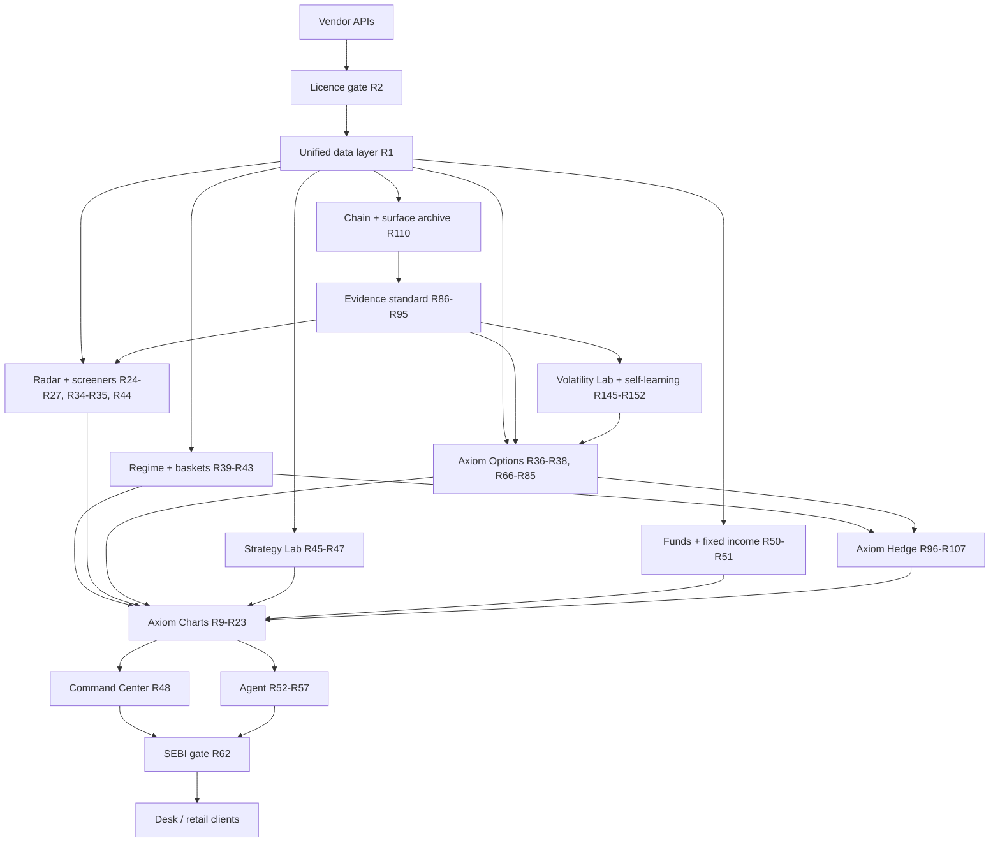
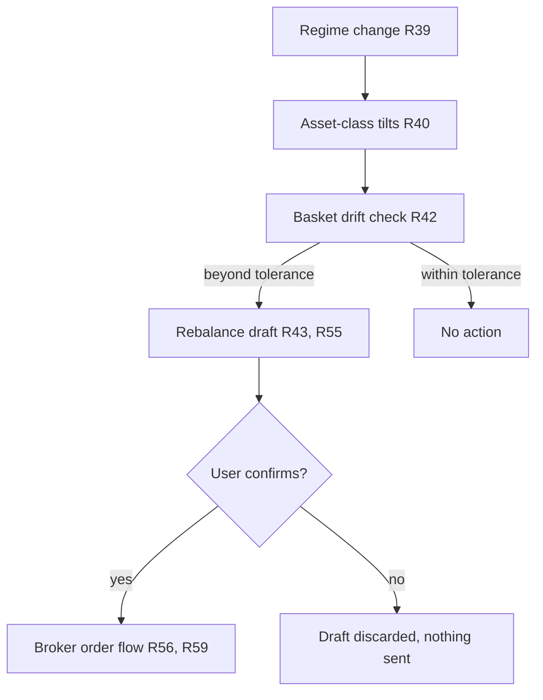
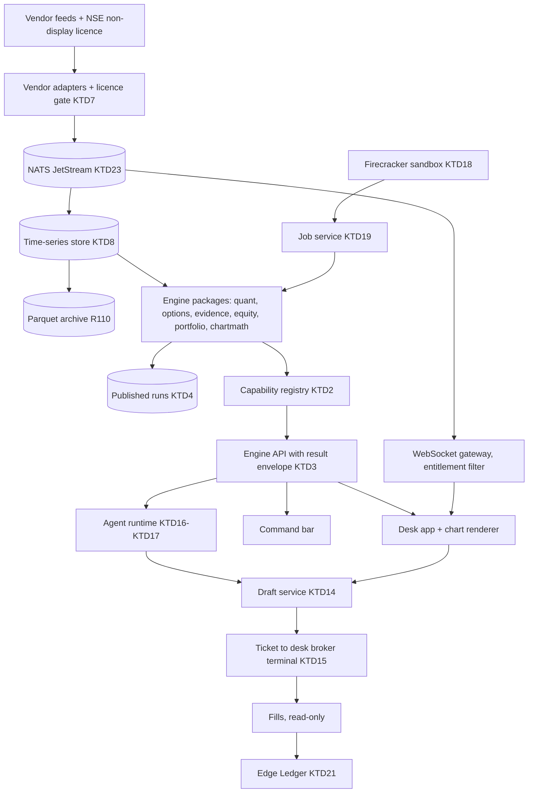
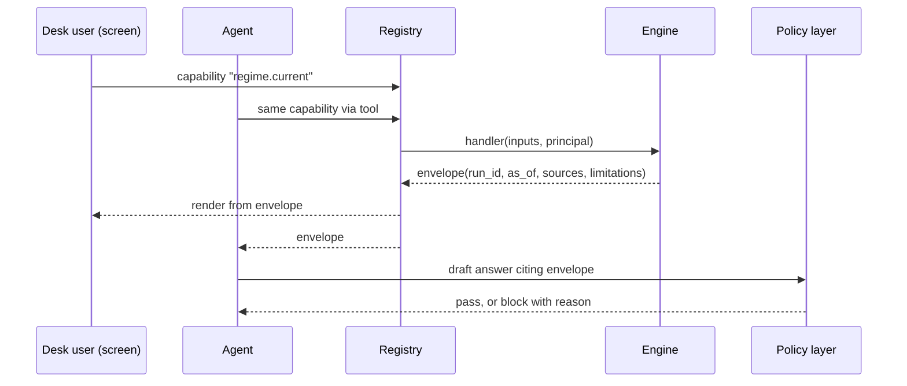
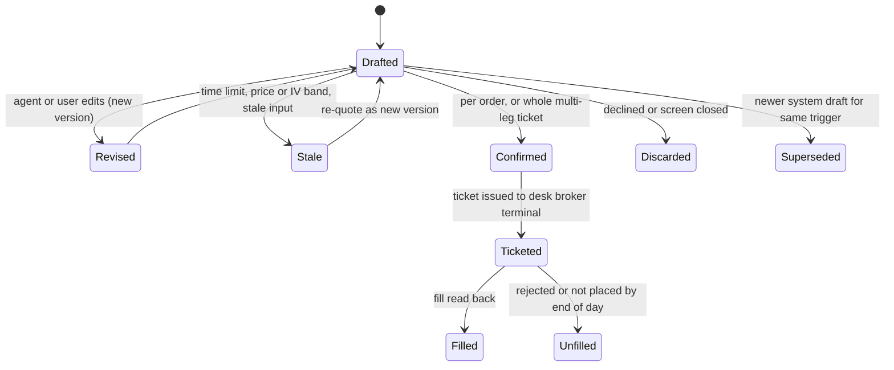
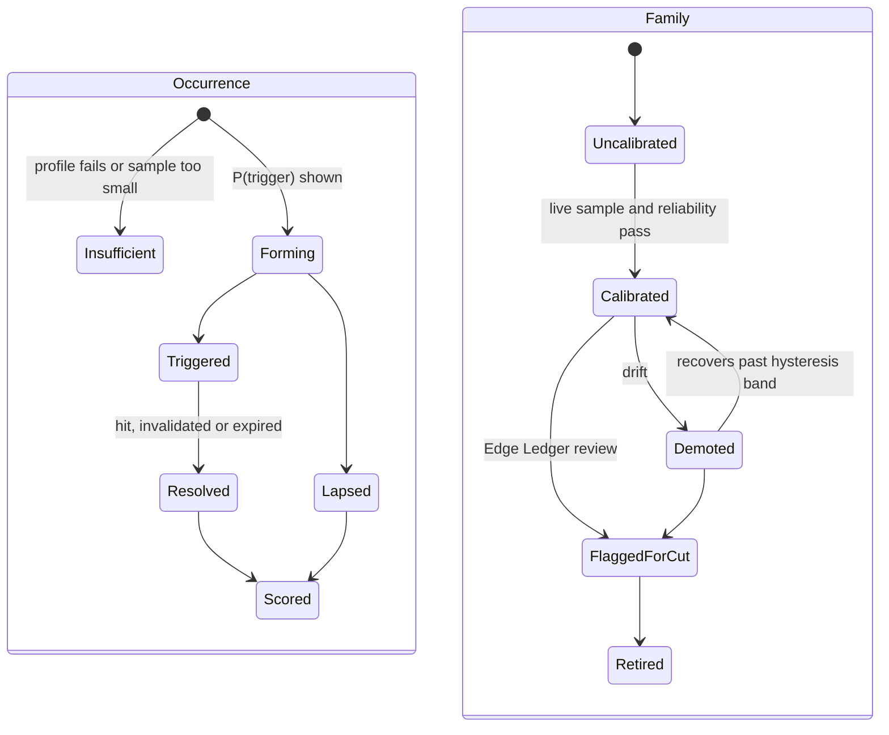
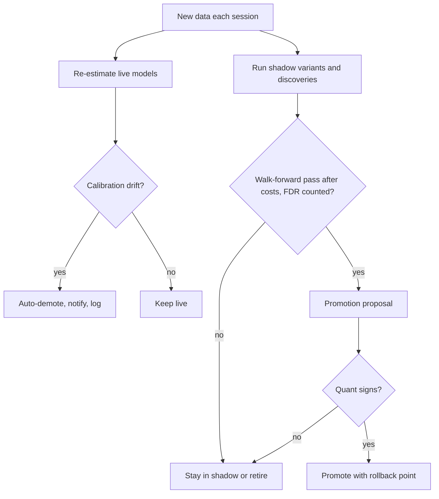
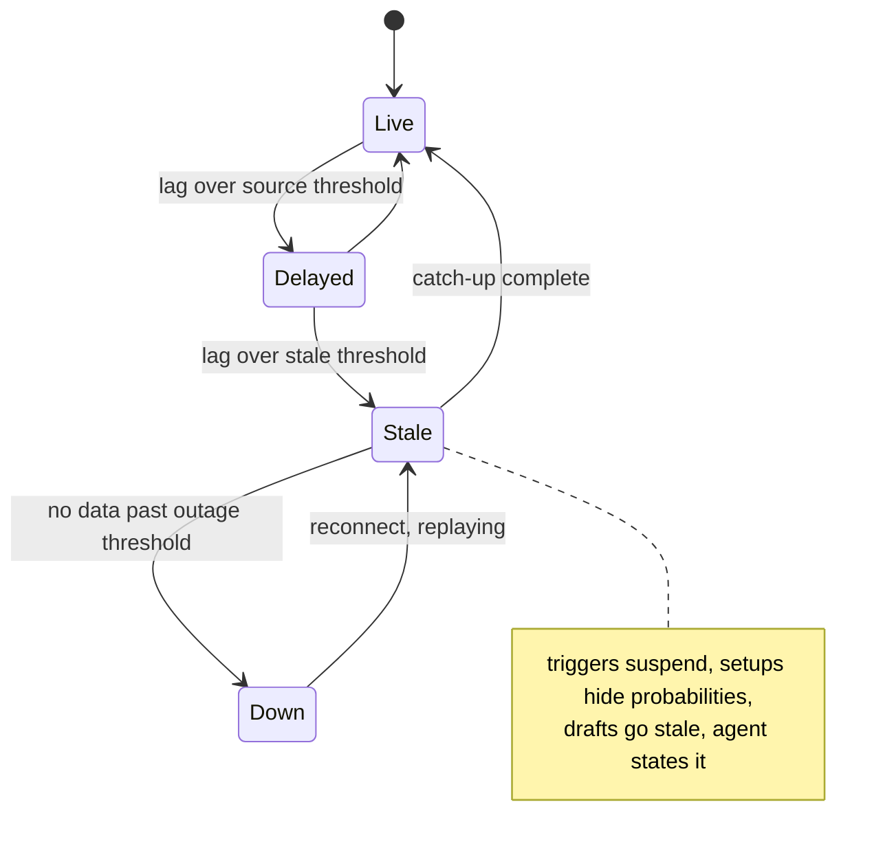
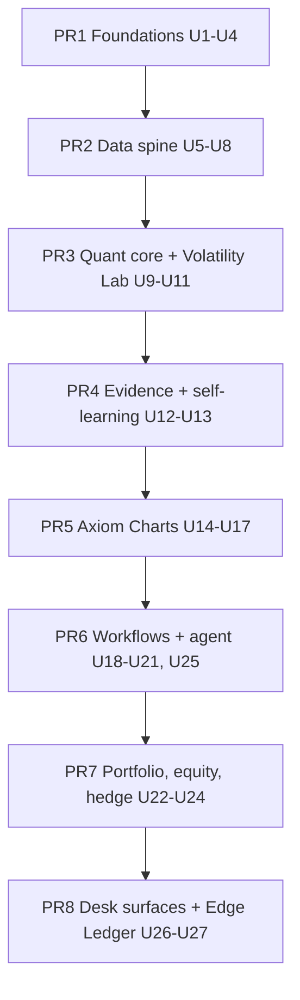

# Axiom Desk Platform - Plan

## Goal Capsule

- **Objective:** Indian investors and traders can research, chart, diversify across every asset class they can actually buy, trade options with pro-grade, statistically backed intelligence, and hedge before markets turn, from one platform they drive by screen or by conversation. The first proof is that the internal investment desk stops using TradingView, Sensibull/Opstra/Tradl, Screener.in/Tijori and Excel/Python backtests for daily work.
- **Means:** Agent-native build on one unified multi-asset data and engine layer. Every module ships with both a screen and agent control, in the order that retires the desk's tools. Brokers later license it white-labelled for their retail clients.
- **Product authority:** This plan covers the whole platform from `axiom_desk_prd_v1_0.md`, plus the new Axiom Charts (section 4.13) and Axiom Hedge (section 4.14) modules, an expanded Axiom Options (section 4.6) with its Volatility Lab, Axiom Equity Intelligence (expanding 4.4 and 4.5) and the Edge Ledger. It supersedes the PRD's phasing and adds actors, gates and boundaries the PRD lacked. The PRD stays the reference for module-level analytics lists that this plan does not restate.
- **Open blockers:** None block starting work. Merge gates are listed under Planning Contract, Open Questions: vendor and NSE non-display contracts, legal review of the V1 ticket path, model-provider clearance, quant sign-off on each model spec, and the desk UI design pass, which must finish before screen work starts.
- **Execution profile:** greenfield repository at `axiom-desk/` (not yet under git; U1 initialises it). Implementation Units cover V1 only, grouped into eight phase PRs. V1.5 and V2 get their own build plans after broker discovery reports.
- **Stop conditions:** stop and ask before merging any unit whose merge gate is open. Stop if evidence shows a session-settled decision cannot work. Stop if a vendor contract forbids a data use a unit depends on.
- **Who finishes:** `ce-work` or an engineer builds each unit. Desk quants sign off model specs and golden numbers. The desk decides when the V1 gate is met.

---

## Product Contract

### Summary

Axiom Desk is a one-stop, multi-asset research and portfolio platform. One unified data and engine layer is driven equally by screens and by a cited AI agent. Axiom Charts, at TradingView Supercharts feature parity, is the canvas every module draws on. Axiom Options is the second flagship: a pro-desk options platform whose setups must meet a published evidence standard. Axiom Hedge turns regime and options intelligence into hedges drafted before markets turn. Its core is a regime → diversified basket → monitor → rebalance-draft loop over India-investable assets. The agent drafts actions; a human confirms every order in the broker's own order flow.

### Problem Frame

Retail investors in India mostly use equity-only tools. Those tools look useful in a bull market and fail them in a bear market, because nothing in them points toward gilts, gold, debt funds or cash when the regime turns. The most recent bear market showed that diversification across asset classes is what protects capital, yet no tool a broker hands its clients connects regime, cross-asset allocation and the client's actual portfolio.

Options trading has the same gap from the other side. Clients see an option chain and OI but rarely understand payoff, Greeks, IV context or scenarios before they trade, so they take positions they cannot reason about. Pro tools fall short too: setups in tools like FnOTrader come as rules plus an illustrative outcome label, with no base rate, sample size or out-of-sample proof, and the per-strike IV most Indian terminals show produces noisy smiles that distort every Greek built on it.

Hedging is almost always reactive. Traders buy protection after volatility has spiked and insurance is expensive, rather than when regime signals first weaken and protection is cheap.

The internal desk works across five tools every day: charts in TradingView, options in Sensibull, Opstra or Tradl, fundamentals in Screener.in or Tijori, backtests in Excel and Python. No view spans asset classes, and nothing can answer a question that crosses those tools. Brokers face the same problem one level up: to cover their clients they would bundle several vendors that do not talk to each other.

### Key Decisions

- **Whole platform in one plan, phased.** All PRD modules plus Axiom Charts are in scope, sequenced V1 / V1.5 / V2. (session-settled: user-directed — chosen over brainstorming one module area at a time: the user wants the full specification scoped together.)
- **Brokers are the paying customer; their retail clients are the end users (B2B2C).** Governs R5, R6, R58–R64. (session-settled: user-directed — chosen over broker internal teams only, and over both: retail clients are the target audience.)
- **The internal desk comes first, as design partner.** It dogfoods every engine on its own capital before any broker ships it. Governs R65. (session-settled: user-approved — chosen over making the desk a SEBI-registered content producer, and over removing it from the product: keeps V1 to one business and one compliance owner.)
- **V1 is done when the desk drops its four tools.** Broker live, agent-driven usage and drawdown resilience are V1.5+ targets. Governs R65. (session-settled: user-approved — chosen over first-broker-live, agent-does-the-work and clients-hold-up as the V1 gate: cheapest proof, needs no broker contract or SEBI exposure, and forces the engines to be good.)
- **Agent-native product shape.** A module is done only when both a screen and the agent can drive it. Governs R4. (session-settled: user-approved — chosen over terminal-first, where the AI is added later, and over a thesis-loop-only V1, which fails the V1 gate.)
- **The agent drafts; a human confirms every order.** No autonomous trading. Governs R55, R56. (session-settled: user-approved — chosen over read-and-explain-only and over autonomous-within-limits, which likely falls under SEBI's retail algo framework.)
- **Investable universe = what an Indian resident can directly buy; global markets are analysis only.** Governs R7, R8. (session-settled: user-directed — the user set the target as Indian citizens and access as the deciding filter.)
- **Investable baskets are a core product.** Diversified multi-asset portfolios that clients invest in or follow. Governs R39–R43. (session-settled: user-directed — chosen over desk-internal allocations, subscription tiers, and software modules as the meaning of "packages".)
- **Axiom Charts targets TradingView Supercharts feature parity and includes idea sharing.** Governs R9–R30. (session-settled: user-directed — chosen over treating idea sharing as outside the product's identity: the user wants the full Supercharts feature set for now.)
- **Custom indicators and strategies are Python in V1; a Pine-like language comes in V1.5+.** Governs R15, R45. (session-settled: user-approved — chosen over a Pine-like language in V1, which is the largest charting build item, and over built-ins only, which keeps the desk on TradingView.)
- **Market data comes from vendor APIs, with licence scope enforced per source.** Governs R2. Vendor terms typically license data for the subscriber's own use; redistribution to broker clients needs either broker-supplied entitlements or a redistribution tier. The user chose vendor APIs as the data path, and the licence gate is the condition this plan attaches to that choice.
- **Strategy Lab runs the desk's existing Python strategies.** Governs R45. If it asked the desk to rewrite them, the desk would keep Python and the V1 gate would fail.
- **Phasing departs from the PRD.** Options moves into V1 because it replaces a tool the desk uses daily. Profile, TPO and footprint move to V1.5 because they need tick- and order-level data. Tenant isolation is built into the data layer in V1; white-labelling ships in V1.5.
- **Client compliance sits with the broker; vendor obligations stay with Axiom.** The broker's RA registration covers baskets, Radar calls and ideas shown to retail clients. Axiom, as a vendor to a regulated entity, meets the broker's cybersecurity and outsourcing obligations. Governs R60–R64.
- **Axiom Options is a V1 flagship for a pro desk, covering the whole option universe.** Buying, writing, futures, synthetics, vol, trend and Greek trading, strategies and backtests. Governs R66–R85. (session-settled: user-directed — chosen over the narrower "understand before you trade" options scope: the user wants the best overall options trading mechanism for a pro desk.)
- **Every setup, pattern and preemptive trigger must pass a published evidence standard.** Governs R86–R95. (session-settled: user-approved — chosen over setups backed only by rules and a backtested win rate, as FnOTrader-style tools show: the user wants correct quant-probabilistic backing.)
- **Setups are anticipated from current data.** The platform estimates whether a setup will trigger and, separately, what happens if it does. Governs R94, R95. (session-settled: user-approved — the user asked to preempt setups from data characteristics; two separate probabilities give anticipation without pretending to forecast prices.)
- **Hedging is its own module and works preemptively.** Governs R96–R107. (session-settled: user-approved — the user asked for hedging techniques for equity, options and futures that respond to changing conditions before markets turn.)
- **Gamma and dealer exposure use a participant-aware model by default.** Governs R74. The US convention assumes dealers are short customer options. NSE option writers are mostly prop firms, FPIs and HFTs, and no source has tested the US assumption on NSE.
- **"Big player" activity is inferred and shown with its evidence. It is never attributed to an entity or called manipulation.** Governs R75–R77. NSE publishes participant categories daily but no names and no aggressor side, and an accusation published under a broker's brand is a defamation and SEBI risk.
- **Every options number derives from an arbitrage-free volatility surface.** Governs R68. Per-strike IV from last traded prices gives noisy smiles that violate no-arbitrage and distort the Greeks, probabilities and screens built on them.
- **Broker discovery runs in parallel with the V1 build.** Three to five broker conversations test the pitch, pricing, data-entitlement model and RA and compliance needs; findings shape V1.5 and V2 requirements without changing the V1 desk gate. (session-settled: user-approved — chosen over waiting for Edge Ledger proof and over signing a single design-partner broker: validates the paying customer early at low cost.)
- **Desk quants own the quant core.** They specify and sign off the volatility surface, Greeks, evidence statistics, regime and equity models before any model output ships; engineers and agents implement against those specs. Governs R66–R70, R86–R95, R130–R132, R144–R152. (session-settled: user-approved — chosen over hiring separate quant engineers, agent-built with desk review, and leaving it undecided: in-house quants are the strongest basis for model correctness.)
- **V1 pays for data depth.** Licensed real-time F&O and cash data for the full universe, plus several years of purchased historical option chains, so calibration and options backtests work at launch. Governs R36, R83, R93, R110. (session-settled: user-approved — chosen over real-time with self-built history, broker-API data only, and index-first coverage: the edges depend on full-universe depth from day 1.)
- **Our own chain and surface archive starts on day 1.** Governs R110. SEBI's 2024–25 rule changes shorten the usable history, so a daily archive of our own computed surfaces becomes the calibration base for every setup, and competitors cannot buy it.
- **Axiom Charts must beat TradingView.** Navigation, on-chart tools, indicators, triggers and integrations are judged against TradingView in timed tests. The features beyond parity draw on data TradingView does not have: F&O positioning, the evidence engine and portfolio context. Governs R111–R129. (session-settled: user-directed — chosen over embedding a library and building only edge overlays, and over minimal V1 charts: the user wants the best charting UI, better than TradingView.)
- **Each module is judged by measured edge.** Table-stakes features exist so the desk can switch. Only capabilities backed by evidence, the archive or data combined across modules count as edge, and each module's edge is measured. Governs R144. (session-settled: user-approved — the user asked to build only where we hold edge; an Edge Ledger measured on desk capital was proposed and confirmed.)
- **Equity intelligence is adaptive and evidence-graded.** Signals are weighted by regime rather than refit each cycle, flows confirm rather than lead, and the macro "sector clock" is not a primary signal. Governs R130–R143. (session-settled: user-approved — the user asked for adaptive, non-post-facto rotation and early bear triggers; the research grades set what leads and what lags.)
- **Volatility trading gets its own lab inside Axiom Options.** Governs R145–R150, R152. (session-settled: user-directed — chosen over the narrower IV/RV spread, vol cones and VRP display in R37 and R70: the user wants volatility trading covered in depth, with AlgoTest's VRP analysis as the floor to beat.)
- **The platform learns on its own but only demotes on its own.** Re-estimation, shadow variants and pattern search run continuously; anything that goes live needs walk-forward evidence and a desk quant's sign-off. Governs R151, R152. (session-settled: user-approved — chosen over models that retrain and redeploy unattended: quants keep sign-off on every live model.)
- **No committed dates.** The PRD's six-month V1 assumed fewer modules than V1 now holds; planning sets the schedule.

### Actors

- A1. Desk user: the internal desk's PMs, analysts, options traders and quants. The V1 user.
- A2. Broker: the paying customer and tenant. Supplies market-data entitlements and the order flow, and owns client compliance.
- A3. Broker RA team: the SEBI-registered research analysts at the broker. They author baskets, Radar calls and published ideas for retail clients.
- A4. Retail client: the broker's Indian investor or trader. The V2 end user.
- A5. Axiom agent: answers questions, runs analyses, draws on charts and drafts actions in every module, citing its sources.
- A6. Data vendors: external market-data and broker APIs.

### Requirements

Phase tags mark when a requirement must be true: [V1], [V1.5] or [V2]. A requirement with no tag is [V1].

**Platform spine**

- R1. One unified data layer serves every module, covering prices, ticks, OI, fundamentals, funds, bonds, macro, corporate actions and institutional flows across the asset classes in R7.
- R2. Every data source carries a licence scope (internal-only or redistributable to a tenant's clients), and no user ever sees data outside their entitlement.
- R3. History is corporate-action adjusted wherever prices are charted, screened or backtested.
- R4. A module counts as done only when a user can drive it through its screen and the agent can drive it through conversation, with equivalent results.
- R5. Tenant isolation exists from V1: strategies, portfolios, watchlists, ideas and baskets of one tenant are never visible to another.
- R6. [V1.5] A tenant can run on its own market-data entitlements, so a broker's licensed feed powers its clients' views.

**Investable universe**

- R7. Asset classes are classified by role:

  | Asset class | Role |
  |---|---|
  | NSE/BSE equities, F&O | Investable, basket-eligible |
  | Mutual funds (equity, debt, hybrid, index) | Investable, basket-eligible |
  | Indian ETFs, incl. gold, silver and global-index ETFs | Investable, basket-eligible |
  | Gold and silver (via ETFs, funds, sovereign gold bonds on secondary market) | Investable, basket-eligible |
  | REITs, InvITs | Investable, basket-eligible |
  | G-Secs, T-bills, SDLs | Investable; basket-eligible only where executable through the tenant's broker |
  | Corporate bonds | Investable via online bond platforms; analysis and tracking in baskets, not one-click execution |
  | International mutual funds / FoFs | Investable only while open to inflows |
  | Global indices, FX, commodities, foreign bond yields | Analysis only |
  | Foreign stocks via LRS, crypto | Out of scope |

- R8. Analysis-only instruments can be charted, screened and used in regime and correlation work, but can never be added to a basket or appear in an order draft.

**Axiom Charts (section 4.13, TradingView Supercharts parity)**

- R9. Charts cover every investable and analysis-only symbol in R7, including continuous futures and fund NAVs.
- R10. Every Supercharts chart type is available: candles, bars, hollow candles, line, area, baseline, Heikin Ashi, Renko, Kagi, point and figure, line break and range. Volume footprint and TPO are [V1.5] per R49.
- R11. Timeframes run from 1 minute to monthly, plus custom intervals, with multi-timeframe analysis on one layout.
- R12. A layout holds up to 8 charts, synced by symbol, interval, crosshair and time.
- R13. Users can compare symbols and build ratio and spread charts from any two instruments or baskets (for example Nifty/Gold, equity basket/gilt fund).
- R14. The built-in indicator and drawing-tool libraries match Supercharts breadth, including volume profile (visible-range, fixed-range and session). Any indicator can be overlaid on price, placed in its own pane, or applied to another indicator or a ratio chart. Indicator sets save and apply in one action.
- R15. Desk users can write custom indicators in Python and plot them on charts. [V1.5+] A Pine-like scripting language is added for retail users.
- R16. Pattern detection marks candlestick patterns, chart patterns (flags, pennants, triangles, head and shoulders, double tops and bottoms, cup and handle), volatility contraction patterns, breakouts and pattern failures on the chart, plus auto trendlines, auto Fibonacci and support/resistance levels.
- R17. Every detected pattern shows its confidence and invalidation level and carries the evidence card from R86–R93, and never uses buy or sell language.
- R18. Derivatives overlays show OI by strike on the price axis, PCR, IV and IV percentile, max pain, exposure levels per R74, and straddle and premium charts.
- R19. Axiom overlays show regime shading on the chart background, Radar signal markers, backtest trades, basket and portfolio equity curves, earnings and corporate-action markers, and FII/DII flows.
- R20. Bar replay lets a user step through history on any chart.
- R21. Server-side alerts fire on price, indicator, drawing and multi-condition triggers, delivered in-app and by email. [V1.5] Push notifications are added.
- R22. Chart templates and layouts save, reload and share within a tenant.
- R23. The agent can build and modify charts on request, and every object it draws is visibly labelled as agent-drawn and cites its data.

**Watchlists, screeners and ideas**

- R24. Any watchlist can be screened with any screen, returning only its members that match.
- R25. Any screen result can be saved as a watchlist, either live (membership re-evaluates) or frozen (a snapshot).
- R26. Patterns from R16, Radar signals and regime alignment are usable as screen criteria.
- R27. Every screen result, watchlist entry and Radar card opens straight into a chart.
- R28. An idea is a chart snapshot linked to the live chart, with thesis, entry zone, invalidation level and horizon, and supports comments.
- R29. Every published idea is tracked after publication and marked as hit, invalidated or expired against its own invalidation level and horizon.
- R30. In V1, ideas are shared within the desk. [V2] Idea sharing for retail clients follows R63.

**Ease of use**

- R31. A command bar and the agent are the primary entry points: any chart, screen, backtest or portfolio view can be opened by typing or saying what is wanted.
- R32. Defaults work without configuration, and advanced tools (footprint, Greeks surfaces, custom scripts) stay hidden until asked for.
- R33. The desk workspace is keyboard-first. [V2] The retail experience is mobile-first.

**Equity research and sector rotation (PRD 4.4, 4.5)**

- R34. Equity research covers the fundamentals, technical and quantitative analytics listed in PRD 4.4, with historical valuation percentiles.
- R35. Sector rotation ranks sectors by momentum, relative strength, breadth, valuation dispersion and institutional flows, classifies them by the lifecycle states in R134, and drills down to constituents.

**Derivatives core (PRD 4.6; expanded by Axiom Options, R66–R85)**

- R36. The live option chain shows strike-wise OI and its change, PCR, max pain, exposure per R74 and IV per strike, in real time, for every NSE F&O underlying.
- R37. Volatility analytics cover IV rank, IV percentile, skew, term structure, realised-versus-implied spread, historical volatility cones and the full volatility surface from R68.
- R38. The strategy builder shows payoff at expiry and before expiry, Greeks, margin, breakevens, max profit and loss, and scenario heatmaps across price, time and IV, and explains the position in plain language before any order is drafted.

**Regime, baskets and the thesis loop (PRD 4.1–4.3, 4.11)**

- R39. The regime engine classifies the market as Risk-On, Early Deterioration, Risk-Off, Recovery or Transition / Uncertain, with a confidence level, transition probabilities and the contributing indicators that explain the call.
- R40. Each regime maps to asset-class tilts across the investable classes in R7.
- R41. Baskets are diversified portfolios across basket-eligible classes, with target weights, rebalance rules and a backtest across past regimes.
- R42. Portfolio monitoring tracks holdings, drift from basket weights, volatility, drawdown, concentration and correlation, and stress-tests against historical shocks.
- R43. A regime change or drift beyond a basket's tolerance produces a rebalance draft per R55, never an order.
- R44. The Opportunity Radar scans the R7 universe per the PRD 4.3 criteria, and each card shows score, confidence, horizon, downside risks, invalidation trigger and the evidence card from R86–R93.

**Strategy Lab (PRD 4.10)**

- R45. Strategy Lab runs strategies written in the desk's own Python, as well as built-in strategy types, against corporate-action-adjusted history.
- R46. Backtests model slippage, transaction costs, position sizing and rebalancing, and report the PRD 4.10 performance metrics against a benchmark.
- R47. Out-of-sample testing is available to users in V1, and platform setup statistics use walk-forward validation from V1 per R89. [V1.5] User-facing walk-forward optimisation, Monte Carlo stress testing and paper trading are added.

**Command Center (PRD section 5)**

- R48. The Command Center answers the PRD's four questions (current regime and confidence, leading sectors and asset classes, top Radar opportunities, risk triggers needing attention), and the agent answers the same four questions in conversation with the same results per R4.

**Market microstructure (PRD 4.7)**

- R49. [V1.5] Market profile / TPO (initial balance, single prints, poor highs and lows) and footprint (cumulative volume delta, imbalances, absorption) are available on Axiom Charts.

**Funds, fixed income and real assets (PRD 4.8, 4.9)**

- R50. Mutual fund and ETF screening covers returns, rolling-return consistency, Sharpe and Sortino, drawdown and capture ratios in V1. [V1.5] Portfolio overlap matrices and concentration analysis are added.
- R51. Gold, silver, REITs and InvITs are tracked for trend, volatility and macro correlation in V1. [V1.5] Fixed-income depth (YTM, duration, credit distribution, yield-curve comparison across G-Secs, SDLs, corporate bonds and debt funds) is added.

**Agent layer (PRD 4.12)**

- R52. Every agent answer states the question answered, the exact data sources and timestamps, the calculation method, the findings with supporting metrics, and the limitations and risks.
- R53. The agent never forecasts prices, promises returns or uses buy or sell language toward a client.
- R54. The agent can run screens, backtests, chart builds, basket analyses and portfolio queries across every module, and combine them in one answer.
- R55. The agent may draft a basket investment, a rebalance or an options trade ticket, and every draft is shown to the user for confirmation.
- R56. No order is ever placed without the user's explicit confirmation of that specific order inside the broker's order flow.
- R57. In V1 the agent accepts typed English. [V1.5] Speech-to-text and Indian-language support are added.

**Broker distribution and compliance (PRD section 6)**

- R58. [V1.5] A broker tenant can white-label the platform with its own branding inside its web and mobile experience.
- R59. [V2] Confirmed drafts hand off to the broker's own order flow, and Axiom never routes orders or holds client funds.
- R60. [V2] Baskets, Radar calls and published ideas reach retail clients only when authored or approved by the tenant's RA team.
- R61. [V2] Retail clients complete risk profiling, and a basket is shown as suitable or unsuitable against that profile.
- R62. The SEBI gate classifies every client-facing output as data, neutral analytics, or research/advice. It is designed and enforced as a no-op in V1, and [V2] blocks research/advice output that lacks RA authorship.
- R63. [V2] Retail clients can share ideas only as educational content without targets or entry levels, and their ideas are moderated. RA-authored ideas are labelled as registered research.
- R64. [V1.5] Axiom meets the obligations a broker passes to its technology vendors: data localisation in India, audit access, security certification and incident reporting.

**Desk adoption**

- R65. The internal desk uses every V1 module on its own capital before any broker receives it.

**Axiom Options: pricing, volatility and Greeks (section 4.6, flagship)**

- R66. Pricing handles European options on futures and indices, with index options cash-settled and stock options settled by physical delivery, and solves IV from a consistent forward.
- R67. Greeks cover delta, gamma, theta, vega and rho, plus vanna, charm, vomma, speed and color, per leg, per position and per portfolio, with vega bucketed by expiry.
- R68. Every IV, Greek, probability and screen derives from an arbitrage-free volatility surface fitted per underlying, never from raw per-strike IV off last traded prices.
- R69. The surface supports sticky-strike and sticky-delta views, so scenarios show how the smile moves with spot.
- R70. Volatility intelligence adds the volatility risk premium and its term structure, event vol (earnings, RBI, budget, expiry) with expected move and IV crush, and skew-change tracking.

**Axiom Options: positioning, flow and big-player inference**

- R71. OI change by strike and expiry is classified in real time as long build-up, short build-up, short covering or long unwinding.
- R72. Participant-wise OI (FII, DII, Pro, Client) is shown daily after NSE publishes it, with its history and changes.
- R73. Futures basis, cost of carry and rollover are tracked per underlying and expiry.
- R74. Gamma, vanna and charm exposure use a participant-aware positioning model by default, with a switch to the US dealer convention, and are always labelled as models with their NSE backtest.
- R75. Big-player positioning is inferred from OI, price, volume, IV and signed-flow changes and is shown with the evidence behind it and its error bars, because NSE publishes no aggressor side or intraday participant identity.
- R76. A high-risk-expiry detector flags underlyings where cash, futures and options activity diverge around expiry or settlement, using the SEBI–Jane Street order pattern as its reference case.
- R77. R75 and R76 output never names an entity or uses the words manipulation or manipulated; desk users see the full evidence, and [V2] retail clients see neutral positioning-driven and pin-risk language.
- R78. Pin probability is shown per strike in the final sessions before expiry.
- R79. A derivatives mood reading combines flows, skew, PCR, basis and participant positioning into one sentiment view, feeds the regime engine, and is explainable by the agent.

**Axiom Options: screening, strategies and backtests**

- R80. Option screens run in real time across every F&O underlying and cover IV spikes, rich and cheap vol against RV, OI build-ups, skew and IV-spread anomalies, signed-flow PCR and option-to-stock volume, unusual activity and pin candidates, feeding watchlists per R24 and R25.
- R81. The strategy builder from R38 covers buying, writing, verticals, straddles, strangles, condors, butterflies, calendars, diagonals, ratios, futures, synthetic futures and hedged combinations, with broker margin and an adjustment planner.
- R82. Vol trading, trend trading and Greek trading (delta-neutral, gamma scalping, theta and vega books) each get dedicated screens and position tools.
- R83. The options backtester replays historical option chains with multi-leg entry, exit and adjustment rules, bid-ask slippage, margin, expiry handling and contract specs as they stood on each date, and runs desk Python per R45.
- R84. Pro desk utilities include a position-Greeks dashboard, risk graphs, P&L attribution by Greek, delta-hedge drafts, an expiry-day console, rollover tools, a spot × vol × time scenario matrix and multi-leg ticket drafts per R55.
- R85. Any contract or strategy can be explained in plain language, covering what moves it, what loses money, liquidity and bid-ask cost, event risk, ban-list status and lot-size impact.

**Setup evidence standard (applies to patterns R17, Radar R44, option setups R80 and hedge triggers R103)**

- R86. Every setup has a fixed definition (trigger, entry, target, invalidation, horizon) set before it is tested.
- R87. Every setup probability is shown beside the unconditional base rate for the same instrument, horizon and days to expiry.
- R88. A setup shows its sample size and confidence interval, small samples are shrunk toward the base rate, and setups below the minimum sample are not shown.
- R89. Published probabilities come only from out-of-sample walk-forward results and are real-world probabilities, never risk-neutral ones.
- R90. Setup discovery corrects for multiple testing, including false-discovery control and deflated Sharpe ratios.
- R91. Every setup shows expectancy and its payoff distribution after bid-ask, slippage, STT, brokerage and margin cost, including tail loss.
- R92. Setup statistics are conditioned on market regime, IV regime, days to expiry and event proximity.
- R93. Every published setup is scored after the fact with a Brier score and reliability curve, is visibly demoted when calibration drifts, and is labelled uncalibrated until its history proves it.
- R94. A setup shows two probabilities: that it triggers within a stated window given current features, and its outcome if it triggers.
- R95. Each underlying carries a data-characteristics profile (liquidity, bid-ask cost, OI depth, IV history length, event calendar, ban-list proximity, lot size), and setups are computed only where the profile supports trustworthy statistics, showing insufficient evidence otherwise.

**Axiom Hedge (section 4.14)**

- R96. Exposure is measured per position type: beta and factor exposure for portfolios and baskets, look-through to holdings for funds and ETFs, Greeks by expiry bucket for options books, and delta and basis for futures.
- R97. Hedge candidates span index and stock puts, put spreads, collars, short index and stock futures, synthetics, calendars, tail wings, and allocation shifts into gilts, gold, debt funds or cash.
- R98. Hedge selection responds to market conditions, preferring outright options when vol is cheap, spreads, collars and futures when vol is rich, skew-financed structures when put skew is steep, and later expiries when term structure is inverted, with each choice explained.
- R99. Every hedge shows its cost including futures basis, protection level, breakeven, tracking error against the hedged exposure, and scenario P&L with and without the hedge.
- R100. Preemptive triggers come from forming signals: regime transition probability, breadth deterioration, skew flattening, VRP compression, FII short build-up and the event calendar.
- R101. Preemptive hedges are proposed as a staged ladder (25%, 50%, 100% hedge ratio) that rises with signal strength, each step a separate draft per R55.
- R102. A user can set a yearly hedge-cost budget, and the platform tracks spending against it.
- R103. Each preemptive trigger shows its false-alarm rate, the drawdown it avoided and its cost across past regimes, under R86–R93.
- R104. Live hedges carry rules for cashing them in after a vol spike, roll prompts before expiry, decay tracking, and cost-versus-saving attribution per regime.
- R105. The agent answers hedge requests (for example, protect my portfolio for a month within 0.8% cost) with two or three drafted alternatives, each showing cost, protection, breakeven, suited conditions and evidence.
- R106. When contract sizes make an exact options hedge impossible for a portfolio, the platform offers ETF, allocation-shift and partial-hedge alternatives, and stock-level hedges carry expiry-week physical-delivery and ban-list warnings.
- R107. [V2] Portfolio-specific hedge suggestions reach retail clients only through the tenant's RA team and the SEBI gate per R60 and R62.

**Indian F&O rules and data**

- R108. Expiry calendars, lot sizes, contract values, weekly-expiry eligibility and ban-list status follow current NSE and BSE rules and update when SEBI changes them.
- R109. The desk sees delta-based OI and intraday position-limit headroom against SEBI limits for its own positions.
- R110. From V1, the platform archives its own option chains, volatility surfaces and computed features daily, and backtests split their history at SEBI rule-change dates.

**Axiom Charts beyond TradingView: watchlists, triggers and insight**

- R111. A highest-conviction view ranks a user's watchlist by evidence-passing setups, regime fit, earnings revisions and F&O positioning, and explains why each name moved in the ranking.
- R112. Watchlist triggers can combine price, OI build-up, IV, delivery percentage, flows and regime conditions in one trigger, and each trigger shows its own base rate and hit rate per R86–R93.
- R113. A pre-open console shows, for each watchlist name before 9:15, GIFT Nifty and global cues, the NSE pre-open auction price and imbalance, overnight corporate actions and news, prior-day OI changes and participant OI, and gap probability against its base rate.
- R114. A positioning panel under any F&O chart shows OI build-up classification, futures basis and rollover, IV against price, and pin and max-pain zones, and alerts on price-positioning divergences.
- R115. Options-implied expected-move bands to each expiry are drawn on price from the R68 surface, with realised range overlaid.
- R116. When a pattern or setup appears, an analog overlay draws the forward paths of its past occurrences as a fan chart with base rate and spread.
- R117. A real-time insight stream surfaces only changes that are statistically unusual against each instrument's own history, de-duplicated and ranked by significance.
- R118. Users set significance thresholds, digests and a daily alert budget, so alert volume stays within what they choose.
- R119. Watchlist health shows correlation, factor and sector concentration and regime fit across the names in a watchlist.
- R120. An events layer shows each upcoming event with its historical price-reaction distribution and implied versus realised move.
- R121. Users can drag price, time or IV on a chart and see live P&L for their positions and portfolio.
- R122. A trade journal plots the user's trades automatically and reports behaviour statistics (holding losers, cutting winners) and the user's own hit rate against base rates.
- R123. The agent answers chart questions in place, including what changed since yesterday, why this setup qualifies, and why a name ranks where it does.
- R124. Desk users share layouts and ideas, and analysts are ranked internally by the calibration of their tracked ideas.
- R125. [V2] Retail clients can switch any chart to a plain-language summary layer.

**Axiom Charts UX bar**

- R126. Common charting tasks (open a symbol, change interval, add or edit an indicator, draw, set a trigger, switch layout, compare symbols) are as fast or faster in Axiom than in TradingView in timed tests with desk users.
- R127. Any indicator, drawing tool, layout or trigger can be found and applied from the command bar by name or plain language, and indicator parameters are editable directly on the chart.
- R128. Integrations cover the broker order flow per R59, desk Python per R15 and R45, alert delivery in-app and by email, watchlist import from TradingView and CSV, and export of charts, data and ideas. [V1.5] Webhook and messaging-app alert delivery are added.
- R129. [V2] A conviction ranking built by Axiom for retail clients, rather than of the client's own picks, reaches them only through the tenant's RA team per R60 and R62.

**Axiom Equity Intelligence (expands PRD 4.4 and 4.5)**

- R130. Every equity signal's effectiveness is tracked per regime, and a "what's working now" view shows which styles and signals are paying off in the current regime.
- R131. Regimes use a small number of states with change-point alerts, every model or weight change is logged with its reason, and adaptation itself is walk-forward validated per R89.
- R132. Signals are weighted by regime rather than refit each cycle, each signal has a decay monitor, and a signal taken from published research ships only after clearing R86–R93 on NSE data with a stricter significance bar.
- R133. A money-flow layer aggregates FII cash and index-futures positioning, participant derivatives, delivery percentage, MF scheme holdings changes, promoter and insider trades, pledging, bulk and block deals, MTF leverage and SIP flows to sector level, and labels each as leading or confirming with its data freshness.
- R134. Each sector carries a lifecycle state (emerging, leading, weakening, lagging, recovering) with transition probabilities, driven by industry relative strength, earnings-revision breadth, 52-week-high proximity, dispersion and leading-industry signals; macro-cycle phase is context only.
- R135. Leaders within each sector are ranked by relative strength, earnings revisions, institutional accumulation and quality, and leadership narrowing is flagged.
- R136. An early-bear and trend-reversal checklist scores trend and time-series momentum, volatility scaling, VRP, average-correlation spikes, credit spreads, the yield curve, post-run-up crash probability and derivatives positioning (FII index-futures shorts, put skew, India VIX term structure), shows each symptom's evidence grade, and feeds R39 and R100.
- R137. Each holding shows a risk cushion: distance to its invalidation level in volatility units, drawdown-at-risk, crash flag, valuation and earnings cushion, liquidity and positioning risk.
- R138. Each holding carries an evidence-backed pointer (add, partial book with a scale-out ladder, hold, or exit) with its reason, following the position-management evidence in the equity research.
- R139. Rebalancing uses threshold bands tuned by regime, with a calendar backstop.
- R140. Each holding has a declared intent (trade, momentum or investment) with its own signals, horizon and exit rules, and changing intent requires an explicit user action that is logged.
- R141. Every equity pointer cites the research behind it and carries its evidence card.
- R142. [V2] Holding-specific pointers reach retail clients only through the tenant's RA team and the SEBI gate per R60 and R62.
- R143. Where Indian history has too few episodes (for example extreme bear markets), statistics say so, and other markets' history may be shown only when labelled as such.

**Edge Ledger**

- R144. An Edge Ledger measures, on the desk's own capital or paper positions, whether each module's setups, rankings, regime calls and hedge triggers beat their base rates after costs, and a module showing no edge at its review is cut or reworked.

**Axiom Options: Volatility Lab and self-learning**

- R145. Each underlying has a Volatility Lab comparing IV with realised volatility across estimators (close-to-close, Parkinson, Garman-Klass, Yang-Zhang, intraday realised) and any lookback, and VRP is measured against the volatility realised over the option's remaining life as well as trailing windows.
- R146. VRP buckets can be conditioned on IV percentile, term-structure slope, skew, regime, event proximity and days to expiry, and each bucket shows its sample size, confidence interval and the after-cost expectancy of a defined volatility trade under R86–R93.
- R147. Realised volatility is forecast per underlying with a regime-aware model, every forecast is scored against what was realised, and the tradable VRP signal is surface IV minus forecast RV.
- R148. VRP is broken out across the surface by expiry (term premium), by strike or delta (skew premium) and around scheduled events (event premium).
- R149. Each underlying has a volatility behaviour profile: mean-reversion speed, vol-of-vol, how IV moves with spot, IV crush around events and expiry-week decay.
- R150. Published volatility patterns (premium harvesting, term-structure carry, put-skew premium, event crush, weekend and expiry decay) ship as hypotheses tested on NSE data, each labelled confirmed on NSE, weakening or not supported, with the platform's own findings shown beside the published claim.
- R151. The platform keeps re-estimating setup statistics, VRP buckets and signal weights and runs candidate variants in shadow. Demotion on calibration drift is automatic; promotion to live needs a walk-forward pass and a desk quant's sign-off, and every change is logged and can be rolled back.
- R152. The platform searches its data for new volatility and positioning patterns, counts every variant it tests toward the R90 multiple-testing correction, and shows each discovery as a candidate until it passes R86–R93 out of sample.

### Visualizations

Module dependencies (spine feeds every engine; every engine renders on Axiom Charts; the agent and Command Center sit on top; the SEBI gate filters everything shown to clients):



Thesis loop (F3):



### Key Flows

- F1. Morning routine
  - **Trigger:** A desk user opens Axiom Desk at market open.
  - **Actors:** A1, A5
  - **Steps:** The Command Center shows regime, leading sectors and asset classes, top Radar opportunities and risk triggers. The user asks the agent "what changed since yesterday's close?" and gets a cited answer. They open any item straight into a chart.
  - **Covered by:** R39, R44, R48, R52, R27
- F2. Screen to watchlist to idea
  - **Trigger:** A user wants names forming a setup.
  - **Actors:** A1, A5
  - **Steps:** They run a screen with a pattern criterion (or ask the agent to). They save the results as a live watchlist, open members on a multi-chart layout with pattern overlays, then publish an idea from one chart with thesis, entry zone, invalidation and horizon. The idea is tracked afterwards.
  - **Covered by:** R12, R16, R17, R24–R29
- F3. Regime-driven rebalance
  - **Trigger:** The regime changes, or a basket drifts beyond tolerance.
  - **Actors:** A1 or A4, A5, A2
  - **Steps:** The platform shows the new regime with its explanation and the affected baskets. The agent drafts a rebalance with exact orders. The user reviews and confirms each order, which passes to the broker's order flow; declining discards the draft.
  - **Covered by:** R39–R43, R55, R56, R59
- F4. Understand an options trade before placing it
  - **Trigger:** A user considers an options position.
  - **Actors:** A1 or A4, A5
  - **Steps:** They view the chain with OI and IV context and build the position in the strategy builder. They review payoff, Greeks, breakevens and scenario heatmaps, ask the agent to explain the risks in plain language, then optionally draft a ticket for confirmation.
  - **Covered by:** R18, R36–R38, R52, R55, R56
- F5. Desk strategy from Python to chart
  - **Trigger:** A quant has an existing Python strategy.
  - **Actors:** A1
  - **Steps:** They run it in Strategy Lab with costs and slippage, review out-of-sample results, plot its trades and custom indicators on Axiom Charts, and save it as a Radar input or basket rule.
  - **Covered by:** R15, R19, R45–R47
- F6. Retail idea or basket publication
  - **Trigger:** [V2] A broker RA or a retail client publishes content.
  - **Actors:** A3, A4, A2
  - **Steps:** The SEBI gate classifies the content. RA-authored content publishes labelled. Client content without targets or entries publishes after moderation. Client content with targets is blocked.
  - **Covered by:** R60, R62, R63
- F7. Options setup from forming to scored
  - **Trigger:** OI, IV/RV and positioning features shift on an F&O underlying.
  - **Actors:** A1, A5
  - **Steps:** The options screen shows a setup as forming, with its probability of triggering. The user opens the evidence card (base rate, sample, out-of-sample hit rate, expectancy after costs, regime split) and the surface, Greeks and positioning behind it. If it triggers, the agent drafts a multi-leg ticket for confirmation. After the horizon, the setup is scored and its calibration updates.
  - **Covered by:** R68, R71–R75, R80, R84, R86–R95, R55, R56
- F8. Preemptive hedge ladder
  - **Trigger:** Regime transition probability toward Early Deterioration rises while vol is cheap.
  - **Actors:** A1, A5
  - **Steps:** Axiom Hedge measures portfolio and options-book exposure, selects hedge structures for current vol, skew and term structure, and drafts the first 25% ladder step within the hedge budget. Each further step is drafted as signals strengthen. After a vol spike, cash-in rules prompt the user to take profit on the hedge.
  - **Covered by:** R96–R105, R55, R56
- F9. Pre-open to first trigger
  - **Trigger:** A desk user opens Axiom before 9:15.
  - **Actors:** A1, A5
  - **Steps:** The pre-open console ranks watchlist names by overnight change, auction imbalance, participant OI and gap probability. The user asks the agent what changed overnight, opens the top names with positioning panels and implied-move bands, and arms compound triggers for the open.
  - **Covered by:** R111–R115, R123
- F10. Sector rotation to holding action
  - **Trigger:** A sector moves from lagging to emerging.
  - **Actors:** A1, A5
  - **Steps:** The rotation view shows the transition with its drivers and evidence. The user opens sector leaders, checks the money-flow layer for confirmation, and reviews current holdings' risk cushions. Pointers suggest adding to leaders and partially booking holdings in weakening sectors; each action becomes a draft per R55.
  - **Covered by:** R133–R138, R141, R55

### Acceptance Examples

- AE1. Covers R2, R6.
  - **Given:** a tenant whose broker entitlement excludes live F&O ticks.
  - **When:** a retail client opens a Nifty option chain.
  - **Then:** the chain shows delayed or entitled data only, labelled as such, and live ticks are never sent to that client.
- AE2. Covers R8.
  - **Given:** a user charting the S&P 500 index.
  - **When:** they try to add it to a basket.
  - **Then:** the action is unavailable, and the platform suggests India-listed ETFs that track it.
- AE3. Covers R17.
  - **Given:** a detected bull flag on a stock.
  - **When:** the user hovers over it.
  - **Then:** they see the confidence, historical hit rate and invalidation level, and no buy or sell wording.
- AE4. Covers R25.
  - **Given:** a screen saved as a live watchlist and another saved as frozen.
  - **When:** a stock stops matching the screen the next day.
  - **Then:** it leaves the live watchlist and stays in the frozen one.
- AE5. Covers R55, R56.
  - **Given:** the agent has drafted a five-order rebalance.
  - **When:** the user confirms three orders and closes the screen.
  - **Then:** only those three orders reach the broker's order flow, and the other two are not sent.
- AE6. Covers R62, R63.
  - **Given:** [V2] a retail client writes an idea with a price target.
  - **When:** they publish it.
  - **Then:** publication is blocked with an explanation, and the same idea without the target and entry level can be submitted for moderation.
- AE7. Covers R4, R48.
  - **Given:** the Command Center shows Early Deterioration at 68% confidence.
  - **When:** a user asks the agent "what regime are we in?"
  - **Then:** the agent returns the same regime and confidence, with sources and timestamps.
- AE8. Covers R87, R88.
  - **Given:** a stock-option setup with 11 historical occurrences, below the minimum sample.
  - **When:** the options screen runs.
  - **Then:** the setup is not shown as a probability; the underlying shows insufficient evidence instead.
- AE9. Covers R87, R91.
  - **Given:** a short-strangle setup with a 78% win rate, a 74% base rate and negative expectancy after costs.
  - **When:** the user opens its evidence card.
  - **Then:** the card shows the win rate beside the base rate and leads with the negative expectancy and tail loss.
- AE10. Covers R93.
  - **Given:** a published setup whose live hit rate falls well below its stated probability.
  - **When:** its calibration is rescored.
  - **Then:** it is visibly demoted with the reason, and the agent stops citing its old probability.
- AE11. Covers R75–R77.
  - **Given:** on an expiry day, Bank Nifty constituents are bought in cash and futures while a large bearish options position builds.
  - **When:** the high-risk-expiry detector fires.
  - **Then:** desk users see the cash, futures and options evidence with error bars, no entity is named, and the words manipulation and manipulated never appear.
- AE12. Covers R101, R102.
  - **Given:** a hedge budget of 0.8% per year with 0.6% already spent.
  - **When:** a preemptive trigger strengthens to the 50% ladder step.
  - **Then:** the draft shows its cost against the remaining 0.2% budget and offers a cheaper structure if the step would exceed it.
- AE13. Covers R106.
  - **Given:** a ₹12 lakh equity portfolio, smaller than one index-option contract's notional.
  - **When:** the user asks for a hedge.
  - **Then:** the platform shows the contract-size mismatch and offers ETF, allocation-shift and partial-hedge alternatives.
- AE14. Covers R112.
  - **Given:** a compound trigger "price up, short build-up, IV rising" armed on a watchlist.
  - **When:** it fires on a stock.
  - **Then:** the alert shows the trigger's historical hit rate beside its base rate, or insufficient evidence if the sample is too small.
- AE15. Covers R133.
  - **Given:** FII cash buying rose in a sector after its price had already rallied.
  - **When:** the money-flow layer displays it.
  - **Then:** the flow is labelled confirming, not leading, with its data date.
- AE16. Covers R140.
  - **Given:** a holding tagged as a trade has hit its invalidation level.
  - **When:** the user tries to keep it by retagging it as an investment.
  - **Then:** the change needs an explicit confirmation, is logged, and the journal records it as an intent change after invalidation.
- AE17. Covers R144.
  - **Given:** a Radar signal family whose desk results trail its base rate after costs at its review.
  - **When:** the Edge Ledger review runs.
  - **Then:** the family is flagged for cutting or rework, and its outputs show that status to desk users.
- AE18. Covers R146, R88.
  - **Given:** Nifty IV in its top decile, conditioned on event weeks, has 14 past occurrences, below the minimum sample.
  - **When:** a user opens that VRP bucket.
  - **Then:** it shows insufficient evidence instead of an average, with the unconditioned top-decile bucket beside it, labelled as unconditioned.
- AE19. Covers R151.
  - **Given:** a shadow variant of a short-strangle setup beats the live version in walk-forward testing.
  - **When:** the weekly model review runs.
  - **Then:** the variant is proposed for promotion and stays in shadow until a desk quant signs off, and the change log records who approved it and why.

### Success Criteria

- V1 gate: the internal desk does its daily charting, options analysis, fundamental research and backtesting in Axiom Desk and has stopped using TradingView, Sensibull/Opstra/Tradl, Screener.in/Tijori and Excel/Python backtests for that work.
- V1 chart bar: every task in the R126 task set is as fast or faster in Axiom than in TradingView for desk users.
- V1 edge proof: the Edge Ledger (R144) shows at least one module family beating its base rate after costs on desk capital; edge claims to brokers cite only ledger-proven modules.
- V1.5 target: most desk screener, backtest and portfolio queries are completed through the agent rather than manual navigation.
- V2 target: one broker ships Axiom white-labelled to a retail pilot cohort.
- Post-V2 target: clients on Axiom baskets show smaller drawdowns than equity-only peers through a down regime. This is tracked, never promised to clients.

### Scope Boundaries

**Deferred for later**

- Pine-like scripting language (V1.5+).
- Market profile / TPO, footprint and order-flow analytics (V1.5).
- Walk-forward optimisation, Monte Carlo and paper trading (V1.5).
- Fund overlap and fixed-income depth (V1.5).
- Cost-aware deep-hedging recommender and rough-volatility forecasting (after V1.5).
- Original research on NSE participant OI as a return predictor, beyond the R72 display.
- Voice input and Indian-language support (V1.5).
- White-labelling and per-tenant data entitlements (V1.5); retail launch, risk profiling and the active SEBI gate (V2).
- The desk publishing baskets or research to brokers as a SEBI-registered content producer.
- Billing and subscription tiers from PRD section 6.

#### Deferred to Follow-Up Work

- V1.5 build plan: white-labelling (R58), the R6 answer from broker discovery, TPO and footprint (R49), voice and Indian languages (R57), vendor obligations (R64), user-facing walk-forward, Monte Carlo and paper trading (R47), fund overlap and fixed-income depth (R50, R51), webhook and messaging alerts (R128).
- V2 build plan: broker order hand-off (R59), RA authoring (R60), risk profiling (R61), the enforced SEBI gate (R62, R63), and retail delivery of ideas, pointers, hedges and conviction lists (R107, R125, R129, R142).

#### Considered and not built in V1

- Inferring trade direction from NSE's tick-by-tick colocation feed. It needs exchange membership; quote-based inference is enough until the Edge Ledger shows direction is where edge is lost.
- Self-hosted language-model inference. It is only needed if no hosted provider clears vendor terms and India residency; merge gate G3 decides.
- A separate time-series cluster for raw ticks of every contract. Snapshots plus raw ticks for the most liquid contracts cover V1 analytics; the U7 benchmark data would show if this is wrong.

**Outside this product's identity**

- Routing orders, holding client funds or acting as a broker.
- Autonomous agent trading of any kind.
- Price forecasts or return promises.
- Direct foreign-stock investing via LRS, and crypto.
- Client ideas with price targets or entry levels.
- Naming entities or alleging manipulation in any output.
- Setup probabilities without a base rate, sample size and out-of-sample proof.
- Models that promote themselves into live use without a desk quant's sign-off.

### Dependencies / Assumptions

- Brokers will pay for a one-stop, agent-driven platform. No broker conversation has validated this yet; parallel broker discovery during V1 tests it, and V1.5 and V2 requirements may change with its findings.
- The desk includes quants able to specify and validate the models named in the quant-core Key Decision. Its total size and instrument mix are not yet known; V1 module depth assumes PMs, analysts, options traders and quants all use it.
- Vendor APIs exist for every R7 asset class at the needed latency and history depth. Tick- and order-level data for R49 is the most expensive and least available.
- Typical vendor terms license data for the subscriber's own use only (UNVERIFIED until contracts are reviewed).
- The broker's RA registration covers baskets, Radar and ideas for its clients (UNVERIFIED per broker).
- SEBI's cybersecurity and outsourcing obligations for intermediaries flow down to technology vendors (UNVERIFIED: check current clauses).
- Draft-and-confirm orders stay outside SEBI's retail algorithmic trading framework (UNVERIFIED: confirm with a broker's compliance team).
- International mutual fund inflows and new sovereign gold bond issues are currently constrained (UNVERIFIED: status changes over time).
- Real-time chains for every F&O underlying and historical chain data deep enough for R83 can be licensed. These are the plan's most expensive feeds and set the V1 critical path.
- Purchased historical chains give R93 and R103 an out-of-sample calibration base at launch; signals that the purchased history cannot cover (for example features that need our own computed surfaces) launch labelled uncalibrated until R110 archiving supplies enough history.
- NSE public data carries no aggressor side, no open/close flag and no intraday participant identity, so R75 and the signed-flow screens in R80 rely on inferred trade direction.
- Signals from US research (signed-flow PCR, O/S ratio, IV spread, skew, pinning, dealer gamma) are untested on NSE and some have decayed since publication; each must pass R86–R93 on NSE data before it ships.
- The SEBI rules in R108 and R109 (contract value, one weekly-expiry index per exchange, Tuesday NSE expiry, delta-based OI and position limits) reflect the Oct 2024 and May 2025 circulars as summarised in research, not read from the primary documents (UNVERIFIED).
- Computing surfaces, Greeks and screens from real-time NSE data counts as non-display use, which NSE Data & Analytics licenses directly and separately from the vendor's display contract (UNVERIFIED: tariff columns read from search extracts).
- SEBI's May 2024 price-data circular, revised in May 2026 with effect from 1 Jul 2026, bars brokers from passing real-time prices to third parties, which puts R6 in doubt (UNVERIFIED: full revised text not read).
- No vendor documents a historical option-chain snapshot or tick API, and no vendor feed carries trade aggressor side (UNVERIFIED until vendors supply sample files).

### Outstanding Questions

**Resolve Before Planning**

- None.

**Open product questions (answered by broker discovery, not blocking V1)**

- Can R6 survive SEBI's price-data circular, or must every tenant's data come under Axiom's own vendor licence?
- Is V2 retail delivery on the web, inside the broker's mobile app, or both?
- Which product does the desk mean by "Tradl"? This only affects the competitor benchmark.

Technical questions from the brainstorm are answered in the Planning Contract (KTD1–KTD24) or listed there as merge gates.

### Sources / Research

- `axiom_desk_prd_v1_0.md`: the original PRD. Its module analytics lists in sections 4.1–4.12 remain authoritative where this plan cites them.
- Archify diagrams of this specification (machine-local; a missing file is not a blocker and this plan governs any disagreement), under `/Users/kunalsaxena/Desktop/axiom-desk/.archify/`: `architecture-system-map-v3-20261112-112653/system-map.html` (modules, gates, actors), `tree-phased-scope-v4-20261112-115746/phased-scope.html` (R-IDs by phase), `tree-charts-beyond-20261112-115746/charts-beyond.html` (parity vs beyond-TradingView, R111–R129), `dataflow-equity-intel-20261112-115746/equity-intel.html` (R130–R143), `dataflow-options-intel-20261112-112653/options-intel.html` (R66–R95 pipeline), `lifecycle-setup-20261112-112653/setup-lifecycle.html` (setup states under R86–R95), `workflow-hedge-ladder-20261112-112653/hedge-ladder.html` (F8), `workflow-thesis-loop-20261112-111236/thesis-loop.html` (F3), `lifecycle-idea-20261112-111236/idea-lifecycle.html` (idea states).
- Archify diagrams of the build plan, under the same `.archify/` folder and with the same machine-local caveat: `tree-v1-build-20261112-150000/v1-build.html` (PR1 to PR8 and their units), `architecture-v1-runtime-20261112-150000/v1-runtime.html` (V1 runtime and boundaries), `workflow-vol-learning-20261112-150000/vol-learning.html` (Volatility Lab and governed self-learning), `lifecycle-draft-20261112-150000/draft-lifecycle.html` (order draft states).
- Competitor references named by the user: TradingView Supercharts (charting parity target), Sensibull, Opstra, Tradl, FnOTrader (options), Screener.in, Tijori (fundamentals), smallcase (basket distribution model).
- `docs/research/2026-11-12-options-benchmark.md`: Indian and global options platforms, canonical texts, NSE data reality, SEBI 2024–25 F&O rules, the SEBI–Jane Street interim order, and a 33-item capability checklist behind R66–R85. Built from search summaries; primary SEBI and NSE documents were not read.
- `docs/research/2026-11-12-equity-regime-rotation.md`: about 45 sources on sector rotation, regime-switching and change-point models, early bear signals, Indian hidden triggers graded by evidence, position management and horizons; behind R130–R143. Built from abstracts and metadata.
- `docs/research/2026-11-12-build-research.md`: build-time research behind KTD6–KTD24 (NSE data licensing, SEBI price-data, algo, cloud and research-analyst rules, charting licences, Python isolation, time-series storage), plus agent-parity and flow-gap findings.
- AlgoTest VRP dashboard, https://algotest.in/vrp-analysis, read 2026-11-12: per-underlying IV against RV with five estimators, 7 to 60 day lookbacks, a 30-day RV lag, and IV-percentile buckets of average VRP and its standard deviation. It shows no sample sizes, conditioning, forecasts, costs or out-of-sample results, which sets the floor R145–R152 build on.
- `docs/research/2026-11-12-options-literature.md`: 33 academic and practitioner sources on option-flow information, pinning, dealer gamma, VRP, surface modelling, deep hedging, expiry manipulation and Indian F&O, with a ranked list of under-implemented capabilities behind R68, R74–R80, R89 and R110.

---

## Planning Contract

**Product Contract preservation:** changed: R145–R152, AE18 and AE19 added at the user's direction (Volatility Lab and governed self-learning). The quant-core decision now also governs R144–R152. The brainstorm's technical questions moved to the KTDs below. R6 text is unchanged and flagged as an open product question. No other requirement changed.

**Target repo:** `axiom-desk/` on the desk machine, greenfield. All file paths below are relative to it.

### Key Technical Decisions

- KTD1. **Python for the engine, quant core and agent; TypeScript for the desk app.** Python 3.12 in a uv workspace holds every package that computes a number, because desk quants own those models (Governs R66–R70, R86–R95, R144–R152 via the quant-core Key Decision) and desk Python runs natively (R15, R45). The desk app and chart renderer are TypeScript on Next.js with pnpm. This matches the user's agentic-os repository, whose `packages/<name>/src/<module>` layout these packages copy.
- KTD2. **One capability registry generates the screen binding, the command-bar entry and the agent tool.** Each entry holds a typed input schema, the engine handler, a permission class, its bindings and a parity fixture. CI fails any entry missing a binding or fixture. This makes R4, R31, R54 and R127 one mechanism, so parity is built in from the first module and cannot drift between two code paths.
- KTD3. **Every engine response carries one result envelope.** It holds a result id, `as_of`, an inputs hash, method and version, sources with their licence scope, limitations, and an evidence-card reference with its calibration status. Screens render badges from it and the agent cites only its contents, which makes R52 a property of the system and carries R2 licence scope to every surface.
- KTD4. **Live-moving answers are published runs with ids.** Regime, Radar, rotation states, Command Center answers and setup probabilities are computed on a schedule or trigger and stored; screens and the agent read the same run. AE7 then becomes an identity check on the run id, and R93 has a concrete run to demote.
- KTD5. **The engine computes every number; the agent selects, composes and explains.** Indicator, pattern, scenario (R121), hedge-candidate (R98, R105) and probability math lives in Python packages behind the registry. The browser never computes a value the agent cannot also get.
- KTD6. **Axiom builds its own chart engine, and a renderer spike picks the drawing layer.** The spike compares a custom canvas/WebGL renderer with SciChart.js used only as a renderer, scored on the R126 task set and on 8 synced charts taking live ticks. Governs R9–R23, R111–R129. (session-settled: user-approved — chosen over embedding TradingView Advanced Charts: a private desk tool and a paid white-label both need a commercial licence, and its indicator math runs in the browser where the agent cannot reach it.)
- KTD7. **Market data comes only from licensed vendor feeds plus an NSE non-display licence.** One adapter interface covers every vendor, with record and replay so tests and offline work use captured sessions, following the Recorder/Replay pattern in agentic-os `packages/connectors`. Broker APIs are never a data source. Redistribution to broker tenants is negotiated into the V1 vendor contract. Governs R1, R2, R6.
- KTD8. **Postgres holds records; a benchmarked time-series store holds market data; Parquet holds the archive.** Postgres stores tenants, books, registry, watchlists, triggers, drafts, ideas, runs and the audit log. ClickHouse and QuestDB are benchmarked on our own chain-snapshot and tick schema before one is chosen (U7). Chain snapshots are stored apart from raw ticks, and the daily archive (R110) plus purchased history sit in Parquet on object storage.
- KTD9. **Every data source publishes a freshness state, and every consumer degrades the same way.** States are live, delayed, stale and down, judged against an exchange calendar of sessions and holidays. Screens badge the state, triggers suspend, setups hide probabilities, open drafts go stale and the agent says what is stale.
- KTD10. **The surface is SSVI-family, fitted per expiry on filtered mid quotes with static no-arbitrage checks.** IV is solved against an implied forward from put-call parity. When a fit fails its checks the output is "surface unavailable", never raw per-strike IV, which keeps R68 true under failure. Quants write and sign the spec in `specs/quant/`.
- KTD11. **One evidence pipeline serves every setup source.** Patterns, Radar, option setups, hedge triggers, triggers with hit rates, desk Python promoted into Radar and platform discoveries all run through the same walk-forward, cost, shrinkage and calibration steps (R86–R95). A tested-variant ledger feeds the multiple-testing correction (R90, R152).
- KTD12. **Setups have two separate state machines, and demotion fans out.** Each occurrence moves through insufficient, forming, triggered, lapsed, resolved and scored. Each setup family moves through uncalibrated, calibrated, demoted, flagged for cutting and retired. Watchlist rankings, armed triggers, open drafts and agent citations subscribe to family status, so a demotion reaches all of them at once (AE10).
- KTD13. **Self-learning runs as a model registry with live and shadow versions.** Re-estimation and discovered variants run in shadow on live data; drift demotes automatically; promotion needs a walk-forward pass plus a quant's signed approval, recorded with a rollback point. Governs R131, R132, R151, R152. (session-settled: user-approved — chosen over models that retrain and redeploy unattended: quants keep sign-off on every live model.)
- KTD14. **One draft service owns every order draft.** Validators for R8 eligibility, lot size and contract value, ban list, margin, hedge budget and physical delivery run together, so an invalid draft never exists. Each draft has a version hash, a time limit and a price and IV band, and confirmation binds to the version and re-checks at confirm time. A multi-leg options ticket confirms as one unit; a multi-order rebalance confirms order by order (AE5). System drafts (ladder steps, rebalances, roll prompts) dedupe per trigger.
- KTD15. **In V1 a confirmed draft becomes a ticket the trader places in the desk's own broker terminal.** Axiom produces the ticket in a format the broker's order window imports or the trader copies, and never calls an order API. Fills come back read-only from the broker's trade book, with contract-note import as the fallback. Governs R55, R56. (session-settled: user-approved — chosen over Axiom placing the order through the broker API after a click, which likely needs exchange algo empanelment under SEBI's 2025 retail algo framework.)
- KTD16. **The agent is its own principal acting for the user.** It reads with the user's entitlements and may create, revise and discard drafts, chart objects, triggers within the alert budget, and jobs within quota. It cannot confirm or hand off orders, change holding intent, change hedge or alert budgets, change model weights or definitions, or decide Edge Ledger cuts. Authorization enforces this, not the prompt.
- KTD17. **The agent runs on Claude models and sends the model computed results and ids only.** Raw licensed ticks and chains never leave the engine. Every answer passes an output policy layer: a grounding check that every number and probability traces to a cited envelope with live calibration status, a language guard that knows whether the audience is desk or client (R53, R77, R138), and the R62 classifier in logging mode. (session-settled: user-approved — chosen over passing tool results to the model unfiltered: vendor terms and India residency may treat the model provider as a redistribution channel.)
- KTD18. **Desk Python runs in Firecracker microVMs in an Indian region.** No network, read-only data mounts, CPU, memory and time caps, with gVisor as the fallback if microVMs are unavailable on the chosen cloud. Indicators (R15), strategies (R45) and option backtests (R83) share this runtime.
- KTD19. **Long-running work goes through one job service.** Backtests, walk-forward runs, full-universe scans, stress tests and analog fans share queued, running, partial, succeeded, failed and cancelled states, readable partial results, checkpoints for resume, per-user quotas shared by screen and agent, and an approval step for agent jobs above a cost threshold.
- KTD20. **Tenancy is tenant, then book, then user, with roles.** Roles are PM, analyst, trader, quant and admin. Only a book's trader confirms its tickets and only quants sign model changes. Users sign in through the desk's identity provider (OIDC with MFA); the API and the WebSocket gateway take tenant, book, user and role only from a server-validated session, never from request parameters, and confirming a ticket needs a recent re-authentication. Admins manage role assignments but cannot grant a role to themselves, and admin carries no trader or quant rights. Isolation (R5) and licence scope (R2) are enforced at the engine boundary for every principal, including the agent, and conversation memory is partitioned per tenant and user.
- KTD21. **The Edge Ledger scores every emitted signal on paper, and taken trades separately.** Scoring only trades the desk took would let desk selection decide which modules survive review (R144). Each review counts every family it judges toward the same false-discovery correction the evidence engine uses (R90) and gives no verdict below a minimum paper-scored sample, so the V1 edge proof and any broker edge claim rest on families that pass after correction.
- KTD22. **Everything runs in an Indian cloud region on a MeitY-empanelled provider from V1.** This prepares R64 and SEBI's 2023 cloud framework before any broker tenant arrives.
- KTD23. **Real-time data reaches browsers through one WebSocket gateway on a message bus.** NATS JetStream carries normalised updates; the gateway filters by entitlement before sending and conflates per client so a slow browser never backs up the bus (AE1).
- KTD24. **Work ships as eight phase PRs.** The user's standing instruction asks for small, single-purpose diffs, which one platform-sized PR cannot meet.

### High-Level Technical Design

Runtime shape: one engine behind one registry, three ways in.



Screen and agent take the same path, so their answers share a run id:



Draft lifecycle (KTD14, KTD15):



Setup occurrence and setup family (KTD12):



Self-learning promotion (KTD13):



Freshness states (KTD9):



Phase order and what each phase unlocks:



The rendered set of these diagrams lives under `.archify/` (see Sources); the prose and mermaid here govern any disagreement.

### Output Structure

```text
axiom-desk/
  pyproject.toml                 uv workspace
  pnpm-workspace.yaml
  packages/
    core/src/axiom_core/         tenancy, registry, envelope, runs, audit, jobs
    data/src/axiom_data/         instruments, calendar, fno_rules, vendors, freshness, store, archive
    quant/src/axiom_quant/       pricing, surface, greeks, vol_lab
    options/src/axiom_options/   chain, positioning, screens, builder, backtest, utilities
    evidence/src/axiom_evidence/ setups, stats, calibration, model_registry, discovery, ledger
    chartmath/src/axiom_chartmath/ indicators, patterns, drawings, scenarios
    equity/src/axiom_equity/     regime, signals, rotation, money_flow, fundamentals, radar, funds
    portfolio/src/axiom_portfolio/ baskets, monitor, cushion, pointers, hedge
    drafts/src/axiom_drafts/     drafts, validators, tickets, fills
    agent/src/axiom_agent/       runtime, tools, context, policy
    chart-ts/                    TypeScript chart renderer
    registry-ts/                 generated client, command index
  services/
    api/  stream/  worker/  sandbox/
  apps/desk/                     Next.js desk app
  specs/quant/                   quant-signed model specs and golden numbers
  tools/benchmarks/              store and renderer benchmarks
```

### Open Questions

Merge gates. Work may start on every unit; a unit whose gate is open does not merge.

- G1. Vendor contracts and the NSE non-display licence are signed, and vendors have supplied sample historical chain files with data dictionaries. The signed terms must allow perpetual storage of raw chains and derived surfaces and features, non-display use of purchased and end-of-day history for calibration and backtests, and keeping the archive after a contract ends. Before signing, fixtures come from a vendor trial or sample-file agreement whose terms allow recording. Gates live adapters in U6, history import and the archive in U7, and every unit whose verification needs multi-year purchased history: the U7 benchmark, the U12 coverage report, U13 promotion tests and the first U27 review.
- G2. Legal review confirms the V1 ticket path stays outside exchange algo empanelment, and that reading the desk's trade book is allowed by the broker's terms, using a read-only credential. Gates the ticket export and fill reader in U21; drafts and validators merge on normal unit criteria.
- G3. A model-provider route clears vendor terms and India residency. Gates switching U25 from the recorded-model test harness to a live provider.
- G4. A desk quant signs each model spec and its golden numbers: surface and Greeks (U9), volatility models (U10), exposure model (U11), evidence thresholds (U12), regime and equity models (U22), hedge ladder thresholds (U24).
- G5. A design pass sets the desk UI direction, using the impeccable workflow and a TASTE file with three likes and three hates from the desk. Its output is `DESIGN.md` plus the TASTE file, and it also fixes overlay defaults and layering, keyboard drawing and the non-colour encoding rules. Unlike G1 to G4, G5 is a start gate: no screen work in any unit with `apps/desk` files begins before it closes. The U14 renderer spike is exempt.

Deferred to implementation: table schemas and partitioning after the U7 benchmark; the HAR-family specification for R147 inside the quant spec; minimum samples, shrinkage priors and calibration bands (R88, R93) inside the quant spec; ladder thresholds (R100, R101); the Edge Ledger review interval and cut threshold (R144). U14 fixes the five spike tasks and two spike testers; U16 fixes the full R126 task list and tester count for the final comparison, reusing the U14 five.

### Risks and Dependencies

| Risk | Effect | Mitigation |
|---|---|---|
| Purchased history lacks chain snapshots | R83 backtests and R93 calibration start thin | G1 sample files before purchase; launch affected setups as uncalibrated; R110 archive from day 1 |
| Conditioning plus minimum samples leaves most stock-option setups "insufficient" | F7 contributes little to the V1 gate | U12 sizes coverage per underlying early and reports it to the desk before the gate is judged |
| Chart engine underperforms TradingView on timed tasks | Desk keeps TradingView, V1 gate fails | U14 spike measures the R126 tasks before the full build; renderer swap stays possible behind `packages/chart-ts` |
| Model provider treated as data redistribution | Agent blocked on full-depth data | KTD17 payload rule; G3 before live provider |
| NSE non-display fees per segment exceed budget | Analytics scope shrinks | Price every segment in G1 before U9 merges |
| Parity drift from client-side computation | Agent and screen disagree | KTD2 CI gate and KTD5; parity fixtures per registry entry |
| Self-learning overfits through many variants | False edges promoted | KTD11 variant ledger, KTD13 quant sign-off, R144 review |
| SEBI rules change mid-build (expiry days, lot sizes) | Wrong contract specs in drafts and backtests | U5 rule tables dated by effective date; R110 splits history at rule changes |

### System-Wide Impact

- **Agent parity:** every capability added in any unit is a registry entry with screen, command-bar and agent bindings and a parity fixture. A unit is not done without them.
- **Licence scope:** every engine output carries source licence scope, so any new dataset needs its scope declared in U6 before a module reads it.
- **Calibration status:** it is shared state. Watchlists, triggers, drafts, the agent and the Command Center read it live and never cache a probability past a status change.
- **Audit:** the audit log records every agent tool call, draft transition, model promotion and sign-off with principal and ids, never raw market data.

---

## Implementation Units

| U-ID | Title | Key files | Depends on |
|---|---|---|---|
| U1 | Repository, CI and quality gates | `pyproject.toml`, `pnpm-workspace.yaml`, `.github/workflows/ci.yml` | none |
| U2 | Tenancy, books, roles and audit | `packages/core/src/axiom_core/tenancy.py`, `audit.py` | U1 |
| U3 | Capability registry, result envelope, published runs | `packages/core/src/axiom_core/registry.py`, `envelope.py`, `runs.py` | U2 |
| U4 | Job service | `packages/core/src/axiom_core/jobs.py`, `services/worker/` | U3 |
| U5 | Instruments, calendar, F&O rules, corporate actions | `packages/data/src/axiom_data/instruments.py`, `calendar.py`, `fno_rules.py` | U3 |
| U6 | Vendor adapters, licence gate, freshness | `packages/data/src/axiom_data/vendors/`, `licence.py`, `freshness.py` | U5 |
| U7 | Store benchmark, market-data store, archive, history import | `tools/benchmarks/store/`, `packages/data/src/axiom_data/store.py`, `archive.py` | U6 |
| U8 | Real-time gateway | `services/stream/` | U6, U7 |
| U9 | Pricing, IV, SSVI surface, Greeks | `packages/quant/src/axiom_quant/surface.py`, `greeks.py`, `specs/quant/surface.md` | U7 |
| U10 | Volatility Lab | `packages/quant/src/axiom_quant/vol_lab/` | U9 |
| U11 | Chain, positioning and flow analytics | `packages/options/src/axiom_options/chain.py`, `positioning.py` | U9 |
| U12 | Evidence engine | `packages/evidence/src/axiom_evidence/` | U4, U10, U11 |
| U13 | Model registry and self-learning | `packages/evidence/src/axiom_evidence/model_registry.py`, `discovery.py` | U12 |
| U14 | Chart renderer spike and chart engine core | `tools/benchmarks/renderer/`, `packages/chart-ts/`, `apps/desk/` | U3, U8 |
| U15 | Chart math: indicators, patterns, drawings, scenarios | `packages/chartmath/src/axiom_chartmath/` | U7, U12 |
| U16 | Command bar, workspace and timed-task harness | `apps/desk/src/command/`, `tools/benchmarks/tasks/` | U14 |
| U17 | Chart intelligence overlays | `apps/desk/src/overlays/`, `packages/options/src/axiom_options/overlays.py` | U11, U14, U15 |
| U18 | Screens, watchlists, triggers and alerts | `packages/options/src/axiom_options/screens.py`, `packages/core/src/axiom_core/triggers.py` | U12, U15 |
| U19 | Strategy builder, options backtester, pro utilities | `packages/options/src/axiom_options/builder.py`, `backtest.py`, `utilities.py` | U9, U12, U17, U20 |
| U20 | Python sandbox and Strategy Lab | `services/sandbox/`, `packages/evidence/src/axiom_evidence/strategy_lab.py` | U4, U7, U14 |
| U21 | Drafts, tickets and fills | `packages/drafts/src/axiom_drafts/`, `apps/desk/src/drafts/` | U3, U5 |
| U22 | Regime, equity intelligence, fundamentals, rotation, Radar, funds | `packages/equity/src/axiom_equity/` | U12, U13, U17, U18 |
| U23 | Baskets, portfolio monitoring, risk cushion, pointers | `packages/portfolio/src/axiom_portfolio/` | U21, U22 |
| U24 | Axiom Hedge | `packages/portfolio/src/axiom_portfolio/hedge/` | U19, U21, U22, U23, U25 |
| U25 | Agent runtime and output policy layer | `packages/agent/src/axiom_agent/`, `packages/core/src/axiom_core/sebi_gate.py`, `apps/desk/src/agent-panel/` | U3, U4, U21 |
| U26 | Command Center, pre-open console, ideas and journal | `apps/desk/src/command-center/`, `packages/core/src/axiom_core/ideas.py` | U17, U18, U22, U25 |
| U27 | Edge Ledger, V1 gate telemetry, SEBI gate in logging mode | `packages/evidence/src/axiom_evidence/ledger.py`, `packages/core/src/axiom_core/usage.py` | U12, U21, U26 |

### PR1: Foundations

Waits on: nothing.

### U1. Repository, CI and quality gates

- **Goal:** a working monorepo where every later unit has a place to land and a gate to pass.
- **Requirements:** supports all; KTD1, KTD24.
- **Dependencies:** none.
- **Files:** `pyproject.toml`, `uv.lock`, `pnpm-workspace.yaml`, `package.json`, `ruff.toml`, `pyrightconfig.json`, `.github/workflows/ci.yml`, `README.md`, `packages/core/tests/test_smoke.py`.
- **Approach:**
  1. Initialise git and the uv and pnpm workspaces with the Output Structure layout.
  2. CI runs lint, type checks and tests for Python and TypeScript, plus parity and golden-number markers that later units fill.
  3. Add a pre-commit check that fails on secrets in diffs.
- **Execution note:** packaging and config; prove it with a clean CI run, not unit coverage.
- **Patterns to follow:** agentic-os root `pyproject.toml` workspace and `packages/<name>/src/<module>` layout.
- **Test scenarios:** Test expectation: none (scaffolding only); the smoke test proves imports resolve.
- **Verification:** CI passes on a fresh clone with only the smoke test present.

### U2. Tenancy, books, roles and audit

- **Goal:** every request knows its tenant, book, user, role and acting principal, and every material action is audited.
- **Requirements:** R5; KTD16, KTD20.
- **Dependencies:** U1.
- **Files:** `packages/core/src/axiom_core/tenancy.py`, `authz.py`, `audit.py`, `packages/core/migrations/`, `packages/core/tests/test_authz.py`, `packages/core/tests/test_audit.py`.
- **Approach:** principals are user, agent acting for a user, and system. Sign-in goes through the desk's OIDC provider with MFA, and every request and socket derives its principal from the server-validated session (KTD20). Permission classes come from the registry (U3). The audit log stores principal, action, ids and verdicts, including every role grant and revocation with its granting principal, never market data.
- **Test scenarios:**
  - A request carrying a forged tenant or user id in its parameters is refused; the session decides the principal.
  - An expired session is refused on the API and closes its WebSocket stream.
  - Confirming a ticket without a recent re-authentication is refused.
  - An admin granting themselves the quant role is refused, and the attempt is audited.
  - A desk analyst reads a book in their tenant and succeeds.
  - A user in tenant A requests a watchlist id from tenant B and gets not-found, with no existence leak.
  - An analyst tries to sign a model spec and is refused; a quant succeeds.
  - An agent principal acting for a trader is refused confirm on a draft line.
  - Each refused and allowed action above writes one audit record with principal and ids.
- **Verification:** authz tests pass for every role and principal pair in the role table.

### U3. Capability registry, result envelope, published runs

- **Goal:** the single mechanism that makes screen, command bar and agent equivalent.
- **Requirements:** R4, R31, R52, R54, R127, AE7; KTD2, KTD3, KTD4.
- **Dependencies:** U2.
- **Files:** `packages/core/src/axiom_core/registry.py`, `envelope.py`, `runs.py`, `services/api/app.py`, `packages/registry-ts/` (generated), `packages/core/tests/test_registry.py`, `packages/core/tests/test_envelope.py`, `packages/core/tests/test_parity.py`.
- **Approach:**
  1. Registry entries declare schema, handler, permission class and bindings; codegen emits the API routes, the TypeScript client, the command index and the agent tool list.
  2. The envelope wraps every handler result; a handler that returns without sources or `as_of` fails at registration.
  3. Runs are immutable, addressable records with id and timestamp.
- **Test scenarios:**
  - An entry missing its agent binding fails the CI registry check.
  - Calling a capability through the API and through the generated tool with the same inputs and `as_of` returns the same result id.
  - Covers AE7. Screen and agent reading "current regime" both return the latest published run id.
  - An envelope built from an internal-only source carries that scope and is refused for a principal without entitlement.
  - Runs cannot be edited after publish; a second publish creates a new id.
- **Verification:** the parity marker runs green against a sample capability, and the generated tool list matches the registry exactly.

### U4. Job service

- **Goal:** long-running work behaves the same whether a screen or the agent starts it.
- **Requirements:** R45–R47, R80, R83, R116; KTD19.
- **Dependencies:** U3.
- **Files:** `packages/core/src/axiom_core/jobs.py`, `services/worker/main.py`, `packages/core/tests/test_jobs.py`.
- **Approach:** jobs are registry capabilities with submit, status, partial, cancel and result. Workers checkpoint per fold or date block. Quotas are per user across both surfaces; agent jobs above a cost estimate wait for user approval.
- **Test scenarios:**
  - A three-fold job reports each fold's partial result before completion.
  - A worker killed mid-run resumes from the last checkpoint, and fold results are not duplicated.
  - A cancelled job stops and keeps completed partials readable.
  - An agent-submitted job above the cost threshold stays queued until the user approves.
  - A user at quota is refused a new job from either surface with the same message.
- **Verification:** job lifecycle tests pass, including the worker-kill case run against a real worker process.

### PR2: Data spine

Waits on: PR1 (merge order only).

### U5. Instruments, calendar, F&O rules, corporate actions

- **Goal:** one point-in-time truth for what each instrument is, when markets trade, and what contract rules applied on any date.
- **Requirements:** R3, R7, R8, R108, R109, AE2; KTD9.
- **Dependencies:** U3.
- **Files:** `packages/data/src/axiom_data/instruments.py`, `calendar.py`, `fno_rules.py`, `corporate_actions.py`, `packages/data/tests/test_instruments.py`, `test_calendar.py`, `test_fno_rules.py`, `test_corporate_actions.py`.
- **Approach:** R7 roles are data on the instrument, never code branches. F&O rules (lot size, expiry day, weekly eligibility, contract value, ban list, position limits) are tables keyed by effective date, so backtests use the rules of their own date.
- **Test scenarios:**
  - Covers AE2. The S&P 500 index is analysis-only and refused as a basket member, and the lookup suggests India-listed ETFs tracking it.
  - The expiry for a Nifty weekly contract in a week before and after the 2025 Tuesday change resolves to the correct day for each date.
  - A lot size changed mid-history returns the old size for dates before the change.
  - A 1:2 split adjusts history before the ex-date and leaves later bars unchanged.
  - An exchange holiday has no sessions, and the next session is computed correctly.
- **Verification:** rule-table tests pass for every rule-change date listed in the options benchmark research.

### U6. Vendor adapters, licence gate, freshness

- **Goal:** all market data enters through one gate that records its licence and tracks its freshness.
- **Requirements:** R1, R2, AE1; KTD7, KTD9. A tenant's own-entitlement feed (R6) is out of V1.
- **Dependencies:** U5.
- **Files:** `packages/data/src/axiom_data/vendors/base.py`, `vendors/recorder.py`, `vendors/<vendor>.py`, `licence.py`, `freshness.py`, `packages/data/tests/test_licence.py`, `test_freshness.py`, `test_replay.py`, `packages/data/tests/fixtures/`.
- **Approach:** each adapter normalises to one schema and declares licence scope per dataset. Record mode captures live sessions to fixtures; replay mode serves them with original timing. Freshness thresholds are set per source.
- **Execution note:** build and test against recorded fixtures first; live adapters wait on G1.
- **Patterns to follow:** agentic-os `packages/connectors` Recorder and Replay.
- **Test scenarios:**
  - Covers AE1. A tenant without live F&O entitlement receives delayed data labelled delayed, and no live tick reaches it.
  - A dataset with no declared licence scope is refused at registration.
  - Replayed sessions produce the same normalised records as the original capture.
  - A feed silent past its threshold moves live to delayed to stale to down, and recovery replays the gap.
  - Removing the WebSocket connection mid-session, through a real closed socket, moves the source to stale within its threshold.
- **Verification:** replay tests pass; the outage test is run against a real closed connection, not a mocked exception.

### U7. Store benchmark, market-data store, archive, history import

- **Goal:** pick the time-series store on evidence, then store live data, archive it daily and load purchased history.
- **Requirements:** R1, R83, R93, R110; KTD8.
- **Dependencies:** U6.
- **Files:** `tools/benchmarks/store/`, `packages/data/src/axiom_data/store.py`, `archive.py`, `history_import.py`, `packages/data/tests/test_store.py`, `test_archive.py`, `test_history_import.py`.
- **Approach:**
  1. Benchmark ClickHouse and QuestDB on recorded sessions: ingest rate, as-of joins of chain to spot, latest-snapshot reads, and wide scans across expiries. Record the result and choice in `tools/benchmarks/store/RESULT.md`.
  2. Store chain snapshots at fixed intervals apart from raw ticks.
  3. A nightly job writes chains, surfaces and computed features to Parquet, partitioned by date and underlying, with rule-change markers.
- **Test scenarios:**
  - An as-of query for a strike at 10:31:07 returns the latest snapshot at or before that time.
  - The nightly archive for a recorded day reloads and matches the store row for row.
  - History split at a SEBI rule-change date returns two segments with their rule versions.
  - Importing a malformed vendor history file rejects it whole and loads nothing.
- **Verification:** the benchmark result is committed with numbers for both candidates, and archive round-trip tests pass.

### U8. Real-time gateway

- **Goal:** browsers receive only entitled, fresh-labelled updates without slowing the bus.
- **Requirements:** R2, R36, AE1; KTD23.
- **Dependencies:** U6, U7.
- **Files:** `services/stream/gateway.py`, `services/stream/tests/test_gateway.py`.
- **Approach:** subscribe on NATS, filter by entitlement and tenant, conflate per client to its latest value per key, attach freshness state.
- **Test scenarios:**
  - Two clients with different entitlements on one symbol receive live and delayed streams respectively.
  - A client that stops reading receives only the latest value per key when it resumes, and other clients keep full rate.
  - A client from tenant A never receives tenant B's private watchlist updates.
- **Verification:** gateway tests pass against a real NATS instance in CI.

### PR3: Quant core and Volatility Lab

Waits on: PR2 (merge order only).

### U9. Pricing, IV, SSVI surface, Greeks

- **Goal:** every options number starts from a fitted, arbitrage-checked surface.
- **Requirements:** R37, R66–R69; KTD10; Key Decision on the arbitrage-free surface.
- **Dependencies:** U7.
- **Files:** `specs/quant/surface.md`, `specs/quant/golden/surface/`, `packages/quant/src/axiom_quant/pricing.py`, `forward.py`, `surface.py`, `greeks.py`, `packages/quant/tests/test_surface.py`, `test_greeks.py`, `test_golden_surface.py`.
- **Approach:** implied forward from put-call parity per expiry; IV solved on filtered mids; SSVI fit per expiry with calendar and butterfly checks; Greeks to second and third order, per leg, position and portfolio, with vega bucketed by expiry; sticky-strike and sticky-delta views.
- **Execution note:** implement test-first against quant-signed golden numbers; G4 gates merge.
- **Test scenarios:**
  - Golden chains from the spec reproduce the signed surface parameters and Greeks within the spec tolerance.
  - A chain with a butterfly-arbitrage quote is filtered and the fit passes its checks.
  - A chain too thin to fit returns "surface unavailable" and no IV values.
  - Index options price as cash-settled European on the index forward; stock options carry the physical-settlement flag.
  - Sticky-delta scenario moves the smile with spot; sticky-strike holds it.
- **Verification:** golden tests pass and the spec file carries a quant's signature.

### U10. Volatility Lab

- **Goal:** the desk's volatility trading workbench, going past AlgoTest's VRP buckets.
- **Requirements:** R37, R70, R145, R147–R149, and the bucket and hypothesis records for R146 and R150; Key Decision on the Volatility Lab. Bucket statistics and hypothesis status stay unset until U12 merges and fills them.
- **Dependencies:** U9.
- **Files:** `specs/quant/volatility.md`, `packages/quant/src/axiom_quant/vol_lab/estimators.py`, `forecast.py`, `vrp.py`, `profile.py`, `hypotheses.py`, `packages/quant/tests/vol_lab/`.
- **Approach:**
  1. RV estimators: close-to-close, Parkinson, Garman-Klass, Yang-Zhang, intraday realised; trailing and forward-over-option-life windows.
  2. A HAR-family regime-aware RV forecast per underlying, scored daily against realised.
  3. VRP by bucket, tenor, delta and event window, with each bucket's statistics computed by the evidence engine (U12) once it lands.
  4. Behaviour profile per underlying.
  5. Published patterns stored as hypotheses with NSE test status.
- **Execution note:** test-first against golden series in the spec; G4 gates merge.
- **Test scenarios:**
  - Each estimator reproduces the spec's golden value on a fixed OHLC series.
  - Forward-window VRP for an option uses realised vol from trade date to expiry only, with no data past expiry.
  - The RV forecast score updates after each session and never uses that session's data in its own forecast.
  - A VRP bucket built before U12 merges carries its occurrences and shows statistics as pending, never a number.
- **Verification:** golden and no-lookahead tests pass; the Lab's views render for Nifty and Bank Nifty from recorded data.

### U11. Chain, positioning and flow analytics

- **Goal:** live chain, OI build-up, participant OI, basis and exposure, labelled as models.
- **Requirements:** R36, R71–R79, R109, AE11; Key Decisions on participant-aware exposure and inferred, never-attributed activity.
- **Dependencies:** U9.
- **Files:** `specs/quant/exposure.md`, `packages/options/src/axiom_options/chain.py`, `positioning.py`, `participants.py`, `basis.py`, `exposure.py`, `expiry_risk.py`, `pin.py`, `mood.py`, `packages/options/tests/`.
- **Approach:** OI change classification per strike and expiry; participant OI loaded after NSE publishes; inferred direction from trades against captured quotes, with error bars; participant-aware exposure with a US-convention toggle; high-risk-expiry detector comparing cash, futures and options activity.
- **Test scenarios:**
  - Price up with OI up classifies as long build-up; price down with OI down as long unwinding.
  - Covers AE11. On a recorded expiry with cash buying and a bearish options build, the detector fires with evidence and error bars, and the output contains no entity name and neither "manipulation" nor "manipulated".
  - Participant OI before NSE publishes shows the previous day, labelled with its date.
  - Exposure output always carries its model label and NSE backtest reference.
  - Position-limit headroom for a desk book uses delta-based OI.
- **Verification:** classification and language tests pass; the exposure spec is signed (G4).

### PR4: Evidence engine and self-learning

Waits on: PR3 (merge order only).

### U12. Evidence engine

- **Goal:** one pipeline that turns any setup definition into published, calibrated probabilities or an honest "insufficient evidence".
- **Requirements:** R86–R95, R17, R44, R80, R103, R112, R146, R150, AE8, AE9, AE10, AE14, AE18; KTD11, KTD12.
- **Dependencies:** U4, U10, U11.
- **Files:** `specs/quant/evidence.md`, `packages/evidence/src/axiom_evidence/setups.py`, `walkforward.py`, `stats.py`, `costs.py`, `calibration.py`, `profile.py`, `variants.py`, `status.py`, `packages/evidence/tests/`.
- **Approach:**
  1. Setup definitions are fixed records (trigger, entry, target, invalidation, horizon) versioned on change.
  2. Walk-forward runs as jobs; costs include bid-ask, slippage, STT, brokerage and margin.
  3. Shrinkage toward base rate, false-discovery control and deflated Sharpe, both probabilities (trigger and outcome), regime and event conditioning.
  4. Family status machine and fan-out events.
  5. Coverage report: share of underlyings with publishable setups.
  6. Statistics for Volatility Lab buckets and published-pattern hypotheses (R146, R150).
  7. The spec states, per setup family, which SEBI rule changes break comparability and whether pre-change history is excluded or used only as a shrinkage prior. That rule sizes the historical-chain purchase under G1.
- **Test scenarios:**
  - Covers AE18. A conditioned VRP bucket under the minimum sample shows insufficient evidence beside the labelled unconditioned bucket.
  - A published-pattern hypothesis with negative after-cost expectancy on NSE shows "not supported".
  - Covers AE8. A setup with 11 occurrences shows insufficient evidence and no probability.
  - Covers AE9. A strangle with 78% win rate, 74% base rate and negative expectancy leads its card with expectancy and tail loss.
  - Covers AE10. A family whose live hit rate falls below its band is demoted, a status event is emitted, and the agent tool returns the demoted status for its old probability.
  - Testing 200 variants raises the significance bar compared with testing 2.
  - A walk-forward fold never sees data after its test window.
  - Covers AE14. A compound trigger shows its hit rate beside its base rate.
- **Verification:** tests pass, the spec is signed (G4), and the coverage report runs on recorded history.

### U13. Model registry and self-learning

- **Goal:** models are re-estimated and new variants tested every session, and a quant signs before any of them goes live.
- **Requirements:** R130–R132, R151, R152, AE19; KTD13.
- **Dependencies:** U12.
- **Files:** `packages/evidence/src/axiom_evidence/model_registry.py`, `shadow.py`, `discovery.py`, `promotion.py`, `packages/evidence/tests/test_model_registry.py`, `test_discovery.py`.
- **Approach:** live and shadow versions per model; nightly re-estimation; discovery searches a bounded feature grammar and registers every variant in the variant ledger; promotion proposals carry walk-forward results; signed promotions record a rollback point.
- **Test scenarios:**
  - Covers AE19. A shadow variant beating live is proposed and stays shadow until a quant signs; the log records signer and reason.
  - An analyst attempting to sign is refused.
  - Rolling back restores the previous live version and its outputs.
  - Drift demotes a live model without any sign-off and notifies quants.
  - A discovery that passes in-sample but fails out of sample stays a candidate.
- **Verification:** promotion and rollback tests pass end to end on recorded data.

### PR5: Axiom Charts

Waits on: PR4 (merge order only). U14 and U16 can be built while PR3 and PR4 are in review because they touch none of their files; U15 needs the U12 setup registry before it merges.

### U14. Chart renderer spike and chart engine core

- **Goal:** decide the renderer on measured evidence, then build the chart core on it.
- **Requirements:** R9–R12, R20, R22, R126; KTD6; G5 for visual direction.
- **Dependencies:** U3, U8.
- **Files:** `tools/benchmarks/renderer/`, `packages/chart-ts/src/`, `apps/desk/src/chart/`, `packages/chart-ts/tests/`, `apps/desk/e2e/chart.spec.ts`.
- **Approach:**
  1. Spike: custom canvas/WebGL and SciChart-as-renderer each draw 8 synced charts on replayed ticks; measure frame time and five R126 tasks (open a symbol, change interval, add an indicator, draw a trendline, switch layout) with two desk users. Record the tasks, testers and result in `tools/benchmarks/renderer/RESULT.md`.
  2. Build every R10 chart type, R11 timeframes, R12 synced layouts, R20 bar replay and R22 saved layouts on the chosen renderer.
  3. Each instrument declares its supported intervals and fields; intervals, chart types and volume-based indicators it cannot feed are disabled in menus with the reason shown.
  4. Below the tablet breakpoint a layout collapses to one chart with a switcher, and drawing and trigger tools are hidden.
- **Execution note:** spike first; no chart feature work before the result is recorded.
- **Test scenarios:**
  - Eight charts synced by crosshair and time stay synced after an interval change on one.
  - Bar replay steps forward one bar and never draws future bars.
  - A saved layout reloads identical for another user in the same tenant and is invisible in another tenant.
  - Renko and point-and-figure built from the same series match golden brick and box values.
  - A fund NAV chart offers daily and longer intervals only, disables volume indicators with the reason, and never renders a blank pane.
- **Verification:** spike result committed; e2e chart tests pass at 1280 width; screenshots at 375, 768 and 1280 in light and dark per the user's UI rules, with 375 and 768 showing the single-chart collapse.

### U15. Chart math: indicators, patterns, drawings, scenarios

- **Goal:** every value a chart shows comes from the engine, so the agent sees the same numbers.
- **Requirements:** R13–R17, R23, R116, R121; KTD5.
- **Dependencies:** U7, U12.
- **Files:** `packages/chartmath/src/axiom_chartmath/indicators/`, `patterns/`, `drawings.py`, `scenarios.py`, `analogs.py`, `packages/chartmath/tests/`.
- **Approach:** indicator library to Supercharts breadth with incremental update; pattern detectors register as setup definitions in U12; drawings are durable objects with author, citation and edit lineage; scenario math reprices positions for dragged price, time or IV.
- **Test scenarios:**
  - Each indicator matches golden values on a fixed series.
  - An incremental update over a new bar equals a full recompute.
  - Covers AE3. A detected bull flag returns confidence, hit rate and invalidation, with no buy or sell wording.
  - An agent-drawn trendline keeps "agent-drawn" after a user edits it, marked as edited by the user.
  - A dragged IV of +5 points reprices a straddle to the value U9 gives for that IV.
- **Verification:** golden and parity tests pass for every indicator in the library.

### U16. Command bar, workspace and timed-task harness

- **Goal:** any chart tool can be found and applied by typing, and task times are measured against TradingView with the same desk users.
- **Requirements:** R31–R33, R126–R128; KTD2.
- **Dependencies:** U14.
- **Files:** `apps/desk/src/command/`, `apps/desk/src/workspace/`, `apps/desk/src/import/`, `tools/benchmarks/tasks/`, `apps/desk/e2e/command.spec.ts`.
- **Approach:** the command index comes from the registry; plain-language matching for tools and indicators; on-chart parameter editing; keyboard-first workspace; TradingView and CSV watchlist import; export of charts, data and ideas. The task harness times each R126 task in Axiom and records TradingView timings for the same users. Keyboard drawing follows the G5 rules: pick the tool from the command bar, move the crosshair by key with snap to bar OHLC, and press Enter to anchor.
- **Test scenarios:**
  - Typing "add 20 ema" adds a 20-period EMA with its parameters editable on the chart.
  - Every registry capability with a command binding is findable by name.
  - A TradingView watchlist export imports with unknown symbols listed, not dropped silently.
  - Every R126 task completes with keyboard only.
- **Verification:** harness runs with desk users and records both tools' times; the R126 success criterion is judged from those numbers.

### U17. Chart intelligence overlays

- **Goal:** chart overlays built from F&O positioning, the volatility surface and the event calendar, plus the overlay framework later units add to.
- **Requirements:** R18, R114, R115, R117, R120, and the earnings and corporate-action markers in R19; KTD9. The rest of R19 lands with the unit that produces its data: regime shading, Radar markers and FII/DII flows in U22, backtest trades in U19, basket and portfolio equity curves in U23. Watchlist health (R119) is in U18 and the pre-open console (R113) in U26.
- **Dependencies:** U11, U14, U15.
- **Files:** `apps/desk/src/overlays/`, `packages/options/src/axiom_options/overlays.py`, `packages/equity/src/axiom_equity/insight_stream.py`, `packages/options/tests/test_overlays.py`.
- **Approach:** positioning panel, implied-move bands from the surface, events layer with reaction distributions, significance-ranked insight stream. Overlays register with a layer, a z-order and a default-on flag set in the G5 design pass, and each chart has an overlay budget managed from one command-bar menu. Every overlay reads freshness and shows it.
- **Test scenarios:**
  - Implied-move bands match the U9 surface straddle for each expiry.
  - When the surface is unavailable, bands are hidden with the reason shown.
  - The insight stream drops a change inside the instrument's normal range and ranks a 4-sigma OI change first.
  - A price-positioning divergence fires one alert, deduplicated across refreshes.
- **Verification:** overlay tests pass; e2e shows each overlay on recorded data.

### PR6: Workflows and agent

Waits on: PR5 (merge order only). Merge of U21's ticket export and fill reader gated by G2; U25's live provider gated by G3.

### U18. Screens, watchlists, triggers and alerts

- **Goal:** screens and watchlists that feed each other, and triggers that report their own hit rates.
- **Requirements:** R21, R24–R27, R80, R112, R118, R119, AE4, AE14; KTD12. The conviction view (R111) needs regime fit and earnings revisions and lands in U22.
- **Dependencies:** U12, U15.
- **Files:** `packages/options/src/axiom_options/screens.py`, `packages/core/src/axiom_core/watchlists.py`, `triggers.py`, `alerts.py`, `apps/desk/src/triggers/`, `apps/desk/src/alerts/`, `packages/core/tests/test_watchlists.py`, `test_triggers.py`.
- **Approach:** screens are jobs over the universe or a watchlist; live watchlists re-evaluate on each run; compound triggers are setup definitions with evidence, composed from the command bar; watchlist health shows per name; the alert budget caps delivery and rolls overflow into a digest shown in an alert inbox.
- **Test scenarios:**
  - Covers AE4. A name that stops matching leaves the live watchlist and stays in the frozen one.
  - Screening a watchlist returns only its matching members.
  - A trigger whose family is demoted shows the demotion on its next fire.
  - Alerts past the daily budget go to the digest, not the inbox.
  - Triggers on a stale source suspend and resume when it is live again, and the inbox shows the suspended state.
  - A compound trigger on price, OI and IV is composed from the command bar and appears armed in the trigger list.
- **Verification:** tests pass; an e2e flow runs F2 from screen to idea.

### U19. Strategy builder, options backtester, pro utilities

- **Goal:** build, test and manage any options position on the surface.
- **Requirements:** R38, R81–R85, backtest-trade overlays from R19; KTD14.
- **Dependencies:** U9, U12, U17, U20.
- **Files:** `packages/options/src/axiom_options/builder.py`, `margin.py`, `backtest.py`, `utilities.py`, `explain.py`, `packages/options/tests/test_builder.py`, `test_backtest.py`.
- **Approach:** payoff at and before expiry, Greeks, margin, breakevens and scenario heatmaps from the surface; the backtester replays archived chains with dated contract specs and bid-ask costs and runs desk Python through U20; utilities include Greek attribution, delta-hedge drafts and the expiry console.
- **Test scenarios:**
  - An iron condor's payoff at expiry matches the analytic breakevens.
  - A backtest across a lot-size change uses the old lot before the change date.
  - A backtest entry on a strike with no quote that day is skipped and reported.
  - The explainer for a stock option in expiry week states the physical-delivery risk and ban-list status.
- **Verification:** tests pass; F4 runs end to end on recorded data.

### U20. Python sandbox and Strategy Lab

- **Goal:** desk Python runs unchanged, safely, with the same costs and evidence as built-ins.
- **Requirements:** R15, R45–R47, F5; KTD11, KTD18.
- **Dependencies:** U4, U7, U14.
- **Files:** `services/sandbox/runner.py`, `services/sandbox/image/`, `packages/evidence/src/axiom_evidence/strategy_lab.py`, `indicator_adapter.py`, `services/sandbox/tests/test_isolation.py`, `packages/evidence/tests/test_strategy_lab.py`, `test_indicator_adapter.py`, `docs/research/desk-strategy-inventory.md`.
- **Approach:**
  1. First, inventory the desk's strategy code: entry points, data-loading paths, third-party packages and file I/O. The adapter contract and the sandbox image come from that inventory. This step can run during PR1.
  2. Firecracker microVMs with no network and read-only data; a thin adapter maps each strategy interface pattern found to Axiom data; results feed the evidence engine, and promoting a strategy to a Radar input goes through U12.
  3. An indicator adapter runs desk Python indicators (R15) in a warm sandbox per workspace and returns series through the registry for chart plotting, recomputed per bar.
- **Test scenarios:**
  - A strategy that opens a socket fails with a network-denied error.
  - A strategy that loops forever is killed at its time cap and the job reports a timeout.
  - Reading another tenant's path fails.
  - A desk strategy from the desk's repo runs without code changes and reports out-of-sample results.
  - Promoting a strategy to Radar without passing U12 is refused.
  - A desk Python indicator plots on a chart with the same values the agent fetches for it.
- **Verification:** isolation tests run against real microVMs in CI, and one real desk strategy per interface pattern in the inventory runs unchanged.

### U21. Drafts, tickets and fills

- **Goal:** every order idea becomes a validated draft, and only a human turns it into a ticket.
- **Requirements:** R43, R55, R56, R101, AE5, AE12, AE13; KTD14, KTD15, KTD16.
- **Dependencies:** U3, U5.
- **Files:** `packages/drafts/src/axiom_drafts/drafts.py`, `validators.py`, `tickets.py`, `fills.py`, `packages/drafts/tests/`, `apps/desk/src/drafts/`, `apps/desk/src/evidence-card/`, `apps/desk/e2e/drafts.spec.ts`.
- **Approach:** draft kinds share one model; validators run together; confirm binds to version and re-checks; tickets export in the desk broker's import format; fills come from the trade book read, with contract-note import as fallback. The fill reader holds only a read-only broker credential; if the broker offers no read-only scope, V1 uses contract-note import only and stores no broker token. Every vendor, broker and model-provider credential lives in the cloud secret manager, readable only by the service that needs it, and never reaches logs or the agent. The draft screen lists drafts with per-order confirm controls, locks multi-leg tickets as one control, gives an inline reason for each refusal (stale, revised, over budget), shows the diff from the version the user last saw, and shows an issued-ticket state with its export action. The evidence card component lives here and is shared by every screen that shows a probability.
- **Execution note:** G2 gates merge of `tickets.py` and `fills.py`; drafts and validators merge on normal unit criteria.
- **Test scenarios:**
  - Covers AE5. Confirming three of five rebalance orders issues tickets for those three only, and the rest are never issued.
  - Confirming a version the agent has since revised is rejected.
  - A strangle ticket confirms as one unit, never one leg.
  - A draft whose underlying moves outside its band goes stale and cannot be confirmed.
  - Covers AE12. A ladder step exceeding the remaining hedge budget shows the budget and offers a cheaper structure.
  - The agent principal calling confirm is refused and audited.
  - Retrying a confirm does not issue a second ticket.
  - The fill service holds no credential able to call a broker order endpoint.
  - On the draft screen, a stale draft shows its refusal reason and has no active confirm control.
- **Verification:** tests pass, including the agent-refusal case through the real authz path; the drafts e2e covers per-order confirm and the issued-ticket state.

### U25. Agent runtime and output policy layer

- **Goal:** the agent drives every module through the registry and never says what the platform cannot back.
- **Requirements:** R4, R23, R52–R57, R62, R123, AE7; KTD16, KTD17.
- **Dependencies:** U3, U4, U21.
- **Files:** `packages/agent/src/axiom_agent/runtime.py`, `tools.py`, `context.py`, `policy.py`, `memory.py`, `packages/core/src/axiom_core/sebi_gate.py`, `apps/desk/src/agent-panel/`, `packages/agent/tests/test_policy.py`, `test_parity_agent.py`, `test_context.py`, `packages/core/tests/test_sebi_gate.py`.
- **Approach:** tools are generated from the registry; workspace context (layout, symbols, drawings, open draft) is readable as a durable object; policy runs grounding, language and R62 classifier checks before any answer is shown, with the classifier built here in logging mode; recorded model responses drive tests until G3 clears a live provider. The agent panel in the desk app shows the conversation, cited envelopes and drafts the agent created.
- **Test scenarios:**
  - Covers AE7. Asked for the current value of a sample published-run capability, the agent returns the same run id, sources and timestamp the screen shows. U22 repeats this with the real regime run.
  - The classifier labels a setup card as analytics and a pointer as research, and both still display in V1.
  - An answer containing a probability from a demoted family is blocked and rewritten to state the demotion.
  - An answer containing "target price" toward a client audience is blocked; the same pointer to a desk user passes.
  - A tool result with raw tick arrays is refused before reaching the model.
- **Verification:** parity and policy suites pass on recorded conversations.

### PR7: Portfolio, equity and hedge

Waits on: PR6 (merge order only).

### U22. Regime, equity intelligence, fundamentals, rotation, Radar, funds

- **Goal:** adaptive, evidence-graded equity and cross-asset intelligence published as runs.
- **Requirements:** R34, R35, R39, R40, R44, R50, R51, R111, R130–R136, R143, AE7, AE15, and the regime shading, Radar marker and FII/DII flow overlays from R19; KTD4, KTD13.
- **Dependencies:** U12, U13, U17, U18.
- **Files:** `specs/quant/regime.md`, `packages/equity/src/axiom_equity/regime.py`, `signals.py`, `rotation.py`, `money_flow.py`, `bear_checklist.py`, `fundamentals.py`, `radar.py`, `funds.py`, `packages/equity/tests/`.
- **Approach:** regime model with a few states and change points, published as runs; signals weighted by regime through the model registry; sector lifecycle states; money flow labelled leading or confirming with data dates; Radar cards through U12; fund and real-asset analytics for V1 scope.
- **Test scenarios:**
  - Covers AE15. FII buying after a sector rally is labelled confirming with its data date.
  - A regime run lists its contributing indicators and transition probabilities.
  - A signal from published research without an NSE pass stays in shadow.
  - With too few Indian bear episodes, the statistic says so, and foreign history appears only labelled.
  - Radar cards never show a probability from a demoted family.
  - Covers AE7. Screen and agent asked "what regime are we in?" return the same published run's regime, confidence, sources and timestamp.
  - The conviction view ranks a watchlist by evidence-passing setups, regime fit, earnings revisions and F&O positioning.
- **Verification:** tests pass; regime spec signed (G4).

### U23. Baskets, portfolio monitoring, risk cushion, pointers

- **Goal:** the thesis loop from regime to basket to monitored portfolio to drafted action.
- **Requirements:** R40–R43, R137–R141, basket and portfolio equity-curve overlays from R19, AE16, F3, F10; KTD14.
- **Dependencies:** U21, U22.
- **Files:** `packages/portfolio/src/axiom_portfolio/baskets.py`, `monitor.py`, `cushion.py`, `pointers.py`, `intent.py`, `packages/portfolio/tests/`.
- **Approach:** baskets of basket-eligible instruments with target weights and rebalance bands tuned by regime; portfolio monitoring from fills; cushions and pointers per holding, each with its evidence card; intent changes need explicit confirmation.
- **Test scenarios:**
  - Drift past tolerance produces one rebalance draft, and a second check the same day does not duplicate it.
  - Covers AE16. Retagging a trade as an investment after invalidation needs confirmation and is logged as an intent change after invalidation.
  - A basket backtest across past regimes uses corporate-action-adjusted history.
  - A pointer to exit an investment-tagged holding shows the intent conflict.
- **Verification:** F3 and F10 run end to end on recorded data.

### U24. Axiom Hedge

- **Goal:** hedge drafts arrive as signals form, stay inside the hedge budget, and show each trigger's past record.
- **Requirements:** R96–R106, AE12, AE13, F8; KTD14.
- **Dependencies:** U19, U21, U22, U23, U25.
- **Files:** `specs/quant/hedge.md`, `packages/portfolio/src/axiom_portfolio/hedge/exposure.py`, `candidates.py`, `ladder.py`, `budget.py`, `lifecycle.py`, `packages/portfolio/tests/hedge/`.
- **Approach:** exposure per position type; candidates chosen by vol, skew and term structure state; ladder steps as system drafts deduped per trigger; budget tracking; cash-in, roll and decay rules; trigger track records through U12.
- **Test scenarios:**
  - Covers AE13. A ₹12 lakh portfolio below one contract's notional gets ETF, allocation-shift and partial-hedge alternatives with the mismatch shown.
  - With cheap vol, the top candidate is an outright put; with rich vol and steep skew, a spread or collar.
  - A 50% step firing while the 25% step draft is unconfirmed supersedes it as one draft.
  - Each trigger shows its false-alarm rate and avoided drawdown across past regimes.
  - Asked to "protect my portfolio for a month within 0.8%", the agent returns two or three drafts from the hedge-candidate capability, each with cost, protection and evidence.
- **Verification:** F8 runs end to end; ladder spec signed (G4).

### PR8: Desk surfaces and Edge Ledger

Waits on: PR7 (merge order only).

### U26. Command Center, pre-open console, ideas and journal

- **Goal:** the screens the desk opens each morning, plus published ideas and an automatic trade journal.
- **Requirements:** R28–R30, R48, R113, R122, R124, F1, F2, F9.
- **Dependencies:** U17, U18, U22, U25.
- **Files:** `apps/desk/src/command-center/`, `apps/desk/src/preopen/`, `packages/core/src/axiom_core/ideas.py`, `journal.py`, `packages/core/tests/test_ideas.py`, `test_journal.py`, `apps/desk/e2e/morning.spec.ts`.
- **Approach:** Command Center reads published runs; the pre-open console uses the calendar's previous session; ideas are snapshots linked to live charts, locked against edits after publication except comments; the journal is built from fills.
- **Test scenarios:**
  - On a Monday, the pre-open console compares against Friday's session.
  - An idea hit by both target and invalidation in one bar resolves by the rule in the idea spec and says which.
  - An F&O idea whose contract expires before its horizon resolves as expired at expiry.
  - Editing a published idea's levels is refused; comments are allowed.
  - Analyst calibration ranking uses only tracked, unedited ideas.
- **Verification:** F1, F2 and F9 e2e flows pass on recorded sessions.

### U27. Edge Ledger, V1 gate telemetry, SEBI gate in logging mode

- **Goal:** measure whether each module has edge and whether the desk has really switched.
- **Requirements:** R62, R65, R144, AE17; KTD21.
- **Dependencies:** U12, U21, U26.
- **Files:** `packages/evidence/src/axiom_evidence/ledger.py`, `packages/core/src/axiom_core/usage.py`, `packages/evidence/tests/test_ledger.py`, `packages/core/tests/test_usage.py`.
- **Approach:** paper-score every emitted signal and score taken trades separately; review report per module family, with every reviewed family counted toward the R90 false-discovery correction and no verdict below the minimum sample; usage telemetry per desk workflow against the four retired tools; the U25 classifier labels every setup card and pointer and blocks nothing in V1.
- **Test scenarios:**
  - Covers AE17. A Radar family trailing its base rate after costs at review is flagged, and its outputs show the flag.
  - A signal the desk ignored is still scored on paper.
  - Forty null families with random outcomes produce no family marked as proven.
  - Every setup card and pointer in a recorded day carries a classifier label.
  - Usage telemetry records which module served each daily workflow.
- **Verification:** ledger tests pass; the first review report runs on recorded history.

---

## Verification Contract

U1 creates these commands; until then they do not exist.

| Gate | Command | Applies to |
|---|---|---|
| Python lint and types | `uv run ruff check .` and `uv run pyright` | every unit |
| Python tests | `uv run pytest` | every unit |
| Parity | `uv run pytest -m parity` | every unit adding registry entries |
| Golden numbers | `uv run pytest -m golden` | U9, U10, U11, U12, U15, U22, U24 |
| TypeScript | `pnpm -r typecheck`, `pnpm -r lint`, `pnpm -r test` | U3 codegen, U14, U16, U17, U18, U21, U25, U26 |
| End to end | `pnpm --filter desk e2e` | U14, U16, U17, U18, U21, U26 |
| Sandbox isolation | `uv run pytest services/sandbox -m isolation` on a host with microVM support | U20 |
| Benchmarks | results committed in `tools/benchmarks/*/RESULT.md` | U7, U14, U16 |

Fixes for real failures follow the user's standing rules: a bug fix shows its test failing on the reverted code, outage handling is tested through real closed connections, and tests that claim to cover "every" item enumerate the items from data.

## Definition of Done

- **Per unit:**
  - Its test scenarios pass.
  - Its registry entries have all bindings and parity fixtures.
  - Its merge gate is closed.
  - Abandoned experiment code is removed from the diff.
- **V1 build complete:** all 27 units merged, all merge gates closed, and the F1 to F10 flows that apply to V1 run end to end on recorded sessions.

## Deferred / Open Questions

These are review items left for the author. They do not block implementation and are separate from the merge gates under Planning Contract, Open Questions.

### From 2026-11-12 review

- **R128 promises a broker order-flow integration that V1 forbids**: Requirements, R128 Axiom Charts integrations (P2, coherence, confidence 75)

  An implementer of the command bar and workspace unit (U16) could build an order hand-off that the V1 ticket decision (KTD15) and the ticket-path legal gate rule out, because R128 cites the V2 order hand-off (R59) with no phase tag.
  Change: reword R128 so V1 covers broker ticket export per KTD15, and mark the hand-off to the broker order flow as V2.

- **The desk's broker and its order-window import format are not named**: U21 Drafts, tickets and fills (P2, design-lens, confidence 75)

  The ticket export and the issued-ticket screen cannot be built or tested until the desk names its broker terminal and whether tickets go in by file import or by copy. Only the desk can supply this, and it belongs with the ticket-path legal review (G2).
- **V1 done:** the desk has worked in Axiom without its four tools for the period it agrees with the PM lead, the R126 timings meet the chart bar, and the Edge Ledger's first review shows at least one module family beating its base rate after costs.
