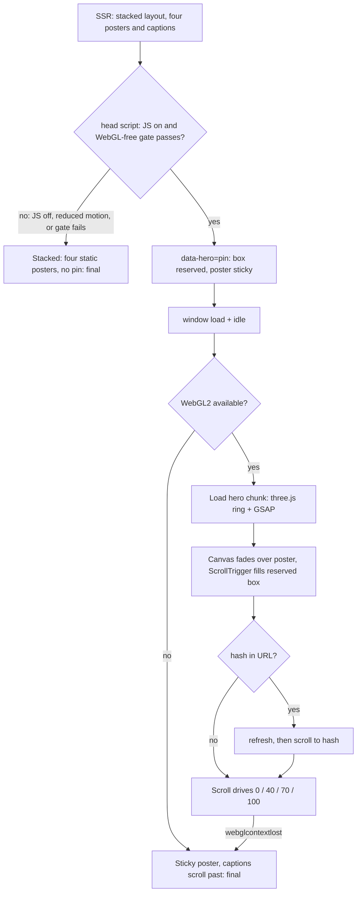
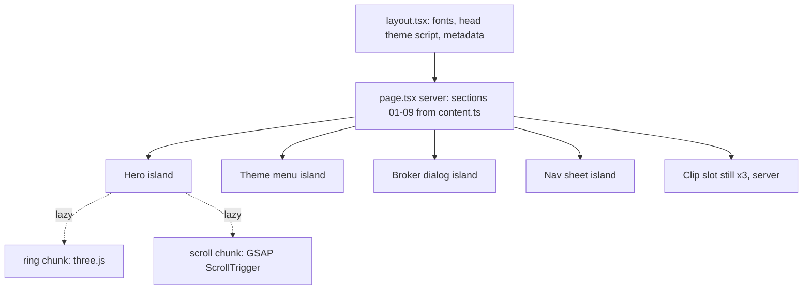

# Axiom Landing Page "Yantra" - Plan

## Goal Capsule

- **Objective:** a first-time Indian visitor on a mid-range Android phone who opens a shared Axiom link understands within one screen that Axiom reads market seasons, diversifies the basket and shows its evidence, sees that a human confirms every order, and knows how to get it (through a broker). A broker can reach the desk from the same page.
- **Means:** the approved "Yantra" direction (`docs/design/landing-direction.md`) built as route `/` of a new Next.js app `apps/desk` (KTD1), with a scroll-driven three.js ring hero over a static poster (KTD4).
- **Authority:** this plan's R-IDs win on product behavior; `docs/design/landing-direction.md` wins on visual spec (palette, type, geometry, copy) except where an R or KTD here amends it (KTD3, R20, R21); the critique fixes in `docs/design/landing-direction-critique.md` are already applied there. `PRODUCT.md` and `references/TASTE.md` bind tone and taste. Project `CLAUDE.md` binds the pipeline order.
- **Execution profile:** one PR, units U1 to U7 in order. Local only, no deploy.
- **Pipeline position:** after this plan, `ce-doc-review`, then `archify` diagrams in `docs/diagrams/`, then the ui-ux-pro-max (on Fable) and impeccable build loop driven by `ce-work`.
- **Stop conditions:** stop and ask if the hero cannot hold 50 fps at DPR 1.5 under the throttled mobile profile (direction Risk: fall back to four posters on all phones); if `shadcn init` would overwrite tokens in a way the diff review can't contain; if any required copy fails the banned-phrase test and needs rewording.
- **Finisher:** `ce-work` builds and verifies; the user approves the screenshots and the impeccable finish review before merge.

---

## Product Contract

### Summary

Build the public landing page at `/` as the first screen of `apps/desk`: scaffold, tokens, fonts, light and dark themes, the 3D ring hero with poster and reduced-motion paths, nine storyboard sections with exact copy, labelled clip placeholders, three restyled 21st.dev primitives, sharing metadata, a 404, and legal page shells. Prove it with a banned-phrase copy test, accessibility and performance checks, and screenshots, then write `DESIGN.md` from the build.

### Problem Frame

Axiom has no public face. The platform plan of record covers desk screens only, and the landing page was added to scope on 2026-11-13 for mass public use. Most visitors arrive from a broker's WhatsApp link on a mid-range Android phone, so the preview card and the first viewport decide whether they stay. Copy that brokers reuse carries SEBI exposure.

### Key Decisions

- **Yantra direction over Pink Paper and Chopda.** (session-settled: user-directed — chosen over alternates A Pink Paper and B Chopda: Yantra carries "instrument" and the evidence-grade stamps; the others read as media or kitsch.) Governs R1, R5–R9.
- **Landing page public, product stays desk-first.** (session-settled: user-directed — chosen over a whole-product public launch: V1 serves the internal desk; retail reaches Axiom through brokers in V2.) Governs R10, R11.
- **Public action is "Ask your broker", with no form.** (session-settled: user-directed — chosen over a notify-me email list and over no public action: no personal data, no privacy obligation, truthful about V1 access.) Governs R10, R11.
- **HyperFrames clips ship as labelled still placeholders.** (session-settled: user-approved — chosen over rendering real clips in this plan: FFmpeg is not installed and the clips depend on screens not yet built.) Governs R12.
- **English only.** (session-settled: user-approved — chosen over a Hindi version: copy and the SEBI review exist in English only.) Governs R5.
- **3D in the hero only.** (session-settled: user-directed — chosen over 3D in other sections: keeps the frame budget and one hero object.) Governs R6, R12.

### Requirements

**Page and copy**

- R1. Route `/` renders the nine storyboard sections 01–09 in order with the exact copy and captions from `docs/design/landing-direction.md` § Scroll storyboard and § First viewport.
- R2. Every visible string on the page and in the sharing metadata passes a banned-phrase check: returns, guaranteed, profit, buy, sell, tips, beat the market, matched as whole words, case-insensitive.
- R3. Every data figure on the page is marked `ILLUSTRATIVE`, and the page shows fewer than 20 data figures. Section ordinals and the product-capability count in section 03 ("up to 8 synced charts") are not data figures. Hero state captions are covered by the `ILLUSTRATIVE` that stays in the caption rail at every frame, and the section 07 specimen card by its own `ILLUSTRATIVE` cell.
- R4. The footer carries "Research tool. Not investment advice. No performance is promised.", the section index, the theme menu, and links to `/privacy` and `/terms`.
- R5. The document language is `en-IN`.

**Hero**

- R6. The hero shows the ring's 0% state as a static poster that is the LCP element and is never unmounted; when the 3D gate passes (KTD4), a three.js ring fades over it and scroll drives the 0/40/70/100 states with their captions.
- R7. When the 3D gate fails, or WebGL loses its context mid-scroll, the poster stays and the captions stay readable; nothing breaks or blanks.
- R8. Under `prefers-reduced-motion: reduce`, there is no pin and no scrub: four static posters (0/40/70/100) with the same captions, as normal sections.
- R9. The hedge card text "a human confirms every order" is in the DOM from first paint, whatever the scroll position.

**Actions**

- R10. "Talk to the desk" opens a dialog showing the desk contact address as text, a Copy button, and a `mailto:` link with a prefilled subject. It has no form fields and stores nothing.
- R11. Under the section 08 "Talk to the desk" button, the public line "Investing with a broker? Ask them for Axiom." is plain text. The page offers no sign-up, trading, pricing or advice.

**Media and primitives**

- R12. Sections 03, 04 and 06 each show a clip slot, filled in this plan by a still placeholder visibly labelled `CLIP PLACEHOLDER`. The slot renders only that still, at a fixed size, so no layout shift occurs when a real clip later replaces it.
- R13. The theme menu (System / Dark / Light), the broker dialog and the mobile nav sheet are 21st.dev components restyled to the tokens: hairline borders, no shadow, radius 4px or less, Hind labels.

**Themes, navigation, sharing**

- R14. The theme follows `prefers-color-scheme` until the visitor picks one in the menu; the choice persists and applies before first paint with no flash.
- R15. One `<nav>` lists the nine section anchors. Deep links such as `/#hedge` land on their section after the hero is set up, and back and forward restore the scroll position.
- R16. Sharing metadata provides `og:title`, `og:description`, a 1200×630 `og:image` of the ring at 0% with the statement, and a Twitter card; its copy passes R2.
- R17. Unknown routes render a tokenised 404 with a link home and `noindex`.
- R18. `/privacy` and `/terms` exist as static pages with a visible "Text pending legal review" notice; no legal text is invented.

**Quality**

- R19. Keyboard and screen-reader users can reach every section and action. The ring is `aria-hidden`; the hero captions are static, ordered DOM text (no live region); the pin never traps focus; focus rings are 2px brass with 2px offset; targets are at least 48px.
- R20. Budgets on the throttled mobile profile: LCP under 2.5 s, CLS under 0.05, total initial JS at most 200 KB gz of which app-owned at most 65 KB gz, hero 3D chunk (three.js and ring) under 160 KB gz, GSAP chunk counted separately and off first paint, full page under 320 KB gz on the poster path (every resource except the hero and GSAP chunks and clip media); the 3D path is that ceiling plus the separate hero and GSAP chunk limits.
- R21. Light and dark themes both keep the second voice: geru and monsoon as real state colours, the CNF / RAC / WL stamp outlines, and pink paper in light mode (direction § Calibration guard).

### Acceptance Examples

- AE1. Covers R6, R7. **Given** a phone reporting `saveData: true`, **when** the page loads, **then** no three.js or GSAP chunk is requested and the poster with captions is final.
- AE2. Covers R15. **Given** a visitor opens `/#hedge` on desktop, **when** the hero pin is set up after load, **then** section 05 sits at the top of the viewport and no layout shift above 0.05 is recorded.
- AE3. Covers R14. **Given** the system is dark and the visitor chose Light last time, **when** the page loads, **then** the first painted frame is light and the light poster is the LCP image.
- AE4. Covers R10. **Given** a desktop with no mail client, **when** the visitor opens "Talk to the desk", **then** the address is visible as text and Copy puts it on the clipboard.
- AE5. Covers R8. **Given** reduced motion, **when** the visitor scrolls the hero, **then** there is no pinned region and the four posters appear as ordinary sections.

### Scope Boundaries

- Sign-in and the Command Center: later plans.
- Deploy, domain and CDN: not in this plan.
- Considered and not built:
  - Analytics. No tracker is added; any tracker changes the privacy policy and needs the user's decision (Open Questions). Changes if the user picks one.
  - A `wa.me` "Share with your broker" link. A new feature without sign-off. Changes on the user's request.
  - Restoring WebGL after context loss. The poster is already a complete state, so a restore path buys nothing.
  - A desk sign-in link. The route doesn't exist yet; it comes with the sign-in plan.

### Deferred to Follow-Up Work

- Real HyperFrames clips for 03, 04 and 06, once FFmpeg is installed and the source screens exist. Clip text tracks and telemetry opt-out are checked then.
- Clip playback, built and tested with the first real clip, per direction § HyperFrames: `preload="none"`; muted `loop playsinline` autoplay only in view with motion allowed and `saveData` off; pause off-screen; a persistent 48px play/pause toggle; a rejected `play()` falls back to the poster frame with the toggle; under 600 KB per clip.
- Legal text for `/privacy` and `/terms`, the legal entity name, and any SEBI registration number, supplied by legal.
- A test on a real mid-range Android device, including WhatsApp's in-app browser (NOT RUN in this plan; the throttled Chrome profile stands in).
- A broker read of the pink-paper light mode (direction § Risk).

### Open Questions

- **Desk contact address and WhatsApp Business number (blocks launch, not merge).** R10 needs a real address and a named person who triages it. Until then the build uses the reserved placeholder `desk@axiom.invalid`, and a test fails the launch check if the placeholder is still present (U3).
- **Placeholder clips (blocks launch, not merge).** The launch check also fails while any clip slot in `content.ts` still shows `CLIP PLACEHOLDER` (U3), until the real clips land.
- **Analytics (blocks nothing in this plan).** Recommendation: cookieless aggregate page counts plus web-vitals monitoring, no personal data, disclosed in `/privacy`, no banner.
- **Next.js pin (merge gate).** KTD2 pins `next@16.4.5`, ten days old, as a security exception to the two-week rule. The user may veto in favour of 16.4.3.

---

## Planning Contract

### Key Technical Decisions

- KTD1. **Next.js App Router with Tailwind driven only by tokens, in `apps/desk`.** (session-settled: user-directed — chosen over CSS Modules and over Astro: one app later hosts sign-in and the desk.) The landing page is a statically rendered server component; only the hero, theme menu, dialog and nav sheet are client islands.
- KTD2. **Pins** (versions published by 2026-10-30 unless noted): `next@16.4.5` (security exception: 16.4.5 fixes 7 advisories, including an image-optimizer SVG bypass), `react`/`react-dom@19.3.1`, `tailwindcss` and `@tailwindcss/postcss@4.3.3` (avoid 4.3.4 and 4.3.5, which Next itself backed out), `three@0.186.1` with `@types/three@0.186.0`, `gsap@3.15.0` with `@gsap/react@2.1.2`, `@playwright/test@1.64.1`, `@axe-core/playwright@4.14.0`, `@lhci/cli@0.15.1`. `shadcn@4.23.0` and `hyperframes@0.8.217` run through `pnpm dlx` only, not as dependencies.
- KTD3. **Budget amended from the direction doc.** An empty Next 16.4 App Router page already ships about 133 KB gz of JS, so the direction's "first-paint JS under 90 KB gz" can't be met by any build on the settled stack. R20 replaces it with 200 KB total / 65 KB app-owned. `next build` no longer prints First Load JS, so size is measured from the browser (U7).
- KTD4. **3D gate.** three.js loads after the `load` event when idle, and only when all hold: WebGL2 is available, reduced motion is off, `deviceMemory` is 4 or more or unknown, `saveData` is false, `effectiveType` is not `slow-2g`, `2g` or `3g`, and the viewport is at least 600px tall (this excludes landscape phones and keeps portrait phones). Otherwise the poster is final. (session-settled: user-directed — chosen over 3D everywhere: the poster is the LCP and the fallback.)
- KTD5. **The pin height is decided before first paint and never collapses afterwards.**
  1. The server-rendered default is the stacked layout, the same one R8 gives reduced motion: four static posters (0/40/70/100), each with its caption, then the hedge card, as ordinary section content with no reserved scroll box. Only the 0% poster is preloaded; the other three are `loading="lazy"`. With JavaScript off, this is final.
  2. The blocking head script (KTD8) sets `data-hero="pin"` synchronously when the gate inputs readable without WebGL all pass: reduced motion off, `deviceMemory`, `saveData`, `effectiveType` and viewport height as in KTD4. CSS reserves the scroll box only under that attribute: 300vh, or 200vh below 768px wide.
  3. Only the WebGL2 check runs after `load`. If it fails, or the context is lost, the box stays. The poster stays sticky inside it and the four captions scroll past in order (CSS `position: sticky`, no JS), so nothing shifts.
  4. GSAP fills the reserved box rather than inserting a spacer. Heights use `svh`/`lvh`; ScrollTrigger ignores mobile address-bar resizes and refreshes on orientation change. After setup, a hash in the URL is re-scrolled to, and scroll restoration is handled manually while the pin is active.
- KTD6. **No Motion library in this plan.** Section reveals (480 ms, 16px rise plus opacity, 60 ms stagger, at most five items; opacity only under reduced motion; direction § Motion grammar) are CSS transitions toggled by one IntersectionObserver. Motion is added with sign-in or the desk when a component needs it. GSAP and ScrollTrigger load with the hero chunk, never on first paint.
- KTD7. **Clip slots render a still only in this plan.** Video playback code waits for the first real clip, because nothing could exercise it now (see Deferred to Follow-Up Work).
- KTD8. **Theme applied before paint.** A blocking inline script in `<head>` reads the stored choice (wrapped in try/catch), sets `data-theme`, and injects a `<link rel="preload" as="image" fetchpriority="high">` for the resolved theme's poster. The hero carries two poster `` elements whose visibility `[data-theme]` CSS controls; the inactive one is `loading="lazy"`, so it isn't fetched. A `<picture media>` source can't be used, because it reads only `prefers-color-scheme` and not the stored choice.
- KTD9. **21st.dev via the shadcn CLI on a reviewed diff.** `shadcn init` overwrites `globals.css` and the `@theme` tokens, so U5 runs it after the tokens exist, reviews the diff, and restores any overwritten token. Only the three named primitives are added.
- KTD10. **Fonts self-hosted through `next/font/google`**: Martel 700/800, Hind 400/500/600, Martian Mono 400/500, latin subset only, no runtime calls to Google. Whether `next/font` emits the digits-only `unicode-range` the direction asks for is UNVERIFIED; if it doesn't, Martian Mono loads in full latin, and the R20 budget still applies.
- KTD11. **Copy lives in one typed content module** (`apps/desk/src/landing/content.ts`). Sections, metadata and the banned-phrase test all read from it, so the test sees every string the page can show.

### High-Level Technical Design

Hero load paths: the pin is decided before first paint (KTD5); three possible end states.



Component boundary: server-rendered page with client islands.



### Output Structure

```text
apps/desk/
  package.json
  next.config.ts
  tsconfig.json
  eslint.config.mjs
  playwright.config.ts
  lighthouserc.json
  public/hero/          poster-{0,40,70,100}-{dark,light}.{avif,webp}
  public/og/            og-1200x630.jpg
  public/clips/         placeholder stills for 03, 04, 06
  src/app/
    layout.tsx          fonts, head theme script, metadata
    page.tsx            landing route
    globals.css         Tailwind + @theme tokens
    not-found.tsx
    privacy/page.tsx
    terms/page.tsx
  src/landing/
    content.ts          all copy and captions
    sections/           01 to 09
    hero/               Hero.tsx, gate.ts, ring.ts, scroll.ts, Poster.tsx
    ClipSlot.tsx
    ThemeMenu.tsx  BrokerDialog.tsx  NavSheet.tsx
  src/components/ui/    restyled 21st.dev primitives
  test/                 node --test unit tests
  e2e/                  Playwright specs
```

### Assumptions

- The workspace already includes `apps/*` in `pnpm-workspace.yaml`; U1 confirms it and adds it if not.
- Posters and the OG image are produced from the ring itself (a headless render of the 0/40/70/100 states) in U4; no image generator is used.
- GSAP's "no charge" Standard licence permits this use. The licence page was unreachable during research (UNVERIFIED); U1 reads the licence file in the installed package before going further.

---

## Implementation Units

### U1. Scaffold `apps/desk`

- **Goal:** an empty Next.js app that builds, lints, typechecks and runs its test commands inside the monorepo.
- **Requirements:** R5; KTD1, KTD2.
- **Dependencies:** none.
- **Files:** `apps/desk/package.json` (name `desk`), `next.config.ts`, `tsconfig.json`, `eslint.config.mjs`, `playwright.config.ts`, `src/app/layout.tsx`, `src/app/page.tsx`, `pnpm-workspace.yaml` if needed, `pnpm-lock.yaml`.
- **Approach:**
  1. Create the app with the KTD2 pins, exact versions, no caret ranges.
  2. Scripts: `dev`, `build`, `typecheck` (`tsc --noEmit`), `lint` (ESLint directly; `next lint` is gone in 16), `test` (`node --test`), `e2e` (Playwright).
  3. Match the repo's TS settings in `tools/benchmarks/renderer/tsconfig.json` where Next allows it.
  4. Read the GSAP licence in `node_modules/gsap` and record the finding in the PR description.
- **Patterns to follow:** `tools/benchmarks/renderer/package.json` for pinning and `node --test`.
- **Test expectation:** none -- scaffolding; U3 adds the first behavioural test.
- **Verification:** `pnpm --filter desk build`, `typecheck` and `lint` pass on the empty page.

### U2. Tokens, fonts, themes, layout shell

- **Goal:** the Yantra visual system as Tailwind tokens, both themes switchable with no flash, and the layout, nav, footer, 404 and legal shells.
- **Requirements:** R4, R14, R15 (nav only), R17, R18, R19, R21; KTD8, KTD10.
- **Dependencies:** U1.
- **Files:** `DESIGN.md` (provisional), `src/app/globals.css`, `src/app/layout.tsx`, `src/app/not-found.tsx`, `src/app/privacy/page.tsx`, `src/app/terms/page.tsx`, `src/landing/sections/Footer.tsx`, `src/landing/Nav.tsx`, `src/landing/theme.ts`, `test/theme.test.ts`, `e2e/theme.spec.ts`.
- **Approach:**
  1. Before any screen work, write a provisional `DESIGN.md` from the approved direction's palette, type, motion and radius rules, to satisfy the G5 start gate in project `CLAUDE.md`. U7 rewrites it from the build.
  2. Copy both palettes exactly from direction § Colour into `@theme` variables keyed by `data-theme`; geru, monsoon and the stamp outline styles are tokens, not one-offs (R21).
  3. Fonts per KTD10.
  4. The `<head>` script resolves stored choice, then system preference; the menu writes the choice (U5 supplies the menu UI; this unit ships the logic).
  5. Radius ceiling 4px, no shadows, focus ring per R19, as global rules.
- **Test scenarios:**
  - The stored-theme resolver returns the stored value when present, the system value when absent, and the system value when storage throws.
  - Covers AE3. With the system dark and stored Light, the first screenshot frame is light and `html[data-theme]` is `light` before hydration.
  - `/does-not-exist` returns the 404 page with `noindex` and a link to `/`.
  - `/privacy` and `/terms` render the "Text pending legal review" notice.
- **Verification:** both themes render the shell with tokens only; no hard-coded colours outside `globals.css`.

### U3. Sections 01–09, content module, copy test, sharing metadata

- **Goal:** the full static page with exact copy, the banned-phrase guard, and the WhatsApp preview.
- **Requirements:** R1, R2, R3, R4, R9, R11, R16; KTD6 (section reveals), KTD11.
- **Dependencies:** U2.
- **Files:** `src/landing/content.ts`, `src/landing/sections/*.tsx`, `src/app/page.tsx`, `src/app/layout.tsx` (metadata), `test/copy.test.ts`, `test/numbers.test.ts`, `test/launch/contact.test.ts`, `test/launch/clips.test.ts`.
- **Approach:**
  1. Every string, caption and metadata field goes in `content.ts` (KTD11); sections render from it.
  2. Section 07's specimen card and stamps follow direction § Scroll storyboard 07.
  3. The hero's static DOM (statement, subline, captions for all four states, hedge card) renders here in the stacked default layout (KTD5); U4 adds behaviour on top. Until U4 renders the real posters, a flat token-coloured stand-in at the final dimensions holds the poster slot, so swapping it causes no layout shift.
  4. Every section has `scroll-margin-top` and a stable `id` matching the nav.
- **Execution note:** write `copy.test.ts` first and see it fail on a seeded banned word before adding the real copy.
- **Test scenarios:**
  - The banned-phrase test walks every string in `content.ts` (enumerated from the module, not a hand list) and fails when "Buy", "profits" or "guaranteed" is planted in any field.
  - Matching is whole-word and case-insensitive, with plural and -ing forms listed explicitly: "buyer" passes, "buying" and "returns" fail.
  - The numbers test counts data figures across the strings in `content.ts` (excluding the R3 exemptions), fails at 20 or more, and fails if a data figure sits in a caption group with no `ILLUSTRATIVE` marker: its own caption, the hero caption rail, or the specimen card.
  - The launch contact test fails while the desk contact is `desk@axiom.invalid`. It lives under `test/launch/`, outside the `test` script's glob, and runs only through a separate `launch` script, so the merge gate stays green and the launch check is reported as failing or NOT RUN until the real address lands.
  - The launch clips test, enumerating the clip slots from `content.ts`, fails while any slot still shows `CLIP PLACEHOLDER`; it runs only through the `launch` script.
  - The rendered page contains "a human confirms every order" before any script runs (JS disabled in Playwright).
  - The `og:title` and `og:description` pass the banned-phrase test.
- **Verification:** the page reads end to end with JavaScript disabled.

### U4. Hero: poster, gate, ring, scroll

- **Goal:** the scroll-driven ring per direction § Hero 3D object, built so failure at any point leaves the poster.
- **Requirements:** R6, R7, R8, R15, R19, R20; KTD3, KTD4, KTD5, KTD6.
- **Dependencies:** U3.
- **Files:** `src/landing/hero/Hero.tsx`, `Poster.tsx`, `gate.ts`, `ring.ts`, `scroll.ts`, `src/app/layout.tsx` (head script), `public/hero/*`, `public/og/og-1200x630.jpg`, `test/gate.test.ts`, `e2e/hero.spec.ts`.
- **Approach:**
  1. Render the ring at 0/40/70/100 headlessly to produce the AVIF and WebP posters per theme (45 KB AVIF target) and the 1200×630 OG image, then replace U3's stand-in with the two-poster wiring per KTD8.
  2. `gate.ts` is a pure function of the capability inputs (KTD4) so it's testable without a browser; the head script runs the WebGL-free part of it to set `data-hero` (KTD5).
  3. `ring.ts` builds geometry and materials as specified, one canvas, low-power, DPR at most 1.5, renders only while in view and scroll changed, disposes on unmount, and handles `webglcontextlost` by stopping and fading out.
  4. `scroll.ts` drives the four states into the reserved box (KTD5). Pointer tilt is desktop only. Below 768px, the section index and the nav-sheet trigger stay visible while the hero is pinned, so the visitor can skip it (direction § Hero 3D object).
  5. Reduced motion renders the four posters as sections and never imports either chunk.
- **Execution note:** measure fps at DPR 1.5 under the throttled profile as soon as the ring renders; if under 50 fps, stop per the Goal Capsule.
- **Test scenarios:**
  - The gate returns false for each failing input on its own (no WebGL2; reduced motion; `deviceMemory` 2; `saveData` true; `effectiveType` `3g`; landscape 844×390), and true for desktop 1280×800 with unknown `deviceMemory`.
  - Covers AE1. With `saveData` emulated, the network log shows no ring or GSAP chunk.
  - Covers AE5. Under reduced motion, there is no pinned element and four poster images are present.
  - Covers AE2. Loading `/#hedge` at 1280×800 puts section 05 at the top after setup, with CLS under 0.05.
  - Forcing `WEBGL_lose_context` mid-scroll leaves the poster visible and the captions readable, with no console errors.
  - With WebGL2 unavailable but the other inputs passing, the poster stays sticky in the reserved box, all four captions scroll past in order, and CLS stays under 0.05 after `load`.
  - With JavaScript disabled, the stacked layout shows the four posters with their captions and the hedge card, with no empty reserved space.
  - Covers AE3. With the system dark and stored Light, the only poster fetched is the light one, and it is the LCP element.
  - At 375px, the nav-sheet trigger is visible at hero scroll positions 0, 40, 70 and 100.
  - The `og:image` is 1200×630 and under 300 KB.
  - Back navigation from a later section restores the same section in view.
  - Keyboard tabbing passes through the hero to section 02 without getting stuck in the pin.
- **Verification:** the hero runs all three end states of the High-Level Technical Design diagram on the throttled profile.

### U5. Clip slots and 21st.dev primitives

- **Goal:** the three clip slots with placeholders, and the theme menu, broker dialog and nav sheet, restyled to tokens.
- **Requirements:** R10, R12, R13, R14, R19; KTD7, KTD9.
- **Dependencies:** U2, U3.
- **Files:** `src/landing/ClipSlot.tsx`, `ThemeMenu.tsx`, `BrokerDialog.tsx`, `NavSheet.tsx`, `src/components/ui/*`, `public/clips/*`, `e2e/actions.spec.ts`.
- **Approach:**
  1. Run `shadcn init` and add the three primitives per KTD9; review the token diff before anything else.
  2. Restyle per R13. No hover lift or shadow growth (direction § Motion grammar).
  3. `ClipSlot` renders the placeholder still labelled `CLIP PLACEHOLDER` at a fixed size (R12, KTD7). It is a server component, not a client island.
  4. `BrokerDialog` implements R10 with the address from `content.ts`.
- **Test scenarios:**
  - Covers AE4. Opening the dialog shows the address as text; Copy writes it to the clipboard; the `mailto:` link carries the subject.
  - The dialog traps focus while open, closes on Escape, and returns focus to "Talk to the desk".
  - The theme menu offers System, Dark and Light; choosing Light persists across a reload.
  - The nav sheet opens at 375px, lists the nine anchors, and closes after one is chosen.
  - Each clip slot shows `CLIP PLACEHOLDER` and has no `<video>` network request on load.
- **Verification:** the three primitives show no stock shadcn look: no shadow, radius 4px or less, Hind labels, token colours only.

### U6. Accessibility, performance and screenshot gates

- **Goal:** automated proof of R19 and R20, and the screenshot matrix the global UI rules require.
- **Requirements:** R19, R20, R21; KTD3.
- **Dependencies:** U4, U5.
- **Files:** `e2e/a11y.spec.ts`, `e2e/budget.spec.ts`, `e2e/screens.spec.ts`, `lighthouserc.json`, `playwright.config.ts`.
- **Approach:**
  1. axe on `/`, `/privacy`, `/terms` and the 404 in both themes.
  2. The budget spec sums the `encodedBodySize` of scripts loaded before `load`, and checks the hero and GSAP chunks separately. App-owned JS is that total minus a framework baseline measured from U1's empty page under the same build and pins, because Turbopack's content-hashed chunk names give no stable path to split on. Record the baseline as a constant in `budget.spec.ts`, with the command that produced it.
  3. Lighthouse CI on the mobile throttled preset for LCP and CLS.
  4. Screenshots at 375, 768 and 1280 in light and dark, plus 360×640 and 844×390 landscape.
- **Test scenarios:**
  - axe reports zero serious or critical violations on each page and theme.
  - Every interactive element is at least 48×48 CSS px.
  - Initial JS is at most 200 KB gz, app-owned at most 65 KB gz, and the three.js chunk under 160 KB gz.
  - On the poster path (`saveData` emulated), every resource loaded totals under 320 KB gz.
  - Lighthouse mobile: LCP under 2.5 s and CLS under 0.05, with the poster as the LCP element.
  - At 844×390 landscape, no pinned element exists.
- **Verification:** all gates pass and the screenshots are committed under `apps/desk/e2e/__screenshots__/`.

### U7. Finish review and DESIGN.md

- **Goal:** the impeccable finish review applied, and `DESIGN.md` written from what was built.
- **Requirements:** R21; the CLAUDE.md UI pipeline.
- **Dependencies:** U6.
- **Files:** `DESIGN.md`, `docs/design/landing-finish-review.md`, any files the review's fixes touch.
- **Approach:**
  1. Run the impeccable finish reviewer against the build, the direction and the screenshots; apply its material fixes and re-run U6.
  2. The impeccable documenter rewrites the provisional `DESIGN.md` from the shipped tokens and components.
  3. For each viewport, record in the review file what is not stock SaaS.
- **Test expectation:** none -- review and documentation; U6 re-runs after fixes.
- **Verification:** the finish review lists no open material fix, and `DESIGN.md` matches `globals.css`.

---

## Verification Contract

| Gate | Command | Applies to |
|---|---|---|
| Types | `pnpm --filter desk typecheck` | every unit |
| Lint | `pnpm --filter desk lint` | every unit |
| Unit tests | `pnpm --filter desk test` | U2, U3, U4 |
| Build | `pnpm --filter desk build` | every unit |
| End to end, a11y, budget, screenshots | `pnpm --filter desk e2e` | U2–U6 |
| Lighthouse | `pnpm --filter desk exec lhci autorun` | U6, U7 |
| Launch check | `pnpm --filter desk launch` | before any deploy; expected to fail until the desk contact and real clips are supplied, and reported as such |
| Repo-wide TS | `pnpm -r typecheck`, `pnpm -r test` | before merge |

Real-device Android and WhatsApp in-app browser checks are NOT RUN in this plan and are reported as such. Bug fixes follow the user's standing rules: show the test failing on reverted code.

## Definition of Done

- **Per unit:** its test scenarios pass and its verification holds; abandoned-attempt code is removed from the diff.
- **Plan complete:**
  - Every gate in the Verification Contract passes, with output shown.
  - Screenshots at 375, 768 and 1280 in light and dark are reviewed against the direction, with per-viewport "not stock SaaS" notes.
  - The impeccable finish review has no open material fix, and `DESIGN.md` exists.
  - Open Questions are surfaced in the PR description, with the launch blockers named.
  - The platform plan carries U28 pointing here.
