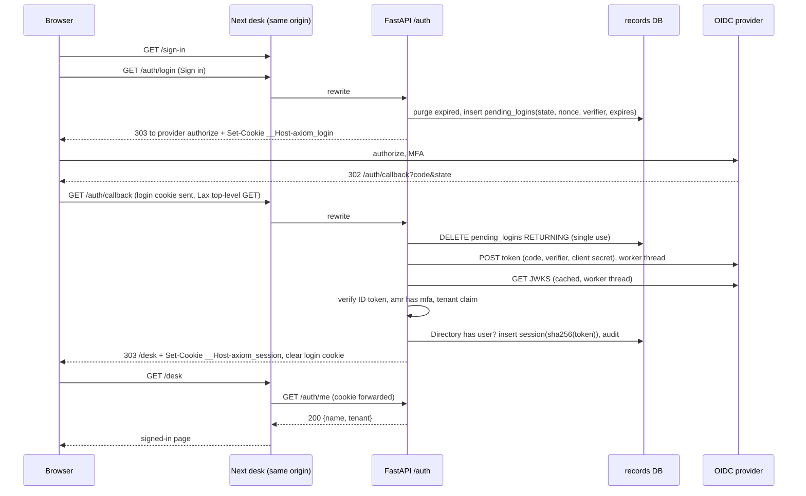
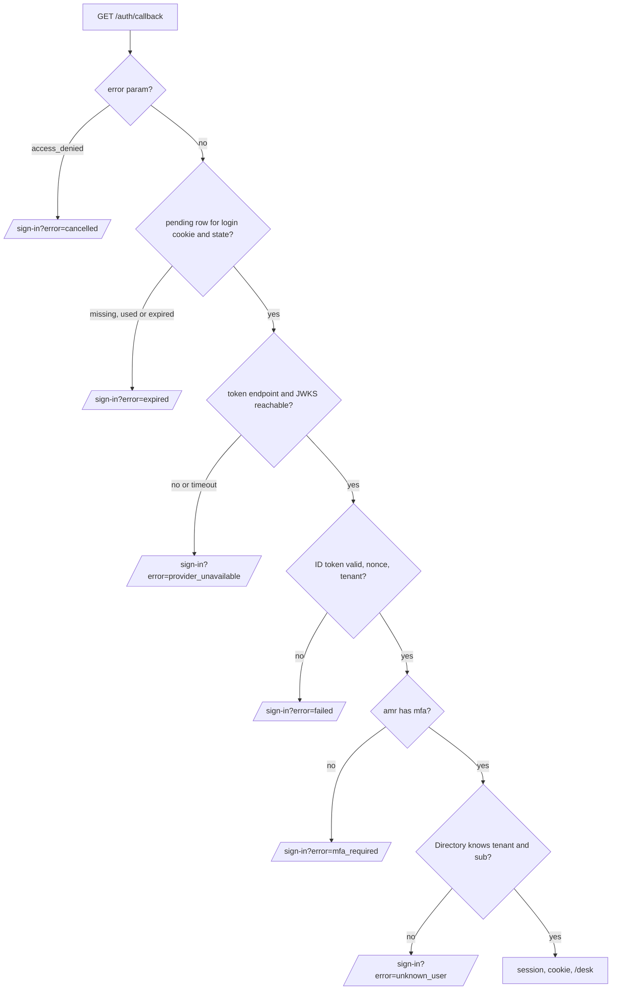

# Desk Sign-In - Plan

## Goal Capsule

- **Objective:** A desk user can sign in through the desk's identity provider with MFA, see a signed-in desk page that names them, and sign out. Nobody without MFA or outside the desk directory gets in, and an API restart does not sign anyone out.
- **Means:** the API runs the whole OpenID Connect sign-in as a confidential client and hands the browser only its own opaque session cookie (KTD1), served from the desk's own origin (KTD7).
- **Authority:** the platform plan `docs/plans/2026-11-12-1110-feat-axiom-desk-platform-plan.md` (U2, KTD20) governs; this plan is a slice of its U2. Where they disagree, KTD20 wins.
- **Execution profile:** one PR, branch `claude/desk-login`, stacked on PR #2 (`claude/u14-renderer-spike-dabe9f`) until that merges.
- **Stop conditions:** stop and ask if any requirement can only be met with vendor-specific code. The real vendor's tenant claim and `sub` mapping are checked when the vendor is chosen (Open Questions), not in this build.
- **Finishes and ships:** the implementing agent, through the repo's feature pipeline (CLAUDE.md): diagram, UI design and review, then backend.

---

## Product Contract

### Summary

Add the sign-in path the platform plan assumes but nobody built: a `/sign-in` screen with one button, the provider round trip, a database-backed session in an HttpOnly cookie, a placeholder signed-in page at `/desk` with Sign out, and readable errors for the ways sign-in fails.

### Problem Frame

`SessionStore.sign_in` already turns claims that someone else verified into a session, and refuses users without MFA or outside the Directory. Nothing produces those verified claims: there is no redirect to a provider, no ID-token check, no cookie and no screen, so no desk user can sign in. Sessions also live in process memory, so every API restart signs everyone out and a second API process cannot see them. Every later desk screen (charts, options, tickets) needs a signed-in user first.

### Requirements

**Signing in**

- R1. `/sign-in` shows one Sign in action that starts sign-in at the configured provider.
- R2. A session is created only when the provider's ID token is valid, says MFA was used, names a tenant, and names a user the Directory knows in that tenant.
- R3. After a successful sign-in the user lands on `/desk`, which shows their name and tenant and a Sign out action.
- R4. A failed sign-in returns to `/sign-in` with a message for its cause: MFA not used, user not on this desk, sign-in expired or already used, sign-in cancelled at the provider, provider unreachable, and any other failure as one generic message.

**Sessions**

- R5. Sessions are stored in the records database and survive an API restart.
- R6. A signed-in user who opens `/sign-in` goes to `/desk`. A signed-out user who opens `/desk` goes to `/sign-in`.
- R7. Sign out ends the session on the server and clears the cookie.
- R8. A user removed from the Directory loses access on their next request, not when the session expires.
- R9. Deferred (review decision 2026-11-13): capability calls with the session cookie, and their cross-site refusal, land with the first desk screen that calls capabilities. Capability calls stay bearer-only here.

**Record and configuration**

- R10. Every sign-in, every sign-out, and every refusal after the ID token verifies (MFA not used, user not on this desk) writes one audit record. Refusals before verification (expired, cancelled, provider unreachable, other failure) have no verified tenant or user, so they are logged with their code, not audited.
- R11. The provider is chosen by configuration (issuer, client id, client secret), with no vendor-specific code.

### Key Decisions

- **One provider for all tenants, tenant named in a token claim.** A provider per broker would change the login route and is not needed for V1. Governs R2, R11.
- **No Sign in link on the public landing page.** Desk users get the desk address; broker visitors should not land on a screen they cannot use. Governs R1.

### Scope Boundaries

- Choosing the identity provider vendor and registering the client.
- Re-authentication UI for ticket confirm (the server check exists in `authz.py`).
- WebSocket sessions.
- Any desk screen beyond the `/desk` placeholder.
- Considered and not built:
  - Idle timeout: the 8-hour absolute limit (KTD5) bounds exposure on a desk machine, and `prompt=login` (KTD1) stops the next person reusing a provider session after Sign out.
  - Return-to after sign-in: `/desk` is the only signed-in page. Add it with the second desk screen.
  - Sign-in rate limiting: the provider throttles credential attempts, the callback has nothing to brute-force, and abandoned login starts are purged on the next insert (U1). Revisit if the callback shows abuse.
  - RFC 9207 `iss` callback check: there is one configured issuer and the ID token's own `iss` is checked. Add it if a second provider is ever configured.

#### Deferred to Follow-Up Work

- Provider-side logout (RP-initiated logout) once a vendor is chosen.
- R9: cookie auth on capability calls plus the same-origin middleware and parity cookie-path tests, with the first desk screen that calls capabilities.
- An `acr`-based MFA rule for providers that do not emit `amr` (see Risks).

---

## Planning Contract

### Key Technical Decisions

- KTD1. **The API is the OIDC client; the browser never holds provider tokens.** Authorization-code flow with PKCE (S256), `state` and `nonce`, confidential client with the secret on the server, default query response mode (form_post would drop the SameSite=Lax login cookie on the cross-site POST). Every authorize request sends `prompt=login`, so the provider asks for credentials and MFA each time and Sign out cannot be undone by a lingering provider session on a shared desk machine. Session.py's contract stays: verified claims in, opaque token out.
- KTD2. **Pending sign-ins live in a `pending_logins` table, keyed by the SHA-256 of a random handle held in a `__Host-axiom_login` cookie.** The row holds state, nonce and PKCE verifier, and expires after 10 minutes. The callback deletes it with `DELETE … RETURNING`, so each sign-in can be completed once, and only by the browser that started it (RFC 9700 §4.7.1 login CSRF). Chosen over a signed cookie, which would need a new signing secret.
- KTD3. **ID tokens are checked with `pyjwt[crypto]==2.15.1`; HTTP to the provider goes through `httpx2`.**
  - Checks: RS256/ES256 signature from the provider's JWKS, `iss`, `aud`, `exp`, `iat`, `nonce`, 60 s leeway; `azp` when `aud` has several values (PyJWT does not check it).
  - Every provider call (discovery, token exchange, JWKS) blocks, so each runs in a worker thread with a 5 s timeout; the shared sqlite connection is never touched from that thread.
  - Versions predate 2026-10-30, the two-week rule. `httpx2` moves from the dev group to `axiom-api` runtime dependencies.
- KTD4. **MFA means `"mfa"` in the token's `amr` list.** A missing or non-list `amr` counts as no MFA. Matches `SessionStore._require_mfa_user` today.
- KTD5. **Session token: 32 random bytes, stored only as its SHA-256, cookie `__Host-axiom_session` (HttpOnly, Secure, SameSite=Lax, Path=/), 8 h absolute.**
  - Lax, not Strict: Strict drops the cookie on the redirect back from the provider.
  - Every sign-in mints a new token (no fixation).
  - `authenticated_at` takes the token's `auth_time`, never `iat` or the server clock. The authorize request sends `max_age=28800` (the session TTL), so OIDC Core requires the provider to return `auth_time`. A token that still lacks it signs in with `authenticated_at` NULL, which the ticket-confirm re-auth check in `authz.py` already refuses. A silently reused provider login therefore never looks fresh. `reauthenticate` follows the same rule.
  - The session row carries a display name from the token (`name`, else `email`, else `sub`).
- KTD6. **`POST /auth/logout` passes a same-origin check; capability calls stay bearer-only (R9 deferred).** `Sec-Fetch-Site: same-origin` passes; without it, `Origin` must equal `AXIOM_PUBLIC_ORIGIN`, and `null` or missing fails. SameSite=Lax is the second layer. The general cookie middleware for capability calls arrives with R9.
- KTD7. **One origin: Next `rewrites()` proxy `/auth/*` to the API (`/capabilities/*` joins with R9).** Next 16's rewrite proxy passes 302s, relative `Location` and every `Set-Cookie` through unchanged, so cookies stay first-party and no CORS is needed. The API origin is read at `next build`, so `AXIOM_API_ORIGIN` must be set for the build. The API sees its own host, so the callback URL and every absolute URL come from `AXIOM_PUBLIC_ORIGIN`, never the request.
- KTD8. **Failures reach the screen as a fixed code, never provider text.** The callback redirects with 303 to `/sign-in?error=<code>`, using `mfa_required`, `unknown_user`, `expired`, `cancelled`, `provider_unavailable` or `failed`. `Unauthenticated` gains a reason so the session layer's refusals map to codes. Detail goes to the log (and, for `mfa_required` and `unknown_user`, the audit record per R10), never the URL.
- KTD9. **A real provider for tests: a stdlib `ThreadingHTTPServer` in `tools/test_idp/`.** About 150 lines: it serves discovery, JWKS, authorize (auto-approves a seeded user picked by a `login_hint`) and token, signs RS256 with a key generated at start, and runs on `127.0.0.1` with an ephemeral or fixed port. Seeded users cover: MFA user in the Directory, user without MFA, user not in the Directory, token without a tenant. Pytest and Playwright both talk to it over HTTP. Chosen over mock-oauth2-server (JVM) and node oidc-provider (another runtime in CI).
- KTD10. **Sign out is a POST to `/auth/logout`.** It deletes the session row and the cookie, then redirects to `/sign-in`. Provider-side logout is deferred.
- KTD11. **`/auth/me` is the session read for the desk.** `/desk` is a Server Component that forwards the cookie to `/auth/me` with `cache: "no-store"` and redirects to `/sign-in` on 401. `/sign-in` does the reverse for R6. Any other `/auth/me` failure (API down, 5xx): `/sign-in` renders signed out with the Sign in action, and `/desk` renders a "desk service unreachable" message with a reload link instead of redirecting. Next 16's `proxy.ts` is not used: it is meant for optimistic checks only.

### High-Level Technical Design

Sign-in sequence (the happy path, then where each failure exits):

Callback outcomes:

### Assumptions

- Directory user ids are the provider's `sub` for the same person. The chosen provider must emit a stable `sub` (KTD20 implies this; the Directory has no email column).
- The tenant claim is set by the provider's admin and cannot be edited by the user. Its name comes from `AXIOM_OIDC_TENANT_CLAIM`, default `tenant`.

### Sequencing

U1 (sessions in the database) and U2 (test provider) are independent. U3 (OIDC client) needs U2 for its tests. U4 (routes) needs U1 and U3. U5 (desk screens, proxy, e2e, CI) needs U4.

---

## Implementation Units

### U1. Database-backed sessions and pending sign-ins

- **Goal:** move sessions into the records database and add the pending sign-in store, keeping the `SessionStore` interface its callers use.
- **Requirements:** R2, R5, R7, R8, R10; KTD2, KTD5, KTD8.
- **Dependencies:** none.
- **Files:**
  - `packages/core/src/axiom_core/migrations/0005_sessions.sql`
  - `packages/core/src/axiom_core/session.py`
  - `services/api/src/axiom_api/app.py` (constructor change in `build_services`)
  - `packages/core/tests/test_session.py`
- **Approach:**
  1. Migration adds `sessions` (token hash primary key, tenant, user, display name, authenticated_at, expires_at) and `pending_logins` (handle hash primary key, state, nonce, verifier, expires_at). `authenticated_at` is nullable (KTD5).
  2. `SessionStore` takes the connection; `sign_in` takes `auth_time` and display name from `VerifiedClaims`, stores the hash and writes the audit record. `reauthenticate` moves to the database and stores the claims' `auth_time` (NULL when absent), not the clock.
  3. `resolve` re-checks `Directory.has_user` on every call and deletes the row when the user is gone (R8).
  4. `Unauthenticated` carries a reason (`mfa_required`, `unknown_user`, `expired`, `invalid`) for KTD8.
  5. Each insert into `pending_logins` or `sessions` first deletes that table's expired rows, so abandoned sign-ins never accumulate. No sweeper job.
  6. Remove the in-memory `shortcut:` note.
- **Patterns to follow:** `jobs.py` for SQL inside `with self._conn`; `migrate()` numbering in `db.py`.
- **Test scenarios:**
  - A session created on one `SessionStore` resolves on a second store built on the same database file (restart).
  - The stored value is not the token: the table holds no row whose key equals the raw token.
  - Signing in twice gives two different tokens; signing out one leaves the other valid.
  - A session resolves until `expires_at` and is refused, with reason `expired`, one second after.
  - Revoking the user's last role makes the next `resolve` raise `unknown_user` and deletes the row.
  - `authenticated_at` equals the claims' `auth_time`, not the clock, so a 20-minute-old `auth_time` fails the confirm re-auth check in `authz.py`; the same holds after `reauthenticate`.
  - Claims without `auth_time` give a session whose principal fails the confirm re-auth check.
  - An expired, never-taken pending row is gone after the next login start.
  - A pending row can be taken once: the second take returns nothing; an expired row is not returned.
  - Sign-in, refused sign-in (no MFA, unknown user) and sign-out each write one audit record with tenant and user ids; nothing else is written.
- **Verification:** existing `test_authz.py` and `test_parity.py` pass unchanged apart from the constructor.

### U2. Test OIDC provider

- **Goal:** a real provider over HTTP that pytest and Playwright both use, with no Docker or JVM.
- **Requirements:** R11 (proves provider-agnostic); KTD9.
- **Dependencies:** none.
- **Files:**
  - `tools/test_idp/idp.py`
  - `tools/test_idp/users.json`
  - `tools/tests/test_idp.py`
- **Approach:** stdlib HTTP server plus `cryptography` for the key. It serves discovery, JWKS, `/authorize` (redirects straight back with a code for the seeded user named by `login_hint`, or `error=access_denied` for a `deny` hint) and `/token` (checks the PKCE verifier and client secret, issues an ID token with `amr`, `auth_time`, `nonce`, tenant claim and `name`). It can run as a script on a fixed port for Playwright. It is never imported by `src/` code.
- **Test scenarios:**
  - Discovery lists endpoints on the server's own origin, and the JWKS key verifies a token it issued.
  - `/token` with a wrong PKCE verifier or wrong client secret returns `invalid_grant` / `invalid_client`.
  - A code can be exchanged once.
- **Verification:** the server starts and stops inside a pytest fixture in under a second.

### U3. OIDC client

- **Goal:** build the provider redirect and turn a callback into `VerifiedClaims`, or a typed failure.
- **Requirements:** R2, R4, R11; KTD1, KTD3, KTD4, KTD8.
- **Dependencies:** U2 (tests).
- **Files:**
  - `services/api/src/axiom_api/oidc.py`
  - `services/api/pyproject.toml` (add `pyjwt[crypto]==2.15.1`, move `httpx2` to runtime, add `uvicorn` for serving)
  - `uv.lock`
  - `services/api/tests/test_oidc.py`
- **Approach:**
  1. Settings from env: `AXIOM_OIDC_ISSUER`, `AXIOM_OIDC_CLIENT_ID`, `AXIOM_OIDC_CLIENT_SECRET`, `AXIOM_OIDC_TENANT_CLAIM`, `AXIOM_PUBLIC_ORIGIN`. The API refuses to start auth routes without them; capability calls keep working.
  2. Discovery is fetched once and cached. Discovery, token exchange and JWKS (PyJWT's key client) each run in a worker thread with a 5 s timeout (KTD3).
  3. One function builds the authorize URL from a pending row, with `prompt=login` (KTD1) and `max_age=28800` (KTD5); one exchanges the code and verifies per KTD3 and KTD4, raising a reason-carrying error.
  4. Verify installed PyJWT signatures with `inspect.signature` before use (CLAUDE.md evidence rule).
- **Test scenarios (all against the U2 provider over HTTP, no mocked verifier):**
  - The MFA user's code yields claims with tenant, `sub`, `auth_time` and name.
  - A token whose `nonce` differs from the pending row is refused (`failed`).
  - A token for another audience is refused.
  - A token signed by a key not in the JWKS is refused.
  - An expired token beyond 60 s leeway is refused; one 30 s past `exp` is accepted.
  - `amr` without `mfa`, `amr` missing and `amr` as a string each give `mfa_required`.
  - A token with no tenant claim gives `failed`.
  - The provider on a closed port gives `provider_unavailable` within the timeout (real unreachable host, not a raised exception).
  - The authorize URL carries `prompt=login`, `max_age=28800`, `code_challenge_method=S256`, `state` and `nonce`.
  - A token without `auth_time` yields claims with no `auth_time` (no `iat` fallback).
- **Verification:** `pyright` and `ruff` clean; no `type: ignore`.

### U4. Auth routes, cookie sessions and same-origin check

- **Goal:** expose `/auth/login`, `/auth/callback`, `/auth/logout`, `/auth/me`, and let capability calls use the cookie safely.
- **Requirements:** R1–R8, R10; KTD2, KTD5, KTD6, KTD8, KTD10, KTD11.
- **Dependencies:** U1, U3.
- **Files:**
  - `services/api/src/axiom_api/auth.py`
  - `services/api/src/axiom_api/app.py`
  - `services/api/tests/test_auth.py`
- **Approach:**
  1. `/auth/login` (GET) stores a pending row, sets `__Host-axiom_login`, and returns 303 to the provider. If discovery is unreachable it returns 303 to `/sign-in?error=provider_unavailable`; if auth is not configured, 303 to `/sign-in?error=failed`.
  2. `/auth/callback` (GET) maps every outcome to the KTD8 codes per the callback flowchart. On success it sets `__Host-axiom_session`, clears the login cookie and returns 303 to `/desk`.
  3. `/auth/logout` (POST) per KTD10. `/auth/me` (GET) returns name and tenant, or 401.
  4. `/auth/logout` runs the KTD6 same-origin check.
  5. Pre-verification refusals are logged with their code, not audited (R10).
  6. The DB is never held in a transaction across a provider call.
- **Patterns to follow:** existing error-to-status mapping in `call_capability`; `TestClient(base_url="https://testserver")` so Secure cookies round-trip.
- **Test scenarios:**
  - Full flow through the U2 provider: login → authorize → callback → `/auth/me` returns the user's name and tenant.
  - Replaying the same callback URL gives `/sign-in?error=expired`.
  - A callback without the login cookie (another browser) gives `expired`.
  - Two sign-ins started in one browser: the second login cookie wins and the first callback gives `expired`.
  - `/auth/login` with the provider on a closed port gives `/sign-in?error=provider_unavailable`; with auth unconfigured it gives `failed`.
  - `error=access_denied` gives `cancelled`; no-MFA user gives `mfa_required`; user outside the Directory gives `unknown_user`.
  - The session cookie has HttpOnly, Secure, SameSite=Lax and Path=/, and no Domain.
  - Logout deletes the row: the old cookie then gets 401 from `/auth/me`.
  - Logout via GET is not allowed.
  - `POST /auth/logout` with `Sec-Fetch-Site: cross-site`, or with no Sec-Fetch-Site and a foreign or `null` `Origin`, is refused 403 and the session survives.
  - A capability call carrying only the session cookie (no bearer) is refused 401, as today (R9 deferred).
  - A cancelled or expired callback writes no audit row; a no-MFA refusal writes exactly one (R10).
- **Verification:** each new test fails with its guarded line removed (mutation check per CLAUDE.md).

### U5. Desk screens, same-origin proxy, end-to-end run

- **Goal:** the `/sign-in` and `/desk` screens, the Next proxy, and one Playwright run of the whole round trip, in CI.
- **Requirements:** R1, R3, R4, R6, R7; KTD7, KTD11.
- **Dependencies:** U4.
- **Files:**
  - `apps/desk/next.config.ts`
  - `apps/desk/src/app/sign-in/page.tsx`
  - `apps/desk/src/app/desk/page.tsx`
  - `apps/desk/src/landing/content.ts` (sign-in copy and error messages)
  - `apps/desk/playwright.config.ts`
  - `apps/desk/e2e/sign-in.spec.ts`
  - `.github/workflows/ci.yml` (e2e job sets up uv and Python for the API and provider)
  - `docs/diagrams/desk-sign-in.html` and source JSON in `docs/diagrams/src/`
- **Approach:**
  1. Diagram first with archify (the CLAUDE.md pipeline), from the sequence above.
  2. Design `/sign-in` and `/desk` with ui-ux-pro-max on `DESIGN.md` tokens (white ground, ink, hairline, Eczar/Anek Latin/Martian Mono). Then review with impeccable and apply its fixes.
  3. Rewrites per KTD7. Pages per KTD11. Sign out is a form POST, so it works without JS.
  4. Error copy is keyed by the KTD8 codes. An unknown code shows the generic message.
  5. Playwright `webServer` runs three servers in order: the test provider, the API (uvicorn, one worker, temp DB seeded with the Directory users), then Next.
- **Test scenarios:**
  - Signed out, `/desk` redirects to `/sign-in`.
  - Sign in as the MFA user: the provider round trip lands on `/desk`, which shows the user's name and tenant.
  - Reload `/desk`: still signed in. (R5 restart survival is proven in U1, not here: Playwright `webServer` cannot restart a shared server mid-run.)
  - Signed in, `/sign-in` redirects to `/desk`.
  - Sign out lands on `/sign-in`; Back to `/desk` redirects to `/sign-in`.
  - Each error code on `/sign-in?error=…` shows its own message, and an unknown code shows the generic one.
  - The no-MFA seeded user ends on `/sign-in` with the MFA message.
  - Keyboard only: Sign in and Sign out are reachable and show the focus ring.
- **Verification:** screenshots of `/sign-in` (plain and one error) and `/desk` at 375, 768 and 1280 in light and dark; impeccable findings fixed or rejected with a reason.

---

## Verification Contract

| Gate | Command | Proves |
|---|---|---|
| Python tests | `uv run pytest` | U1–U4 behavior against the real test provider |
| Parity | `uv run pytest -m parity` | capability calls unchanged for bearer clients |
| Lint and types | `uv run ruff check .`, `uv run ruff format --check .`, `uv run pyright` | no suppressions |
| Lock | `uv sync --locked` | new deps pinned, at least two weeks old |
| Secrets | `uv run python tools/check_secrets.py --range origin/main..HEAD` | test-provider keys are generated at start, never committed |
| Desk | `pnpm --filter desk lint`, `typecheck`, `test`, `e2e` | U5 round trip, existing 48 e2e unchanged |
| JS budget | initial JS on `/` stays ≤ 200 KB | sign-in pages add nothing to the landing bundle |
| UI | screenshots 375/768/1280, light and dark, plus impeccable review | CLAUDE.md UI rules |
| Review | `ponytail:ponytail-review` on the full diff | merge gate |

---

## Definition of Done

- Every R1–R8, R10 and R11 has a passing test named in U1–U5, and each security test (U3, U4) was shown to fail with its check removed.
- CI green on GitHub, including the e2e job running the API and test provider.
- `docs/diagrams/desk-sign-in.html` exists. Screenshots are taken, and impeccable findings are closed.
- No in-memory session code, abandoned experiments or `shortcut:` notes that no longer hold remain in the diff.
- `.env` and provider secrets are absent from the repo; the README or `services/api` docstring names the six env vars: `AXIOM_OIDC_ISSUER`, `AXIOM_OIDC_CLIENT_ID`, `AXIOM_OIDC_CLIENT_SECRET`, `AXIOM_OIDC_TENANT_CLAIM`, `AXIOM_PUBLIC_ORIGIN`, and `AXIOM_API_ORIGIN` for `next build`.

---

## Risks

| Risk | Mitigation |
|---|---|
| The chosen provider omits `amr` (Entra emits it optionally; some providers drop it on SSO renewals) | Test with the real provider before launch; if it fails, build the deferred `acr` rule rather than relaxing KTD4 |
| Directory user ids do not match the provider's `sub` | Stop condition in the Goal Capsule; checked when the vendor is chosen |
| `AXIOM_API_ORIGIN` unset at `next build` bakes a wrong proxy target | Build fails fast when it is missing in production mode |
| The single shared sqlite connection is blocked during provider calls | Provider calls run without a transaction, and discovery, token exchange and JWKS all run off the event loop (KTD3) |

## Open Questions

- Which identity provider (vendor, tenant claim name, how `sub` maps to Directory users). Blocks production use, not this build.

## Sources

- RFC 9700 (OAuth 2.0 Security BCP) §2.1 and §4.7.1; OpenID Connect Core §3.1.3.7 (ID token validation). Not re-checked against the published text; cited from research.
- OWASP CSRF Prevention Cheat Sheet (Fetch Metadata, Origin check).
- Next 16.4.5 source: `next/dist/server/lib/router-server.js` and `proxy-request.js` (rewrite proxy passes `Set-Cookie` and `Location` unchanged; probed in Chromium).
- Starlette 1.10.0 / FastAPI 0.162.5: `set_cookie` defaults (secure and httponly off), `RedirectResponse` defaults to 307, TestClient sends Secure cookies only on an https `base_url`.
- PyJWT 2.15.1 (2026-09-28): key client rate-limits refetch on unknown `kid`; does not check `azp`.
- Existing code: `packages/core/src/axiom_core/session.py`, `authz.py` (`CONFIRM_TICKET` re-auth window), `tenancy.py` (`has_user`), `services/api/src/axiom_api/app.py`.
