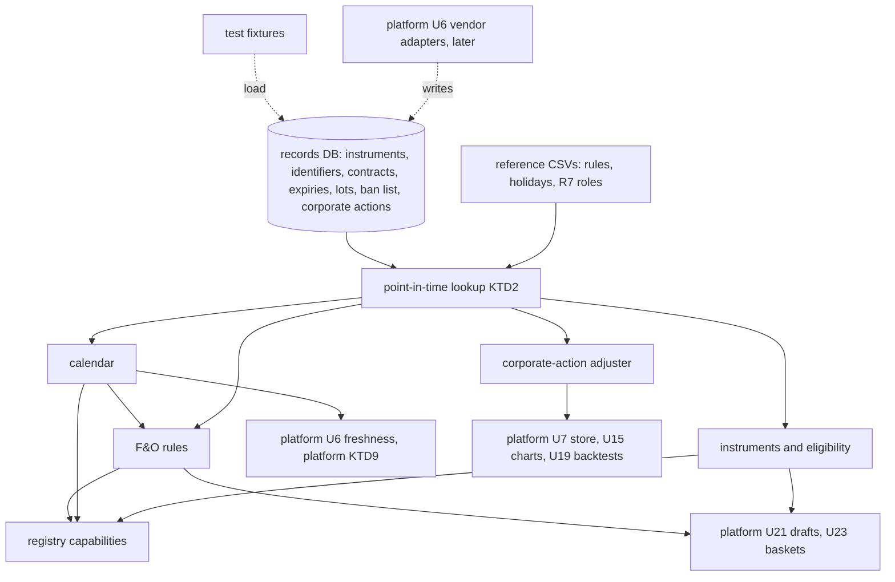
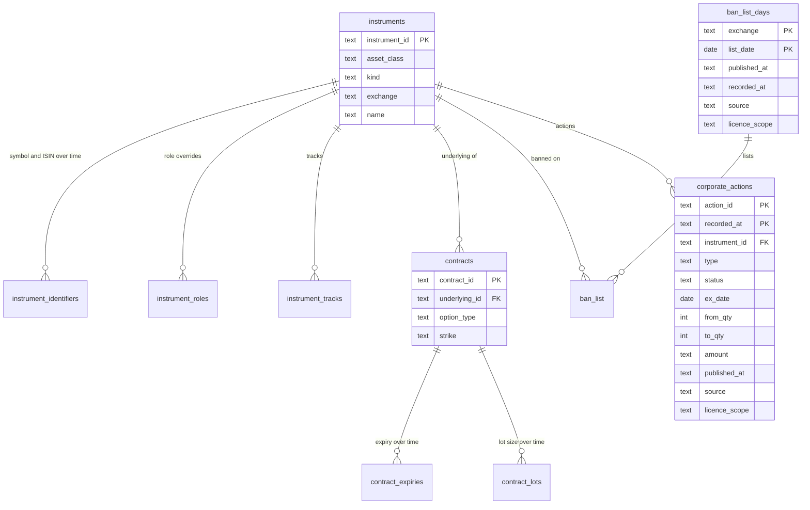
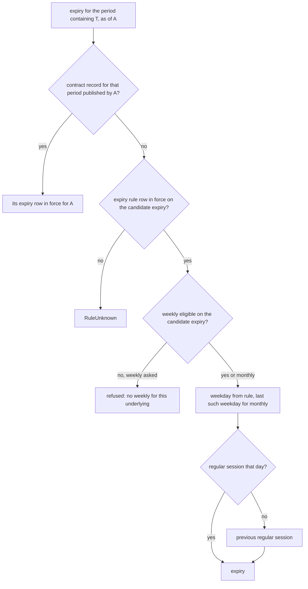

# U5 Instruments, Trading Calendar, F&O Rules and Corporate Actions - Plan

## Goal Capsule

- **Objective:** Any screen, backtest or agent answer that asks "what was this instrument, was the market open, and which contract rules applied on date D" gets the answer that was true on D, with its source cited. An analysis-only instrument can never reach a basket or an order draft, and a backtest never uses a rule from a different date.
- **Means:** a new `packages/data` (`axiom_data`) package whose lookups all go through one effective-dated row shape (KTD2), with circular-driven rules kept as cited CSV files and feed-driven data kept in records-DB tables (KTD1).
- **Authority:** the platform plan `docs/plans/2026-11-12-1110-feat-axiom-desk-platform-plan.md` governs; this plan is its U5 (platform R3, R7, R8, R108, R109, AE2, KTD9). Where they disagree, the platform plan wins. Requirement IDs below are local to this plan and cite the platform IDs they serve as "platform R…".
- **Execution profile:** one PR, the first of the platform's PR2 (data spine). Branch from `main`; stack on any unmerged predecessor per the repo's usual practice. Backend only.
- **Feature pipeline (CLAUDE.md):** groom (this plan), diagram (U1 step 1), UI step skipped because U5 has no screen, backend through `ce-work` or `ship`.
- **Stop conditions:** stop and ask if a vendor or NSE term forbids storing a dataset U5 loads (platform G1), or if a primary circular contradicts a rule row in a way that changes an implementation unit rather than a data row.
- **Who finishes:** the implementing agent. A desk member who can read SEBI and NSE circulars fills `verified_against` on rule rows (KTD9); that is not a merge gate.

---

## Product Contract

### Summary

Build the reference-data layer every later unit reads: the instrument master with R7 roles and basket eligibility, a per-segment trading calendar, effective-dated F&O rule tables, contract lot sizes, the daily ban list, and corporate-action adjustment of price history. Expose instrument lookup, the calendar and F&O rules as registry capabilities so screen, command bar and agent get the same answers.

### Problem Frame

SEBI changed index-derivative rules three times between Nov 2024 and Dec 2025: contract value and lot sizes reset, weeklies cut to one benchmark per exchange, NSE expiry moved to Tuesday, and position limits moved to delta-based OI. A backtest spanning those dates that reads today's rules prices the wrong lot, expires on the wrong day and counts weeklies that no longer existed. Freshness (platform KTD9) cannot tell an outage from a holiday without a session calendar. Charts and screens over unadjusted history show false gaps at every split and bonus. Every later data, quant, drafts and backtest unit (platform U6, U7, U9, U11, U19, U21, U23) needs these answers and needs them for the date it is working on, not for today.

### Requirements

**Instruments and roles**

- R1. Every instrument carries an asset class, and its R7 role comes from a dated role table, with per-instrument overrides as dated rows, never a code branch (platform R7).
- R2. An analysis-only instrument is refused as a basket member or order-draft leg with a reason, and the refusal lists investable India-listed instruments that track it on that date (platform R8, AE2).
- R3. An instrument keeps one internal id across symbol and ISIN changes, and a symbol lookup resolves to the instrument that held that symbol on the date asked.

**Trading calendar**

- R4. For each segment the calendar answers whether a timestamp is inside a session, and gives the previous and next session, counting exchange holidays and special sessions such as Muhurat trading and special Saturday sessions (platform KTD9).
- R5. A date past the last published holiday list is refused, never assumed to be a trading day.

**F&O rules and contract data**

- R6. Expiry weekday, weekly-expiry eligibility, minimum contract value, the expiry-day calendar-spread margin benefit and index position limits are rows with an effective date and a cited circular. Each lookup returns the row in force on the date the rule governs: the contract's expiry date for expiry weekday and weekly eligibility (KTD3), the asked date D for the rest (platform R108, R109).
- R7. A contract's expiry and lot size come from its contract record as known on D, and an expiry or lot size revised during a contract's life returns the old value for dates before the revision.
- R8. Ban-list status for an underlying on D comes from the daily ban list published for D, and a date whose list was never loaded is refused under R9 rather than read as "not banned" (platform R108).
- R9. A date with no row in force is refused with "rule unknown", never filled from a neighbouring row.
- R10. Every answer that used a rule row not yet checked against its primary document carries an "unverified rule" limitation in its envelope.

**Corporate actions**

- R11. History adjusted as of D applies every split and bonus with ex-date on or before D to bars before the ex-date and leaves later bars unchanged; volume adjusts by the inverse factor (platform R3).
- R12. Cash dividends leave price-adjusted history unchanged; a total-return mode applies them for the backtests and screens that ask for it (platform R3).
- R13. An action type the adjuster does not handle (rights, merger, demerger) leaves history unadjusted at that date and says so as a limitation.

**Point in time and surfaces**

- R14. Every lookup takes the date it answers for. Nothing defaults to today.
- R15. Instrument lookup, the trading calendar and F&O contract rules are registry capabilities with screen, command and agent bindings and parity fixtures (platform R4, KTD2).

### Acceptance Examples

- AE1. Covers R2 (platform AE2).
  - **Given:** the S&P 500 index (analysis-only) and an India-listed ETF that tracks it.
  - **When:** eligibility is asked for the index as a basket member on 2026-11-13.
  - **Then:** the answer is refused with reason "analysis-only", and the suggestion list contains the ETF.
- AE2. Covers R6, R14.
  - **Given:** the NSE Nifty weekly expiry rule rows.
  - **When:** the weekly expiry is resolved for the week of 2025-08-25 and for the week of 2025-09-01.
  - **Then:** the first is Thursday 2025-08-28 and the second is Tuesday 2025-09-02.
- AE3. Covers R9.
  - **Given:** a rule whose rows start on 2019-01-01.
  - **When:** the rule is asked for 2018-06-01.
  - **Then:** the lookup refuses with "rule unknown", naming the rule and date.

### Scope Boundaries

- Ingesting NSE, BSE or vendor files. Platform U6 adapters write these tables; this plan loads fixtures only.
- Computing delta-based (FutEq) OI and headroom. This plan owns the limit rows (platform R109); platform U11 computes exposure against them.
- Margin computation. This plan stores the expiry-day calendar-spread rule; the platform U21 margin validator applies it.
- Rules in research §4.3 that no table here stores: intraday position-limit monitoring (2025-04-01), revised MWPL and ban computation (2025-10-01) and intraday MWPL monitoring (2025-11-03). They govern how the exchange computes the ban list and limits, not a value a lookup returns; the golden table lists them as not stored (KTD8).
- Re-striking historical option chains after corporate actions. Adjusted contracts arrive as new contract records from the exchange contract master.
- Any screen. The desk screens that show these answers come with later units.
- Considered and not built:
  - Rights, merger and demerger adjustment factors: they need entitlement prices and cost-split ratios the feeds may not carry; R13 makes the gap visible. Revisit when a desk backtest hits one.
  - MWPL ban-entry thresholds: ban status comes from NSE's daily list (R8), so thresholds only matter for forecasting a ban, which no V1 unit does. The post-Oct-2025 thresholds are also unverified.
  - Audit replays of "what did we believe on date X": `recorded_at` (KTD2) is stored, so a `recorded_by` lookup argument can be added later without a data change.
  - Weekday-only fallback when the calendar runs out: R5 refuses instead, because a silent guess breaks expiry and freshness.
  - A wall-clock CI test or scheduled job warning before the holiday list runs out: a clock-dependent test turns every PR red each December, and R5's refusal already fails loudly. Revisit if a lapse reaches production.
  - Lot sizes for rule-derived contracts with no contract record: purchased history is expected to carry lot per contract (platform G1). Revisit if G1 samples lack it.

#### Deferred to Follow-Up Work

- Live loading of the instrument master, contract master, ban list and corporate actions (platform U6).
- Cross-checking real contract-master expiries against the expiry rule rows, which needs the real files platform U6 loads.
- Backfilling holiday calendars and rule rows to the start of purchased history once G1 fixes its depth.

---

## Planning Contract

### Key Technical Decisions

- KTD1. **Data lives where its changes come from.** Rules set by SEBI or exchange circulars, and the yearly holiday lists, are CSV files inside `axiom_data/reference/`, reviewed as PR diffs. Data a feed changes daily or per contract (instrument master, identifiers, role overrides, tracking links, contract expiries, lot sizes, ban list, corporate actions) lives in records-DB tables that platform U6 adapters write. Circular rows change a few times a year and the diff is the review; daily data must not need a release.
- KTD2. **One effective-dated row shape, two timestamps, one lookup primitive.** Every effective-dated row has `effective_from` (inclusive), `effective_to` (exclusive, open when null), `published_at` (when the source made the fact public: circular date, announcement time, list or file date), `recorded_at` (when the row entered Axiom) and `source`. Identity tables (`instruments`, `contracts`) and `corporate_actions` (KTD10) are the exceptions. The primitive resolves (key, on): among rows in force on `on` with `published_at` no later than the end of `on` in IST, the latest `recorded_at` wins. So a later correction or backfill applies to every past date it covers, and nothing published after `on` leaks into it. Two rows in force on the same date with the same `recorded_at` fail at load. No row in force raises `RuleUnknown` (R9).
- KTD3. **Expiry is resolved for a target period as of a date, and the contract record wins.** Inputs are (exchange, underlying, cycle, target date, `as_of`). Contract records are read as published by `as_of`. Expiry weekday and weekly eligibility are evaluated at the candidate expiry date, because the Sep 2025 change re-dated live contracts by their expiry (Assumptions). Contract expiry is a dated attribute (`contract_expiries`), like lot size, so a re-dated contract answers its old expiry for `as_of` dates before the re-dating. The weekday rule covers periods without contract records and contracts not yet listed. An expiry that falls on a day without a regular session moves to the previous regular session; special sessions (Muhurat, special Saturdays) do not count.
- KTD4. **Corporate-action ratios are two integers, `from_qty` and `to_qty`.** A split of 1 share into 2 is `(1, 2)`, price factor 1/2. A bonus of 1 new for every 1 held is `(1, 2)` too. Strings like "1:2" never enter the store, because sources disagree on which side is the new share count.
- KTD5. **IST is a fixed UTC+05:30 offset.** India has no daylight saving, so no tzdata dependency. Sessions are local open and close times per segment and date. Stored timestamps are normalised to UTC on write, so SQL text comparison of `published_at` and `recorded_at` orders correctly.
- KTD6. **U5 tables join core's single migration sequence** (`packages/core/src/axiom_core/migrations/0006_…` onward). `migrate()` runs one ordered directory over one records DB; a second runner for one package is not worth it. SQL stays portable for the Postgres move noted in `db.py`.
- KTD7. **Every row carries its source and licence scope.** CSV rule rows cite a circular and have scope `public`. DB rows carry the dataset name and the scope platform U6 declares for it. Capabilities return the sources of the rows they read, so the registry's entitlement check (`Registry.call`) works unchanged.
- KTD8. **Golden dates are a separate hand-kept table.** `packages/data/tests/fixtures/golden_rule_dates.csv` lists (rule, key, date, expected, circular) written from the circulars, independently of the rule CSVs, so the test is not the rule table checking itself. It carries a row for every change date in `docs/research/2026-11-12-options-benchmark.md` §4.3, which is the platform U5 verification gate; dates whose rule no table stores (Scope Boundaries) are rows marked not stored, so the list stays complete. A second test enumerates every change date from the rule CSVs and checks the day before and the day of (CLAUDE.md "every X" rule). The platform plan's G4 sign-off list does not include U5, so no quant sign-off gates this merge.
- KTD9. **Unverified rule rows ship, visibly.** Each CSV row has `verified_against` (the primary document read, by circular number and date). Empty means unverified, and answers using it carry R10's limitation. Rows start unverified because research read secondary sources only. The implementer cites the circular number on every row and fills `verified_against` only for a primary document actually read; filling it is not a merge gate.
- KTD10. **Corporate actions are versioned per action.** Primary key (`action_id`, `recorded_at`), with `published_at`, `status` (active or cancelled), `source` and `licence_scope`. As of D, the adjuster keeps the latest-recorded version of each `action_id` published by the end of D, drops cancelled ones, then applies those with `ex_date <= D`. A corrected ratio or moved ex-date therefore applies once, at its corrected values.
- KTD11. **Refusals are one error type the API maps to 422.** `RuleUnknown`, the calendar-horizon error and naive-timestamp refusals subclass a new `Refused` error in `packages/core/src/axiom_core/authz.py`, beside `Forbidden` and `NotFound`. `call_capability` in `services/api/src/axiom_api/app.py` today maps only those two, session errors and validation errors, so an unmapped refusal would be a 500.
- KTD12. **A ban list is known per day, not per banned stock.** `ban_list_days` holds one row per exchange and date whose list was loaded, empty lists included. Ban status for D with no such row raises `RuleUnknown` (R8, R9).

### High-Level Technical Design

Where data comes from and who reads it:



Records-DB tables. Every effective-dated table carries the KTD2 columns (`effective_from`, `effective_to`, `published_at`, `recorded_at`, `source`) plus `licence_scope`; only columns beyond those are drawn:



`instruments` and `contracts` are identity rows with no effective dates (they still carry `source` and `licence_scope`). `ban_list_days` and `corporate_actions` are keyed as drawn (KTD12, KTD10).

Expiry resolution for (exchange, underlying, cycle, target date T, `as_of` A), per KTD3:



### Output Structure

```text
packages/data/
  pyproject.toml
  src/axiom_data/
    __init__.py
    py.typed
    pointintime.py          effective-dated rows, lookup, RuleUnknown
    calendar.py
    instruments.py
    fno_rules.py
    corporate_actions.py
    capabilities.py         registry entries
    reference/
      holidays.csv          per segment, per date, with circular
      special_sessions.csv
      session_hours.csv
      asset_class_roles.csv
      expiry_rules.csv
      weekly_eligibility.csv
      contract_value.csv
      expiry_margin_rules.csv
      position_limits.csv
  tests/
    conftest.py
    fixtures/               instrument, contract, lot, ban and corporate-action rows; golden_rule_dates.csv
    test_pointintime.py
    test_calendar.py
    test_instruments.py
    test_fno_rules.py
    test_corporate_actions.py
    test_capabilities.py
packages/core/src/axiom_core/migrations/
  0006_instruments.sql
  0007_fno_contract_data.sql
  0008_corporate_actions.sql
```

### Rule Rows the Reference Tables Must Carry

Each row cites its circular. Dates come from `docs/research/2026-11-12-options-benchmark.md` §4.3 and `docs/research/2026-11-12-options-literature.md` §6.3, which read secondary sources only, so every row starts with `verified_against` empty (KTD9).

| Table | Change | Effective | Cited source |
|---|---|---|---|
| `contract_value.csv` | Index derivatives minimum contract value ₹15 lakh (from ₹5–10 lakh) | 2024-11-20 | SEBI/HO/MRD/TPD-1/P/CIR/2024/132 |
| `weekly_eligibility.csv` | One weekly benchmark per exchange: NSE Nifty 50, BSE Sensex; BankNifty, FinNifty, MidcapSelect weeklies end | 2024-11-20 | SEBI/HO/MRD/TPD-1/P/CIR/2024/132 |
| `expiry_margin_rules.csv` | No calendar-spread margin benefit on expiry day | 2025-02-01 | SEBI/HO/MRD/TPD-1/P/CIR/2024/132 |
| `expiry_rules.csv` | NSE weekly and monthly expiry Thursday to Tuesday; BSE to Thursday | expiries on or after 2025-09-01 | NSE circular (number to confirm; literature cites NSE 33/2025 as a lead) |
| `position_limits.csv` | Index options per PAN: ₹1,500 cr net FutEq end of day, ₹10,000 cr gross per side | 2025-12-06 | SEBI/HO/MRD/TPD-1/P/CIR/2025/79 |

Rows before these changes (the pre-Nov-2024 weekly days per index, the old contract value) are also needed for backtests over purchased history. Their exact days and start dates are filled from the circulars during U4, not from memory.

### Assumptions

- The Sep 2025 expiry change re-dated live contracts expiring after 2025-08-31, which is why expiry rules key on expiry date (KTD3). If the circular says otherwise, only `expiry_rules.csv` rows change.
- NSE held a special live session on Saturday 2025-02-01 (Union Budget). U2's special-session test uses it; confirm from the NSE circular before relying on it.
- Equity cash and equity F&O share one holiday list; currency and commodity segments have their own. U2 keys holidays by segment either way.
- Lot-size revisions can apply to contracts already listed, so lot size is a dated attribute of the contract, not of the underlying (R7).
- NSE ban notices, contract masters and corporate-action announcements are public, so fixtures built from them may be committed. Vendor-sourced versions of the same data carry the vendor's scope (KTD7).
- The holiday calendar's history starts at 2019-01-01 until G1 fixes the depth of purchased history.

### Sequencing

U1 first. U2 and U3 depend only on U1 and can run in parallel. U4 needs U2 (holiday shifts) and U3 (contracts reference instruments). U5 needs U3. U6 needs U2 to U5.

### Risks

| Risk | Mitigation |
|---|---|
| A secondary source got a rule date or weekday wrong | KTD9 limitation on every answer; a correction recorded later applies to every past date (KTD2); contract-master cross-check once platform U6 loads real files |
| Holiday list not updated for the next year | R5 refuses past the horizon; the Definition of Done records when coverage ends |
| Migration numbers 0006–0008 collide with another in-flight branch | Renumber at rebase; `migrate()` keys on file name, so only unapplied names may change |
| Look-ahead through facts published after D | Lookups filter on `published_at` (KTD2); corporate actions also on `ex_date <= D` (KTD10) |
| A missed ban-list load reads as "not banned" | `ban_list_days` coverage per date (KTD12) |
| Ambiguous split notation in feeds | KTD4 two-integer ratio; platform U6 adapters must map each vendor's notation, with a fixture per vendor |

### System-Wide Impact

- **Licence scope:** platform U6 must declare a scope for every dataset it writes into these tables; rows without one are refused at load (KTD7).
- **Backfill:** platform U6 must set `published_at` from the source, never from load time, or backfilled history is invisible to past dates (KTD2).
- **Errors:** a new `Refused` error in core and its 422 mapping in the API (KTD11) are available to every later unit.
- **Point in time:** downstream units must pass the date they work on. A unit that wants "now" passes today's IST date explicitly (R14).
- **Agent parity:** three new registry entries; the generated agent tool list and command index change.

---

## Implementation Units

### U1. `axiom_data` package and point-in-time rows

- **Goal:** a workspace package with the one effective-dated lookup every later unit uses.
- **Requirements:** R9, R10, R14; KTD2, KTD9, KTD11.
- **Dependencies:** none.
- **Files:**
  - `docs/diagrams/u5-reference-data.html` and its source under `docs/diagrams/src/`
  - `pyproject.toml` (workspace member, dependency, source)
  - `uv.lock`
  - `packages/core/src/axiom_core/authz.py` (`Refused`, KTD11)
  - `packages/data/pyproject.toml`
  - `packages/data/src/axiom_data/__init__.py`, `py.typed`
  - `packages/data/src/axiom_data/pointintime.py`
  - `packages/data/tests/conftest.py`
  - `packages/data/tests/test_pointintime.py`
- **Approach:**
  1. Diagram first with `archify` (CLAUDE.md pipeline step 2), from the High-Level Technical Design above.
  2. Package mirrors `packages/core/pyproject.toml` (hatchling, Python 3.12, depends on `axiom-core`). Reference CSVs ship as package data read through `importlib.resources`.
  3. The row type and lookup per KTD2. Lookups take `on` with no default (R14). `RuleUnknown` subclasses `Refused` (KTD11).
  4. CSV loader validates columns, dates, `source` and `verified_against`, and fails on overlapping rows.
  5. A lookup result carries the rows it used, so callers can emit sources (KTD7) and the R10 limitation.
- **Patterns to follow:** `packages/core/src/axiom_core/envelope.py` frozen dataclasses with `__post_init__` validation; `packages/core/tests/conftest.py` in-memory sqlite fixture with `migrate`.
- **Test scenarios:**
  - A row in force from 2024-11-20 answers for 2024-11-20 and not for 2024-11-19 (inclusive start).
  - A row ending 2025-09-01 does not answer for 2025-09-01 (exclusive end).
  - A date before the first row raises `RuleUnknown` naming the rule and the date.
  - A gap between two rows raises `RuleUnknown` for a date inside the gap.
  - Two rows for the same key and date with the same `recorded_at` fail at load.
  - A correction recorded today for a 2025 row is the answer for a 2025 lookup.
  - A row backfilled today with a 2023 `published_at` answers a 2023 lookup.
  - A row published on D+1 is not visible to a lookup on D.
  - A row with empty `verified_against` marks the result unverified; a filled one does not.
  - A naive `published_at` or `recorded_at` is rejected, and stored values are UTC (KTD5).
- **Verification:** `uv sync --locked` resolves the new member; pyright and ruff clean with no suppressions.

### U2. Trading calendar

- **Goal:** sessions per segment, with holidays and special sessions, for freshness and expiry shifts.
- **Requirements:** R4, R5, R14; KTD5; platform KTD9.
- **Dependencies:** U1.
- **Files:**
  - `packages/data/src/axiom_data/calendar.py`
  - `packages/data/src/axiom_data/reference/holidays.csv`, `special_sessions.csv`, `session_hours.csv`
  - `packages/data/tests/test_calendar.py`
- **Approach:**
  1. Session hours are effective-dated per segment (KTD2), so a future change to market hours is one row.
  2. A date has a regular session when it is a weekday and not a holiday. Special sessions (Muhurat, special Saturdays) are sessions with their own hours but not regular sessions, so they count for freshness and session queries and not for the expiry shift (KTD3).
  3. Queries: regular-session day for (segment, date), session containing a zoned timestamp, previous and next session from a timestamp, sessions in a date range.
  4. The calendar knows its horizon (the last date the holiday list covers) and refuses past it with a `Refused` subclass (R5, KTD11).
  5. Holiday rows cite NSE's yearly holiday circular per year.
- **Patterns to follow:** U1 lookup.
- **Test scenarios:**
  - A listed exchange holiday has no session, and the next session is the following trading day's open (platform U5 scenario).
  - Friday 15:31 IST gives next session Monday 09:15 IST when Monday is not a holiday, and the following Tuesday when it is.
  - The special Saturday session on 2025-02-01 has a session with its own hours and is not a regular-session day.
  - A Muhurat session is open only inside its published window, and its date is not a regular-session day.
  - 09:14:59 IST is outside the session and 09:15:00 is inside; 15:30:00 is outside (exclusive close).
  - A naive timestamp is refused.
  - A date one day past the horizon raises the horizon error, and so does a range that crosses it. Tests use fixed dates, never the wall clock.
- **Verification:** every holiday row cites a circular; tests pass.

### U3. Instruments, R7 roles and basket eligibility

- **Goal:** one instrument identity over time, its R7 role on any date, and the eligibility answer drafts and baskets will call.
- **Requirements:** R1, R2, R3, R14; KTD1, KTD6, KTD7; platform R7, R8, AE2.
- **Dependencies:** U1.
- **Files:**
  - `packages/core/src/axiom_core/migrations/0006_instruments.sql`
  - `packages/data/src/axiom_data/instruments.py`
  - `packages/data/src/axiom_data/reference/asset_class_roles.csv`
  - `packages/data/tests/fixtures/instruments.json`
  - `packages/data/tests/test_instruments.py`
- **Approach:**
  1. Migration adds `instruments`, `instrument_identifiers`, `instrument_roles` (overrides) and `instrument_tracks`, per the ERD.
  2. `asset_class_roles.csv` encodes the platform R7 table as rows, one role per asset class. Roles: basket-eligible, broker-executable only, tracking only, investable while open to inflows, analysis-only, out of scope.
  3. Role on D: an override row in force wins, else the asset-class row. International FoFs closing to inflows is an override row, not a code path.
  4. Eligibility takes a purpose (basket member or order-draft leg) and returns allowed, conditional with its condition named, or refused with reason. Broker-executable only (G-Secs, T-bills, SDLs) returns conditional on the tenant's broker; platform U23 resolves the condition. Tracking-only (corporate bonds) is allowed as a basket tracking member and refused as an order-draft leg.
  5. Refusals list investable instruments with a `instrument_tracks` row to the refused one in force on D (R2).
  6. A loader writes fixture or feed rows and refuses rows without `source`, `licence_scope` or `published_at` (KTD2, KTD7). Platform U6 reuses it.
- **Patterns to follow:** `packages/core/src/axiom_core/runs.py` for SQL inside `with self._conn`; `jobs.py` for row mapping.
- **Test scenarios:**
  - Covers AE1. The S&P 500 index is refused as a basket member with reason analysis-only, and the suggestions contain the fixture ETF that tracks it.
  - The same index is refused as an order-draft leg.
  - An NSE equity is allowed as a basket member and an order-draft leg.
  - A G-Sec is conditional, naming broker execution as the condition.
  - A corporate bond is allowed as a basket tracking member and refused as an order-draft leg.
  - An international FoF is allowed before its closed-to-inflows override date and refused from it.
  - A tracking ETF whose tracking row ended before D is not suggested on D.
  - A symbol renamed on date X resolves to the same instrument id before and after X, and the old symbol does not resolve after X.
  - Every asset class in `asset_class_roles.csv` has a role on 2026-11-13, enumerated from the file.
  - A row without `licence_scope` is refused at load.
- **Verification:** tests pass; migration applies on a fresh DB and on a DB already at 0005.

### U4. F&O rules, contract records and ban list

- **Goal:** the contract rules in force on any date, and the expiry, lot and ban answers drafts and backtests need.
- **Requirements:** R6, R7, R8, R9, R10, R14; KTD2, KTD3, KTD8, KTD9, KTD12; platform R108, R109.
- **Dependencies:** U2, U3.
- **Files:**
  - `packages/core/src/axiom_core/migrations/0007_fno_contract_data.sql`
  - `packages/data/src/axiom_data/fno_rules.py`
  - `packages/data/src/axiom_data/reference/expiry_rules.csv`, `weekly_eligibility.csv`, `contract_value.csv`, `expiry_margin_rules.csv`, `position_limits.csv`
  - `packages/data/tests/fixtures/contracts.json`, `ban_list.json`
  - `packages/data/tests/fixtures/golden_rule_dates.csv`
  - `packages/data/tests/test_fno_rules.py`
- **Approach:**
  1. Migration adds `contracts`, `contract_expiries`, `contract_lots`, `ban_list_days` and `ban_list`, per the ERD.
  2. Rule CSVs hold the rows in "Rule Rows the Reference Tables Must Carry", plus the pre-change rows, each citing its circular (KTD9).
  3. Expiry resolution per KTD3 and the expiry flowchart, using U2's regular sessions for the shift.
  4. Expiry and lot size per contract from `contract_expiries` and `contract_lots` (R7). Minimum contract value is returned as a rule for validators; this unit does not reject contracts against it.
  5. Ban status on D per KTD12.
  6. One function returns the contract rules for (exchange, underlying, D): expiry weekday per cycle, weekly eligibility, minimum contract value, expiry-day calendar-spread benefit, position limits, and ban status, with the sources and any R10 limitation.
- **Execution note:** write `golden_rule_dates.csv` from the circulars and research §4.3 first, then the rule CSVs, so the golden rows are not copied from the tables they test (KTD8).
- **Patterns to follow:** U1 lookup; U3 loader.
- **Test scenarios:**
  - Covers AE2. Nifty weekly for the week of 2025-08-25 is Thursday 2025-08-28; for the week of 2025-09-01 it is Tuesday 2025-09-02 (platform U5 scenario).
  - Nifty monthly for Aug 2025 is 2025-08-28 and for Sep 2025 is 2025-09-30.
  - A rule-derived expiry on an exchange holiday moves to the previous regular session.
  - The Nifty weekly for the week of 2025-10-20 resolves to Monday 2025-10-20, because Tuesday 2025-10-21 is a holiday with only a Muhurat session (confirm against the NSE circular).
  - As of 2024-11-15, a BankNifty weekly for the week of 2024-11-25 is refused as not weekly-eligible; a BankNifty weekly for the week of 2024-11-11 resolves.
  - As of 2025-07-15, the Sep 2025 Nifty monthly does not use contract records published after 2025-07-15.
  - A contract re-dated from 2025-09-25 to 2025-09-30 answers 2025-09-25 as of dates before the re-dating was published and 2025-09-30 after.
  - Minimum contract value is the old value on 2024-11-19 and ₹15 lakh on 2024-11-20.
  - The calendar-spread benefit on expiry day is available on 2025-01-31 and not on 2025-02-01.
  - A contract whose lot was revised mid-life returns the old lot before the revision and the new lot from it (platform U5 scenario).
  - A stock in the ban list on D is banned on D and not on D+1 when D+1's list is loaded without it.
  - Ban status on a date with no `ban_list_days` row raises `RuleUnknown`, even for a stock with no ban rows.
  - Covers AE3. A rule asked for a date before its first row raises `RuleUnknown`.
  - An answer built on an unverified row carries the R10 limitation, and one built only on verified rows does not.
  - Every row in `golden_rule_dates.csv` matches the lookup, and the file has a row for every change date in research §4.3 (KTD8).
  - For every change date enumerated from the rule CSVs, the day before returns the old row and the day of returns the new one (KTD8).
- **Verification:** tests pass; each rule CSV row cites a circular.

### U5. Corporate actions and adjusted history

- **Goal:** adjusted bars as of any date, for charts, screens and backtests.
- **Requirements:** R11, R12, R13, R14; KTD4, KTD10; platform R3.
- **Dependencies:** U3.
- **Files:**
  - `packages/core/src/axiom_core/migrations/0008_corporate_actions.sql`
  - `packages/data/src/axiom_data/corporate_actions.py`
  - `packages/data/tests/fixtures/corporate_actions.json`
  - `packages/data/tests/test_corporate_actions.py`
- **Approach:**
  1. Migration adds `corporate_actions` per the ERD; ratios per KTD4, cash amounts as decimal text.
  2. Actions used for "as of D" per KTD10.
  3. Split and bonus: price factor `from_qty / to_qty` on bars dated before the ex-date, volume by the inverse. Factors multiply across actions.
  4. Total-return mode adds cash dividends: factor `1 - amount / close` using the close on the trading day before the ex-date (from the bars passed in).
  5. Rights, merger and demerger rows leave bars unchanged and return a limitation naming the type and ex-date (R13).
  6. The adjuster takes bars as plain rows and returns new rows plus limitations; platform U7 supplies real series later.
- **Patterns to follow:** U3 loader for rows.
- **Test scenarios:**
  - A split of 1 into 2 halves prices and doubles volume before the ex-date, and leaves the ex-date bar and later unchanged (platform U5 scenario).
  - A bonus of 1 for every 1 held (`(1, 2)`) gives the same factor as that split.
  - Two splits multiply: bars before both get both factors, bars between get one.
  - As of a date before the ex-date, the action is not applied.
  - An action published after D is not applied as of D even though its ex-date is before D (late announcement).
  - A bonus ratio corrected in a later version applies once, at the corrected ratio, as of dates after the correction was published.
  - An action cancelled before D is not applied as of D.
  - An action whose ex-date moved applies only at the corrected ex-date.
  - A cash dividend leaves price-adjusted bars unchanged.
  - Total-return mode with a ₹10 dividend and a prior close of ₹1,000 scales earlier bars by 0.99.
  - Total-return mode with no bar before the ex-date returns a limitation instead of guessing a close.
  - A demerger leaves bars unchanged and returns its limitation.
  - A ratio with zero or negative quantity is refused at load.
- **Verification:** tests pass; results match a worked example kept in the fixture file.

### U6. Registry capabilities and API wiring

- **Goal:** screen, command bar and agent get the same instrument, calendar and F&O answers.
- **Requirements:** R10, R15; KTD7, KTD11; platform R4, KTD2, KTD3.
- **Dependencies:** U2, U3, U4, U5.
- **Files:**
  - `packages/data/src/axiom_data/capabilities.py`
  - `services/api/pyproject.toml` (add `axiom-data`)
  - `services/api/src/axiom_api/app.py` (`build_services` registers the three entries; `call_capability` maps `Refused` to 422 per KTD11)
  - `packages/registry-ts/generated/agent-tools.json`, `command-index.json`, `packages/registry-ts/src/generated.ts` (regenerated)
  - `services/api/tests/test_parity.py` (seed fixture instruments in the `services` fixture)
  - `packages/data/tests/test_capabilities.py`
- **Approach:**
  1. Three read entries, `Action.READ`, all bindings, version `"1"`: `instrument_lookup` (symbol or id, date, optional purpose; returns identity, role and eligibility with suggestions), `trading_calendar` (segment, date or timestamp; returns the trading-day answer and adjacent sessions), `fno_contract_rules` (exchange, underlying, date).
  2. Each handler returns `HandlerResult` with `as_of` at the end of the asked date in IST, the sources of the rows used (KTD7), and the R10 and R13 limitations.
  3. Parity fixtures use fixture-backed symbols. The shared parity test's `services` fixture seeds a few `public`-scope instrument, contract and ban-list-day rows through the U3 loader, since `packages/data/tests/fixtures/` is not importable from `services/api`; no assertion changes.
  4. Regenerate with `python -m axiom_api.codegen` and commit the output.
- **Patterns to follow:** `packages/core/src/axiom_core/capabilities.py` (`latest_run`); `services/api/src/axiom_api/app.py` registration.
- **Test scenarios:**
  - Covers AE1. `instrument_lookup` for the S&P 500 index with purpose basket member returns refused plus the tracking ETF, and the same result id on the API and agent surfaces.
  - `fno_contract_rules` for Nifty on 2025-09-02 cites the expiry circular as a source and carries the unverified limitation while the row is unverified.
  - `trading_calendar` on a holiday returns no session and the next session.
  - A source whose scope the tenant lacks is refused by the registry, using a DB row with a non-public scope.
  - A date past the calendar horizon, and a rule asked before its first row, each return 422 with the refusal message through the API, not a 500.
  - The parity test passes for all registered capabilities, enumerated from the registry.
- **Verification:** `codegen --check` clean; parity marker green; generated tool list matches the registry.

---

## Verification Contract

| Gate | Command | Proves |
|---|---|---|
| Lock | `uv sync --locked` | new workspace member resolves, no new third-party dependency |
| Lint and types | `uv run ruff check .`, `uv run ruff format --check .`, `uv run pyright` | no suppressions |
| Tests | `uv run pytest` | U1–U6 scenarios, including golden rule dates and the every-change-date test |
| Parity | `uv run pytest -m parity` | three new capabilities answer identically on every surface |
| Generated files | `uv run python -m axiom_api.codegen --check` | TypeScript client and tool list match the registry |
| Secrets | `uv run python tools/check_secrets.py --range origin/main..HEAD` | no secrets in fixtures |
| Mutation | remove the holiday shift, the `published_at` filter, latest-`recorded_at` selection, the `ban_list_days` check, the exclusive `effective_to` and the analysis-only refusal one at a time | each named test fails (CLAUDE.md coverage rule) |
| Review | `ponytail:ponytail-review` on the full diff | merge gate |

`uv run pytest -m golden` stays empty for U5: the platform plan reserves the golden marker for quant-signed numbers (U9 and later), and U5's golden dates are ordinary tests.

---

## Definition of Done

- Every R1–R15 has a passing test named in U1–U6, and the mutation checks above each made their test fail.
- Every rule CSV row and holiday row cites its circular. Rows not yet read against the primary document have empty `verified_against`, and answers using them carry the R10 limitation.
- `docs/diagrams/u5-reference-data.html` exists.
- `holidays.csv` covers 2027 if NSE has published the 2027 list by merge; otherwise the PR description states the date coverage ends, after which R5 refuses.
- CI green on GitHub.
- No abandoned experiment code, no `shortcut:` notes that no longer hold, and no vendor-licensed data committed as fixtures.

---

## Open Questions

- Which NSE circular moved weekly and monthly expiry to Tuesday, and did it re-date live contracts? Fills the `expiry_rules.csv` citation and confirms KTD3's keying. Not blocking: the row ships unverified.
- Should rule rows be verified against primary documents before platform U19 backtests or U21 drafts merge? Recommendation: yes, as a check in those units' plans; not a U5 gate.
- How far back must the calendar and rule rows go? Set by the depth of purchased history (platform G1).
- NSE adjusts F&O contracts for extraordinary dividends above a threshold (UNVERIFIED value). Confirm the contract master carries the adjusted strikes and lots, so U5 needs no rule for it.

## Sources

- Platform plan U5, R3, R7, R8, R108–R110, AE2, KTD8, KTD9, KTD14, G1, G4: `docs/plans/2026-11-12-1110-feat-axiom-desk-platform-plan.md`.
- `docs/research/2026-11-12-options-benchmark.md` §4.1 (ban list), §4.3 (SEBI 2024–25 rule changes); `docs/research/2026-11-12-options-literature.md` §6.3. Secondary sources, primary circulars not read.
- Existing code: `packages/core/src/axiom_core/registry.py` (`Capability`, `Registry.call` entitlement check), `envelope.py` (`HandlerResult`, `Source`), `runs.py`, `capabilities.py`, `db.py` (`migrate`, sqlite shortcut), `services/api/src/axiom_api/app.py` (`build_services`), `services/api/tests/test_parity.py` (enumerates every capability).
- Sibling plans for conventions: `docs/plans/2026-11-13-1804-feat-desk-sign-in-plan.md`, `docs/plans/2026-11-13-1108-feat-landing-page-plan.md`.
