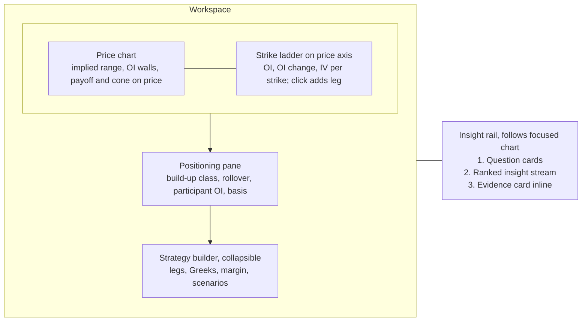
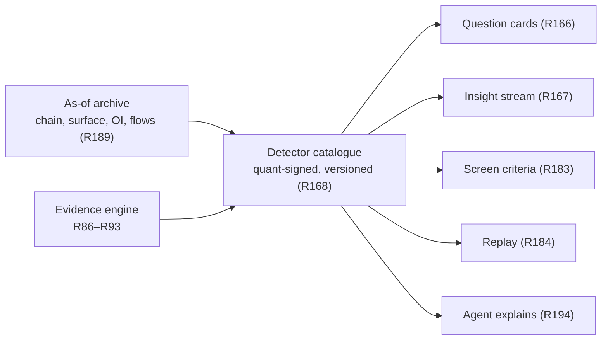

# Axiom Charts - Plan

## Goal Capsule

- **Objective:** A desk trader opens one chart and gets everything needed to decide on an Indian F&O or equity instrument: price, strikes, positioning, volatility, and what the evidence says, each with its base rate. The desk stops opening TradingView for charts and Sensibull, Opstra or Tradl for position building.
- **Means:** An options-native chart with strikes on the price axis and the strategy builder on the chart. An insight rail driven by a quant-specified detector catalogue. Cross-stock pattern twins. An AI screener builder that backtests itself. Point-in-time replay across all of it.
- **Product authority:** Extends `docs/plans/2026-11-12-1110-feat-axiom-desk-platform-plan.md` (the platform plan), units U14–U17, and proposes amendments to R12, R20, R110, R116, R126, KTD6 and units U7, U12, U18 and U19, listed under Platform Plan Amendments. Platform R-IDs are not edited here. New IDs continue the platform plan's sequences: R155+, F11+, AE21+. Where this contract and the platform plan disagree, the platform plan stands until an amendment is accepted into it.
- **Open blockers:**
  - The U14 renderer decision is open. SciChart was not run (no licence key), the R126 timed tasks were not run (no named desk testers), and 16 charts with the rail open has never been measured.
  - `DESIGN.md` has no chart-pane tokens. G5 blocks chart screen work until it does.
  - Desk quants have not specified the V1 detector catalogue (R169).

---

## Product Contract

### Summary

Axiom Charts becomes an options-native workbench. Strikes, OI and surface IV sit on the price axis, and strategies are built by clicking strikes and drawn as payoff on the price chart. An insight rail beside the focused chart answers a few desk questions per instrument, then streams evidence-graded insights from quant-signed detectors. Equity charts find pattern twins across stocks and show past analogs, winners and losers. An AI screener builder backtests every screen point-in-time, reports its efficacy, and says plainly when no tweak improves it. Replay restores all of this exactly as known at any past moment.

### Problem Frame

Desk traders read price in TradingView, then switch to Sensibull, Opstra or Tradl to build and size the position. They read OI build-up, rollover, participant positioning and vol context by hand across tabs. No tool connects those signals to the instrument on screen, says how often each signal has meant anything before, or explains why one strike is a better fit than another for a stated objective.

TradingView is weakest exactly here for an Indian F&O desk (checked 2026-11-13, sources below):

- No IV rank, IV history, smile or surface.
- Per-strike OI only through community scripts. No native PCR, max pain or participant OI (UNVERIFIED absence).
- No options or futures screener.
- Patterns carry no hit rates or sample sizes.
- Replay is not point-in-time.
- Real-time NSE F&O for a professional desk needs an exchange agreement and the top tier.

Its options strategy builder and AI Copilot mean that a payoff diagram and a chart-drawing assistant do not set Axiom apart. Positioning, the arbitrage-free surface, evidence and point-in-time correctness do.

Equity charts have the same gap. Patterns are shown without the story of what followed past occurrences. Screens are built without any measure of whether they ever worked, so the desk backtests them separately in Excel or Python.

### Key Decisions

- **The wedge is the options-native chart.** Evidence on the chart, point-in-time replay and speed are kept as supporting pillars, not the lead. Governs R155–R164. (session-settled: user-approved — chosen over evidence-on-chart, point-in-time replay and speed-plus-agent as the primary wedge: TradingView is weakest for NSE F&O.)
- **The chart owns the strategy builder, point-in-time replay, cross-stock pattern twins and 16 synced charts.** Governs R155–R158, R173–R176, R184–R189, R190. (session-settled: user-directed — all four chosen over leaving them where the platform plan put them.)
- **The AI screener builder is fully in this contract.** Governs R177–R183. (session-settled: user-directed — chosen over charts owning only the screener joins, and over dropping the screener: the user wants one contract for the whole loop.)
- **Strikes are ranked by evidence for a stated objective, never called favourable.** Stories show winners and losers. Governs R159, R171, R175. (session-settled: user-approved — chosen over direct "favourable strike" language everywhere and over a direct desk voice with a neutral retail voice: keeps R17, R77 and broker SEBI exposure intact.)
- **Insights sit in a rail beside the focused chart.** The strike ladder is on the price axis, with the positioning pane and a collapsible builder below. Governs R165, R172. (session-settled: user-approved — chosen over all-on-chart pins and a 50/50 chart-plus-workbench split, judged on a rough layout sketch.)
- **A quant-specified detector catalogue powers the rail, led by question cards.** The agent only explains. Governs R166–R170, R194. (session-settled: user-approved — chosen over a stream with no question cards and over an agent-written narrative: the engine computes every number, per KTD5, and TradingView Copilot already does narrative.)
- **When no screen tweak survives testing, the builder says so.** Governs R180, R181. (session-settled: user-approved — chosen over showing the best in-sample tweak with a warning: in-sample winners invite overfitting.)
- **Everything ships in sequence, with no MVP cut.** (session-settled: user-directed — chosen over a one-month index-only slice: the user wants every piece built one by one.)
- **"Easy" is measured, and the look is designed elsewhere.** Ease is judged by timed tasks against TradingView. Finish and motion come from the repo's design pipeline (DESIGN.md, ui-ux-pro-max, impeccable) under G5. Governs R192, R195.
- **No 3D on chart panes.** The volatility surface in 3D lives in the Volatility Lab. Chart panes keep the renderer's frame budget, per the repo's UI constraints.

### Actors

Uses the platform plan's actors: A1 desk user (traders, PMs, analysts, quants) and A5 Axiom agent. Desk quants, part of A1, specify and sign off every detector, question card and screen-efficacy statistic.

### Requirements

**Options-native chart**

- R155. On any F&O underlying or contract chart, the price axis carries a strike ladder showing per-strike OI, OI change and surface IV (R68) at each strike's price level, for a selected expiry.
- R156. Clicking a strike on the ladder adds a leg to an on-chart strategy, and a leg moves by dragging it along the strike axis or across expiries.
- R157. The on-chart strategy draws its payoff at expiry and at a chosen date, breakevens, max profit and loss, and a probability cone from the surface directly on the price chart, with the R38 outputs in the builder below.
- R158. Dragging spot, IV or time reprices the on-chart strategy live, extending R121 to strategies not yet traded.
- R159. For an objective the user states, the chart ranks strikes and expiries. Example objectives: cheapest vega per rupee, highest theta per unit of risk, best liquidity at a target delta, cheapest protection to a level. Each ranked strike shows the metric, bid-ask cost, liquidity and evidence, and is never labelled favourable, buy or sell.
- R160. Each expiry shows one F&O-implied range combining implied-move bands (R115), OI walls, pin probability (R78) and positioning, with the base rate of the underlying settling inside such ranges.
- R161. OI walls and positioning-derived support and resistance levels are drawn on price with their strength, today's shift, and their historical hold rate per R86–R93.
- R162. The positioning pane (R114) adds rollover percentage and cost against their own history, participant-wise OI changes (FII, DII, Pro, Client) and futures build-up class over time.
- R163. Every options-native element reads one chain and surface snapshot and shows its as-of time and freshness per KTD9. An element whose input is unavailable is hidden with the reason shown.
- R164. An on-chart strategy can be sent to a multi-leg ticket draft per R55. The chart never places an order.

**Insight rail**

- R165. Each layout has one insight rail that follows the focused chart and covers only that chart's instrument.
- R166. The rail opens with question cards answering a fixed set of desk questions per instrument class. For F&O: where it is likely to settle by expiry, who is positioned and how that is changing, whether vol is cheap or rich, and what the current setup usually does. For equities: what pattern is forming and what usually follows, who is accumulating, and where it ranks in its sector.
- R167. Below the cards, the rail streams insights ranked by significance per R117, within the user's budgets per R118.
- R168. Every question-card answer and insight comes from a versioned detector in a catalogue that desk quants specify and sign off, and the agent explains detector outputs without computing new numbers (KTD5).
- R169. The V1 F&O detector catalogue covers:
  - long build-up, short build-up, short covering and long unwinding, at contract and strike level
  - rollover against its base
  - OI walls and their shifts
  - participant-wise OI shifts
  - PCR and max-pain changes
  - basis anomalies
  - IV against RV and VRP bucket state (R146)
  - skew and term-structure shifts
  - pin candidates and unusual activity
- R170. Every insight opens an evidence card per R86–R93: base rate, sample, confidence interval, out-of-sample status, and what followed past occurrences, failures included. Otherwise it shows insufficient evidence per R95.
- R171. Each insight tells its story in plain language: what changed, against what normal, what historically followed, and what would invalidate it. The text never uses buy, sell, favourable or assured wording (R17, R77).
- R172. Selecting an insight highlights its strike, level or time on the chart, and selecting a chart object shows the insights attached to it.

**Pattern twins and stories**

- R173. From a detected pattern or a user-selected chart region, "find twins" returns instruments across the R7 universe whose current price action matches, ranked by similarity, each with its evidence card.
- R174. The same request returns past analogs from any instrument, drawn from a point-in-time universe that includes delisted names (R153). Their forward paths are drawn as the R116 fan, with winners, losers and the split shown.
- R175. A pattern's story names the conditions that separated analogs that worked from those that failed, such as regime, volume, sector strength or F&O positioning, only where the difference passes R90. Otherwise it says no distinguishing condition was found.
- R176. Every twin search, analog split and story condition counts as a tested variant under R90.

**AI screener builder**

- R177. A user builds a screen by typing or saying it in plain language or by editing criteria, and confirms the structured criteria before the screen runs.
- R178. Every saved screen is backtested automatically and point-in-time. The universe is taken as of each date with delisted names (R153), fundamentals as reported, prices corporate-action adjusted (R3), and history split at SEBI rule-change dates (R110).
- R179. Screen efficacy shows the forward returns of matches against the universe base rate at stated horizons, with hit rate, sample size, confidence interval, turnover, after-cost expectancy, decay over time and regime-conditioned results, per R86–R93.
- R180. The builder suggests criteria to add or remove, and presents a suggestion as an improvement only when it passes R88–R90 out of sample with every tried variant counted.
- R181. When no suggestion passes, the builder says no improvement was found and lists what was tried, how many variants, and why each failed.
- R182. A saved screen tracks its live matches forward, and its live efficacy is shown separately from its backtest.
- R183. Screen criteria can use equity fields, the F&O screens in R80, detected patterns and rail detectors. Every result opens into a chart with the matching criteria highlighted (R27).

**Point-in-time replay**

- R184. Replay restores everything on the chart surface for the replayed timestamp, exactly as known then: chart, chain, surface, OI, positioning, rail, question cards, patterns, evidence cards and screen results. Nothing computed with later data appears.
- R185. Evidence statistics shown in replay use only history available before the replayed timestamp.
- R186. Replay runs synced across every chart in a layout, at selectable speeds, in tick, second or bar steps wherever the data supports that step.
- R187. During replay a user can build on-chart strategies and paper-trade them, with fills at that moment's bid-ask and costs.
- R188. Alerts and triggers evaluate in replay as replay events and never send a live notification.
- R189. Chain, surface and every detector output can be read as of any past timestamp in the archive.

**Layout, speed and ease**

- R190. A layout holds up to 16 charts synced by symbol, interval, crosshair, time and date range. Drawings sync across charts of the same underlying, including its futures and options contracts, and time-only drawings sync across all charts.
- R191. With 16 charts taking live ticks and the rail open, the chart holds at least 60 fps, with p95 frame time at most 16.7 ms and no frame over 50 ms in a 10-minute session.
- R192. Every chart tool has a keyboard path and a command-bar entry (R127), and the most-used tools take one keystroke.
- R193. The strike ladder, rail and positioning pane are on by default for F&O charts and off for others, within the U17 overlay budget.
- R194. The agent can build an on-chart strategy, rank strikes, find twins, build and explain a screen, and start a replay on request, with the same results as the screen (R4). It explains any rail item by citing its detector and evidence card.
- R195. The R126 timed-task set adds six tasks:
  - build a short straddle on the chart
  - read the implied range to expiry
  - rank strikes for an objective
  - find twins of a pattern
  - build and backtest a screen
  - start a synced replay

### Visualizations

The layout chosen for the focused chart (rough probe; final layout comes from the design pass):

One detector catalogue feeds every surface, live and in replay:

### Key Flows

- F11. Instrument to strategy draft
  - **Trigger:** A trader opens BankNifty from the command bar.
  - **Steps:** The ladder, positioning pane and rail load for the nearest expiry. The trader reads the "where will it settle" card and the short-covering insight, and opens its evidence card. They rank strikes for "highest theta per unit of risk", click two strikes to build a strangle, drag IV down 2 points to see P&L, and send it to a ticket draft.
  - **Covers:** R155–R160, R164, R166, R170.
- F12. Pattern to twins to screen
  - **Trigger:** A flag is detected on an equity chart.
  - **Steps:** The rail explains the pattern and its story. The trader asks for twins, sees six current matches and the analog fan, and saves the twin set as a screen. The screen backtests automatically.
  - **Covers:** R173–R176, R177–R179.
- F13. Screen build and improve
  - **Trigger:** The analyst types "stocks above 200 DMA with rising delivery and FII buying in sector".
  - **Steps:** The analyst confirms the parsed criteria. The backtest reports efficacy against the base rate. They ask for improvements and get either passing suggestions or "no improvement found" with the tried list. They save the screen, and live tracking starts.
  - **Covers:** R177–R183.
- F14. Replay session
  - **Trigger:** The trader replays the expiry day of a past week across a 4-chart layout.
  - **Steps:** Chain, rail and patterns appear as they were known then. The trader paper-trades a straddle at that moment's bid-ask. A trigger hit shows as a replay event.
  - **Covers:** R184–R188.

### Acceptance Examples

- AE21. **Covers R159, R171.** The user ranks puts for "cheapest protection to 22,000 by expiry". The list shows cost, bid-ask and liquidity per strike, and no row or label says favourable, buy or sell.
- AE22. **Covers R163.** The surface goes stale at 10:42. Ladder IV, the probability cone and the implied range hide with "surface stale since 10:42", while OI stays visible.
- AE23. **Covers R170.** A short-covering insight on a thinly traded stock option has a sample below the R88 minimum. Its card shows insufficient evidence, not a hit rate.
- AE24. **Covers R180, R181.** The user asks to improve a screen. 40 variants are tried and none survives correction. The builder shows "No improvement found", the count of 40, and why the best candidate failed.
- AE25. **Covers R184, R185.** In replay at 10:30 on a past date, the rail shows a short-covering insight detected at 10:28 and not one detected at 11:00. Its base rate uses data before that date only.
- AE26. **Covers R188.** A price trigger is crossed during replay. It is logged as a replay event and no email or in-app live alert is sent.
- AE27. **Covers R174.** The analogs for a cup-and-handle include a since-delisted company whose pattern failed, and it counts in the loser split.
- AE28. **Covers R165.** With 16 charts open, focus moves from chart 3 to chart 11. The rail switches to chart 11's instrument and shows nothing from chart 3.
- AE29. **Covers R164.** Sending an on-chart iron condor creates a four-leg ticket draft awaiting confirmation, and no order exists until the user confirms it in the broker flow.

### Success Criteria

- The desk does daily charting and position building in Axiom without opening TradingView, Sensibull, Opstra or Tradl. This counts toward the platform V1 gate.
- In the R126 and R195 timed tasks with named desk users, Axiom's median time beats TradingView's on every task TradingView supports. Tasks TradingView cannot do are recorded as unsupported there.
- The R191 frame budget holds in the U14 harness with 16 charts and the rail open.
- Every detector in the catalogue appears in the Edge Ledger (R144) and is demoted when it stops beating its base rate.

### Scope Boundaries

**Deferred for later**

- Retail-client voice, plain-language layer and RA routing for rail content and screens (V2, per R60, R62, R125).
- Pine-like scripting (V1.5+, per R15).
- Footprint and TPO, plus replay of them (V1.5, per R49).
- Webhook and messaging alert delivery (V1.5, per R128).
- Detectors beyond the R169 catalogue and equity question cards beyond R166. Each is added after quant sign-off.

**Outside this product's identity**

- Placing or routing orders from the chart.
- Naming entities behind positioning or calling activity manipulation (R77).
- Outcome language that promises or reassures ("assured", "favourable", "sure-shot").
- An agent-written narrative that computes its own numbers.
- 3D or HyperFrames content on chart panes.

### Platform Plan Amendments

Proposed changes to `docs/plans/2026-11-12-1110-feat-axiom-desk-platform-plan.md`. None is applied by this document.

- **R12:** raise the layout cap from 8 to 16 charts and add date-range and drawing sync, as stated in R190.
- **R20:** replace "step through history" with point-in-time replay per R184–R188.
- **R110:** add as-of reads of chain, surface and detector outputs per R189. Today R110 archives daily, and only U7 has an intraday snapshot as-of query.
- **R116:** extend analogs from the charted instrument to the whole point-in-time universe per R173–R176.
- **R126:** add the six tasks in R195.
- **KTD6:** change the spike's load from 8 to 16 synced charts with the rail open, and judge it against R191.
- **U7:** owns R189.
- **U12:** registers detectors (R168) and counts twins, story conditions and screen suggestions as tested variants (R176, R180).
- **U14:** re-runs the spike at 16 charts, with SciChart licensed and two named desk testers, before any chart feature work. It owns R184–R186, R188, R190 and R191.
- **U15:** owns R173–R176 and the strike-ranking math in R159.
- **U16:** owns R192 and R195.
- **U17:** owns the strike ladder, implied range, OI walls and positioning additions (R155, R160–R163), plus the rail (R165–R172) and R193.
- **U18:** owns the screener builder (R177–R183). The platform plan has no screen-efficacy or screen-backtest requirement today.
- **U19:** keeps the strategy engine (R38, R81). The on-chart builder surface (R156–R158, R164, R187) moves to U17.
- **U25:** owns the agent actions in R194.
- **G5:** `DESIGN.md` adds chart-pane tokens: ladder, rail, payoff, cone and evidence card.
- **PR5 sequencing:** U17 and U18 now depend on U7 as-of reads and the U12 detector registry. `ce-plan` decides whether PR5 splits.

### Dependencies / Assumptions

- The archive (R110) holds intraday chain and surface snapshots dense enough for tick, second or bar replay of options elements. Where it does not, replay offers only the steps the data supports (R186).
- Participant-wise OI is end-of-day NSE data. Intraday participant shifts are not available, and R162 shows the as-of date.
- Desk quants can specify and sign off the R169 catalogue. Rail breadth grows only as fast as they do.
- The custom Canvas2D renderer measured 120 fps (p95 9.2 ms) at 8 charts, in single runs. 16 charts are unmeasured.

### Outstanding Questions

**Resolve Before Planning**

- Which two desk users run the R126 and R195 timed tasks, and when SciChart gets a licence key for the spike.

**Deferred to Planning**

- Similarity method and time scales for pattern twins (R173).
- As-of storage and retention design behind R189, and the snapshot density replay needs.
- How the rail and strike ladder behave below the tablet breakpoint, given that U14 collapses to one chart there.
- Minimum history before a detector's evidence card leaves "uncalibrated" (R93).
- Replay speed steps and the paper-trading cost model (R186, R187).

### Sources / Research

- Platform plan: `docs/plans/2026-11-12-1110-feat-axiom-desk-platform-plan.md`. Covers R9–R30, R38, R68, R74–R95, R110–R129, R144–R154, KTD5, KTD6 and KTD9, U7, U12, U14–U19, and G5.
- Renderer spike: `tools/benchmarks/renderer/RESULT.md` (partial, no decision).
- Design inputs: `PRODUCT.md`, `DESIGN.md` (provisional, no chart tokens), `references/TASTE.md`.
- Options research: `docs/research/2026-11-12-options-benchmark.md`, `docs/research/2026-11-12-options-literature.md`.
- TradingView baseline, checked 2026-11-13 from TradingView's own pages:
  - options volatility page: https://www.tradingview.com/symbols/NSE-NIFTY/options-volatility/
  - futures-only intraday OI: https://www.tradingview.com/blog/en/intraday-open-interest-futures-55091/
  - screener list: https://www.tradingview.com/features/
  - auto patterns without statistics: https://www.tradingview.com/support/solutions/43000690464-auto-chart-patterns-on-tradingview/
  - replay limits: https://www.tradingview.com/support/solutions/43000712747-bar-replay-how-and-why-to-test-a-strategy-in-the-past/
  - NSE F&O professional data: https://www.tradingview.com/support/solutions/43000777677-can-i-access-real-time-futures-and-options-data-from-nse-and-bse/
  - layout sync: https://www.tradingview.com/support/solutions/43000629992-how-to-sync-the-charts-of-my-layout/
  - options strategy builder: https://www.tradingview.com/blog/en/new-product-tradingview-options-44783/
  - AI Copilot: https://www.tradingview.com/support/solutions/43000795131-getting-started-with-ai-copilot/
  - tiers and prices: https://in.tradingview.com/pricing/
  - UNVERIFIED: no PCR, max pain or participant OI, and no delisted-symbol handling, since TradingView states neither absence.
