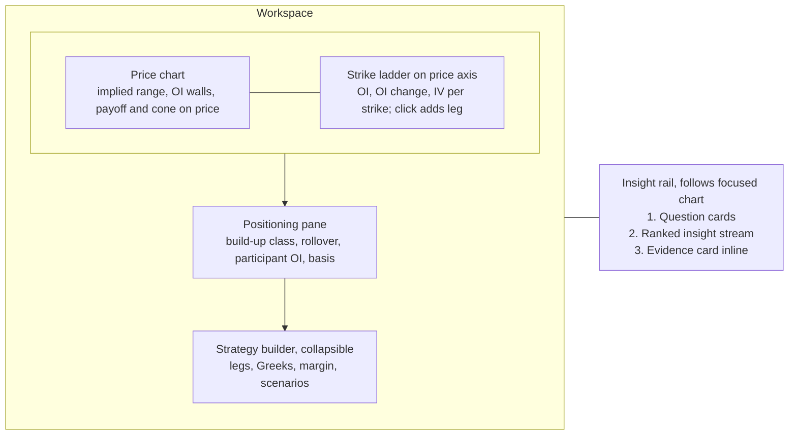
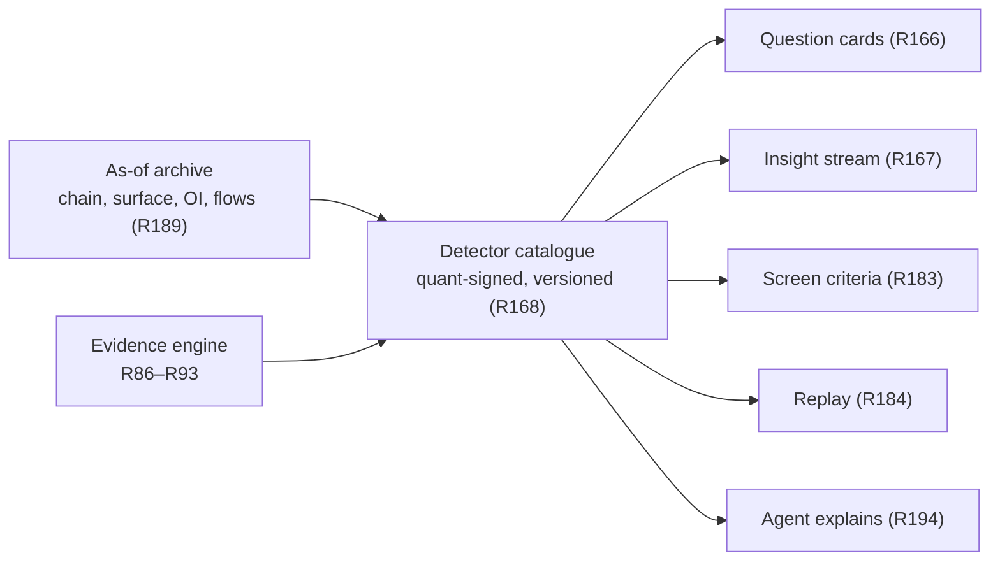

# Axiom Charts - Plan

## Goal Capsule

- **Objective:** A desk trader opens one chart and gets everything needed to decide on an Indian F&O or equity instrument: price, strikes, positioning, volatility, and what the evidence says, each with its base rate. The desk stops opening TradingView for charts, Sensibull, Opstra or Tradl for position building, and GoCharting for market profile and order flow.
- **Means:** An options-native chart with strikes on the price axis and the strategy builder on the chart. An insight rail driven by a quant-specified detector catalogue. Cross-stock pattern twins. An AI screener builder that backtests itself. One auction model per instrument that reads market profile, volume profile and order flow across nested timeframes, with a DOM ladder that sends confirmed orders through the broker. Point-in-time replay across all of it.
- **Product authority:** Extends `docs/plans/2026-11-12-1110-feat-axiom-desk-platform-plan.md` (the platform plan), units U14–U17, and proposes amendments to R12, R14, R20, R49, R56, R110, R116, R126, KTD6, units U7, U12, U14–U19, U21 and U25, gates G1, G2 and G5, and PR5 sequencing, listed under Platform Plan Amendments. Platform R-IDs are not edited here. New IDs continue the platform plan's sequences: R155+, F11+, AE21+. Where this contract and the platform plan disagree, the platform plan stands until an amendment is accepted into it.
- **Open blockers:**
  - The U14 renderer decision is open. SciChart was not run (no licence key), the R126 timed tasks were not run (no named desk testers), and 16 charts with the rail open has never been measured.
  - `DESIGN.md` has no chart-pane tokens. G5 blocks chart screen work until it does.
  - Desk quants have not specified the V1 detector catalogues (R169, R200) or the auction pattern catalogue (R209). Intraday detectors launch uncalibrated until Axiom's own archive is deep enough.
  - No tick-by-tick and depth feed is contracted (G1). Footprint, delta, absorption, the heatmap and the DOM depth view (R205, R215) cannot ship without it.
  - Sending orders from the chart (R215) waits on G2 legal review of the broker-API order path.

---

## Product Contract

### Summary

Axiom Charts becomes an options-native workbench. Strikes, OI and surface IV sit on the price axis, and strategies are built by clicking strikes and drawn as payoff on the price chart. An insight rail beside the focused chart answers a few desk questions per instrument, then streams evidence-graded insights from quant-signed detectors. Equity charts find pattern twins across stocks and show past analogs, winners and losers. An AI screener builder backtests every screen point-in-time, reports its efficacy, and says plainly when no tweak improves it. A single auction model per instrument reads market profile, volume profile and order flow across today, the current balance and the expiry cycle with no setup, and streams a pre-open plan and scenario cards in Dalton's terms with Axiom's own base rates. A DOM ladder stages an order on a click and sends it through the broker after one confirm. Replay restores all of this exactly as known at any past moment.

### Problem Frame

Desk traders read price in TradingView, then switch to Sensibull, Opstra or Tradl to build and size the position. They read OI build-up, rollover, participant positioning and vol context by hand across tabs. No tool connects those signals to the instrument on screen, says how often each signal has meant anything before, or explains why one strike is a better fit than another for a stated objective.

TradingView is weakest exactly here for an Indian F&O desk (checked 2026-11-13, sources below):

- No IV rank, IV history, smile or surface.
- Per-strike OI only through community scripts. No native PCR, max pain or participant OI (UNVERIFIED absence).
- No options or futures screener.
- Patterns carry no hit rates or sample sizes.
- Replay is not point-in-time.
- Real-time NSE F&O for a professional desk needs an exchange agreement and the top tier.

Its options strategy builder and AI Copilot mean that a payoff diagram and a chart-drawing assistant do not set Axiom apart. Positioning, the arbitrage-free surface, evidence and point-in-time correctness do.

Equity charts have the same gap. Patterns are shown without the story of what followed past occurrences. Screens are built without any measure of whether they ever worked, so the desk backtests them separately in Excel or Python.

Market profile and order flow cost a separate subscription and a separate tool. On GoCharting, the desk's current one, market profile is complex to set up and does not stay clean across timeframes, yet a profile read needs the day, the multi-day balance and the expiry cycle together, with HVN/LVN and order flow beside it. The trader still does the Dalton-style synthesis in their head, and none of these tools says how often a profile pattern has meant anything on NSE.

### Key Decisions

- **The wedge is the options-native chart.** Evidence on the chart, point-in-time replay and speed are kept as supporting pillars, not the lead. Governs R155–R164. (session-settled: user-approved — chosen over evidence-on-chart, point-in-time replay and speed-plus-agent as the primary wedge: TradingView is weakest for NSE F&O.)
- **The chart owns the strategy builder, point-in-time replay, cross-stock pattern twins and 16 synced charts.** Governs R155–R158, R173–R176, R184–R189, R190. (session-settled: user-directed — all four chosen over leaving them where the platform plan put them.)
- **The AI screener builder is fully in this contract.** Governs R177–R183. (session-settled: user-directed — chosen over charts owning only the screener joins, and over dropping the screener: the user wants one contract for the whole loop.)
- **Strikes are ranked by evidence for a stated objective, never called favourable.** Stories show winners and losers. Governs R159, R171, R175. (session-settled: user-approved — chosen over direct "favourable strike" language everywhere and over a direct desk voice with a neutral retail voice: keeps R17, R77 and broker SEBI exposure intact.)
- **Insights sit in a rail beside the focused chart.** The strike ladder is on the price axis, with the positioning pane and a collapsible builder below. Governs R165, R172. (session-settled: user-approved — chosen over all-on-chart pins and a 50/50 chart-plus-workbench split, judged on a rough layout sketch.)
- **A quant-specified detector catalogue powers the rail, led by question cards.** The agent only explains. Governs R166–R170, R194. (session-settled: user-approved — chosen over a stream with no question cards and over an agent-written narrative: the engine computes every number, per KTD5, and TradingView Copilot already does narrative.)
- **When no screen tweak survives testing, the builder says so.** Governs R180, R181. (session-settled: user-approved — chosen over showing the best in-sample tweak with a warning: in-sample winners invite overfitting.)
- **Everything ships in sequence, with no MVP cut.** (session-settled: user-directed — chosen over a one-month index-only slice: the user wants every piece built one by one.)
- **Replay shows detectors as they were live, and includes paper trading.** Governs R184, R187, R196. (session-settled: user-approved — chosen over replaying with today's detector versions by default, and over leaving paper trading in V1.5 per platform R47: keeps "as known then" true while serving practice.)
- **"Easy" is measured, and the look is designed elsewhere.** Ease is judged by timed tasks against TradingView. Finish and motion come from the repo's design pipeline (DESIGN.md, ui-ux-pro-max, impeccable) under G5. Governs R192, R195.
- **Order flow runs on a contracted tick-by-tick feed and is labelled as inferred.** Governs R205, R206. (session-settled: user-approved — chosen over coarse delta from snapshot feeds and over shipping profile in V1 with order flow in V1.5: a real footprint needs per-trade data, and no NSE feed carries the aggressor side.)
- **Composite profiles with naked POCs, the VWAP family, the liquidity heatmap and options flow by strike are all in.** Governs R202, R204, R205, R207. (session-settled: user-directed — chosen from a list where each was optional.)
- **Profiles sit per session inside the chart, Dalton-style.** The strike ladder keeps the price axis, and a composite profile lane sits at the far right. Governs R203. (session-settled: user-approved — chosen over stacked permanent axis lanes and one switchable axis lens, judged on a rough layout sketch.)
- **Suggestions come as a pre-open plan plus live scenario cards and quiet chart marks.** Governs R212, R213. (session-settled: user-approved — chosen over live scenarios only and over marks only.)
- **One auction model per instrument drives every profile and order-flow suggestion.** Overlays are views of it. Governs R208–R214. (session-settled: user-approved — chosen over an indicator toolkit of separate overlays: the user wants the synthesis done for them, not more parts.)
- **The chart sends orders through the broker after one confirm in Axiom.** Governs R164, R215, R216. (session-settled: user-directed — chosen over true one-click sending and over keeping DOM clicks as drafts confirmed in the broker's window: the user wants order placement on the chart through the broker integration.)
- **No 3D on chart panes.** The volatility surface in 3D lives in the Volatility Lab. Chart panes keep the renderer's frame budget, per the repo's UI constraints.

### Actors

Uses the platform plan's actors: A1 desk user (traders, PMs, analysts, quants) and A5 Axiom agent. Desk quants, part of A1, specify and sign off every detector, question card and screen-efficacy statistic.

### Requirements

**Options-native chart**

- R155. On any F&O underlying or contract chart, the price axis carries a strike ladder showing per-strike OI, OI change and surface IV (R68) at each strike's price level, for a selected expiry.
- R156. The ladder shows call and put columns for each strike. A click adds a bought one-lot leg of that type, and a shift-click adds a sold one. Each leg is a chip on the chart that edits side, lots and expiry, and dragging the chip moves it along the strike axis.
- R157. The on-chart strategy draws its payoff at expiry and at a chosen date, breakevens, max profit and loss, and a probability cone from the surface directly on the price chart, with the R38 outputs in the builder below.
- R158. Dragging spot, IV or time reprices the on-chart strategy live, extending R121 to strategies not yet traded.
- R159. For an objective picked from a closed, quant-signed list, the chart ranks strikes and expiries. Examples: cheapest vega per rupee, highest theta per unit of risk, best liquidity at a target delta, cheapest protection to a level. Each ranked strike shows the metric, bid-ask cost, liquidity and evidence, and is never labelled favourable, buy or sell. The agent maps a free-text objective onto the list, or says none fits.
- R160. Each expiry shows one F&O-implied range combining implied-move bands (R115), OI walls, pin probability (R78) and positioning, with the base rate of the underlying settling inside such ranges.
- R161. OI walls and positioning-derived support and resistance levels are drawn on price with their strength, today's shift, and their historical hold rate per R86–R93.
- R162. The positioning pane (R114) adds rollover percentage and cost against their own history and futures build-up class over time. Participant-wise OI changes (FII, DII, Pro, Client) appear as market-level context, labelled as such and never attributed to the charted instrument.
- R163. Every options-native element reads one chain and surface snapshot and shows its as-of time and freshness per KTD9. An element whose input is unavailable is hidden with the reason shown.
- R164. An on-chart strategy is sent as a multi-leg order through the R215 stage-and-confirm path. Until G2 clears that path, sending creates a ticket draft per R55.

**Insight rail**

- R165. Each layout has one insight rail that follows the focused chart and covers only that chart's instrument.
- R166. The rail opens with question cards answering a fixed set of desk questions per instrument class. For F&O: where it is likely to settle by expiry, who is positioned and how that is changing, whether vol is cheap or rich, and what the current setup usually does. For equities: what pattern is forming and what usually follows, who is accumulating, and where it ranks in its sector.
- R167. Below the cards, the rail streams insights ranked by significance per R117, within the user's budgets per R118.
- R168. Every question-card answer and insight comes from a versioned detector in a catalogue that desk quants specify and sign off, and the agent explains detector outputs without computing new numbers (KTD5).
- R169. The V1 F&O detector catalogue covers:
  - long build-up, short build-up, short covering and long unwinding, at contract and strike level
  - rollover against its base
  - OI walls and their shifts
  - participant-wise OI shifts, as market-level context only
  - PCR and max-pain changes
  - basis anomalies
  - IV against RV and VRP bucket state (R146)
  - skew and term-structure shifts
  - pin candidates and unusual activity

  Each detector is tagged as either calibrated at launch from purchased end-of-day history, or uncalibrated until the R110 archive is deep enough. Question cards use calibrated detectors first.
- R200. The V1 equity detector catalogue covers the three equity questions in R166: R16 chart patterns with their forward outcomes, accumulation from delivery percentage and institutional-flow changes (R133, never naming entities per R77), and sector-relative rank (R135). It carries the same calibration tags as R169.
- R170. Every insight opens an evidence card per R86–R93: base rate, sample, confidence interval, out-of-sample status, and what followed past occurrences, failures included. Otherwise it shows insufficient evidence per R95.
- R171. Each insight tells its story in plain language: what changed, against what normal, what historically followed, and what would invalidate it. The text never uses buy, sell, favourable or assured wording (R17, R77).
- R172. Selecting an insight highlights its strike, level or time on the chart, and selecting a chart object shows the insights attached to it.

**Pattern twins and stories**

- R173. From a detected pattern or a user-selected chart region, "find twins" returns instruments across the R7 universe whose current price action matches, ranked by similarity, each with its evidence card.
- R174. The same request returns past analogs from any instrument, drawn from a point-in-time universe that includes delisted names (R153). Their forward paths are drawn as the R116 fan, with winners, losers and the split shown.
- R175. A pattern's story names the conditions that separated analogs that worked from those that failed, such as regime, volume, sector strength or F&O positioning, only where the difference passes R90. Otherwise it says no distinguishing condition was found.
- R176. Every twin search, analog split and story condition counts as a tested variant under R90, in one family per request and pattern definition, not desk-wide.
- R198. Twins and analogs appear in a results tray under the rail, which is exempt from R165's one-instrument rule. Selecting a twin previews it without moving focus, and "open in layout" places it in a chosen chart slot.

**AI screener builder**

- R177. A user builds a screen by typing or saying it in plain language or by editing criteria, and confirms the structured criteria before the screen runs.
- R178. Every saved screen is backtested automatically and point-in-time. The universe is taken as of each date with delisted names (R153), fundamentals as reported, prices corporate-action adjusted (R3), and history split at SEBI rule-change dates (R110).
- R179. Screen efficacy shows the forward returns of matches against the universe base rate at stated horizons, with hit rate, sample size, confidence interval, turnover, after-cost expectancy, decay over time and regime-conditioned results, per R86–R93.
- R180. The builder suggests criteria to add or remove, and presents a suggestion as an improvement only when it passes R88–R90 out of sample. Every backtested revision of a screen, whether the user or the builder made it, counts as a tested variant in one family for that screen's lineage. The efficacy card shows the lineage's cumulative variant count.
- R181. When no suggestion passes, the builder says no improvement was found and lists what was tried, how many variants, and why each failed.
- R182. A saved screen tracks its live matches forward, and its live efficacy is shown separately from its backtest.
- R199. Editing a saved screen forks a new version in the same lineage, and the new version's live tracking starts fresh.
- R183. Screen criteria can use equity fields, the F&O screens in R80, detected patterns and rail detectors. Every result opens into a chart with the matching criteria highlighted (R27).

**Point-in-time replay**

- R184. Replay restores everything on the chart surface for the replayed timestamp, exactly as known then: chart, chain, surface, OI, positioning, rail, question cards, patterns, evidence cards and screen results. Nothing computed with later data appears. Detectors show the version live at that timestamp from recorded outputs. Before a detector went live it shows "detector not yet live", unless the user opts into a backfill of the current version, which is labelled as a backfill.
- R196. Replay is an explicit mode. Every chart, the rail and the builder show a non-dismissible "Replay as of <time>" state. Send-to-ticket (R164) is replaced by paper trade, and paper positions stay in a separate replay book after exit.
- R185. Evidence statistics shown in replay use only history available before the replayed timestamp.
- R186. Replay runs synced across every chart in a layout, at selectable speeds, in tick, second or bar steps wherever the data supports that step.
- R187. During replay a user can build on-chart strategies and paper-trade them, with fills at that moment's bid-ask and costs.
- R188. Alerts and triggers evaluate in replay as replay events and never send a live notification.
- R189. Chain, surface and every detector output can be read as of any past timestamp in the archive.

**Auction, market profile and order flow**

- R201. Every intraday chart opens with market profile and no setup: 30-minute TPO periods over the NSE session, the 09:15–10:15 initial balance, a 70% value area and the POC. Index profiles are built on index futures, because index spot has no volume. A changed setting is labelled non-default and carries no base rate.
- R202. Profiles combine three nested timeframes by default: today, the current balance (a composite from the session the market last entered balance, with a rolling 5 sessions as fallback), and the expiry cycle (last expiry to next expiry under the SEBI calendar in force). Weekly and monthly value appear as reference levels. Composites use a basis-adjusted continuous futures series, so contract rolls add no false structure.
- R203. The chart draws each session's TPO profile inside the chart beside that session's bars, with a composite profile lane at the far right. On F&O charts the strike ladder keeps the price axis.
- R204. The volume profile (R14) marks HVNs and LVNs. Naked POCs, unfilled single prints and poor highs and lows carry forward as reference levels until traded. Session and anchored VWAP draw with deviation bands, anchored by click or to an event: an expiry, results or a gap day.
- R205. Zooming in past a threshold replaces bars with a footprint of volume at bid and ask, delta and imbalances per price. A cumulative-delta pane and a liquidity heatmap of resting depth by price, with large-order pulls, refills and large-trade prints, are toggles. These appear only where the tick-by-tick feed covers the instrument; elsewhere they are hidden with the reason shown.
- R206. Every order-flow value is labelled as using an inferred aggressor and shows the measured classification accuracy for that instrument.
- R207. The strike ladder (R155) adds options volume and OI change by strike, and dealer gamma levels labelled as a model resting on a stated assumption about who is short options.
- R208. One auction model per instrument tracks: balance or imbalance and its duration, the day type and open type forming, location against prior and composite value, other-timeframe or day-timeframe control, and whether order flow confirms. Desk quants specify and sign it off like the R168 catalogue.
- R209. The V1 auction pattern catalogue covers:
  - day types: normal, normal variation, trend, double distribution, neutral, neutral extreme, non-trend, P and b profiles
  - open types: open drive, open test drive, open rejection reverse, open auction in and out of range, each read against prior value and range, plus inventory correction at the open
  - structure: the 80% rule, IB and range extension, single prints, poor highs and lows, excess, balance-area breakouts with look above or below and fail, value migration, naked POCs, HVN acceptance and LVN fast travel, other-timeframe control
  - order flow: absorption, exhaustion, stacked imbalances, delta divergence, initiative against responsive activity, trapped traders

  Each pattern records its source theory, detection rule, timeframes, what the source says follows, and what invalidates it.
- R210. Every pattern shows the source's reading, such as "Dalton's reading: …", beside Axiom's own NSE walk-forward base rate and sample per R86–R93, or "uncalibrated". Profile patterns may calibrate from purchased 1-minute history. Order-flow patterns stay uncalibrated until Axiom's tick archive is deep enough. No pattern is stated as fact.
- R211. Day type and open type are provisional during the session, shown as a probability per period, and fixed at 15:30. The shortened 15:15–15:30 period is excluded from day-type thresholds, and the futures pre-open auction is its own open reference.
- R212. Before the open, each instrument gets a plan card: the open relative to prior value and range, likely day types, the key reference levels, and scenarios with base rates and invalidation.
- R213. During the session, auction scenario cards stream into the insight rail (R167) as they trigger. Quiet chart marks label poor highs and lows, single prints, IB breaks, range extension and absorption. Each mark carries a one-line plain explanation and opens its evidence card. Wording follows R171.
- R214. Auction-model fields are screener criteria (R183). Replay (R184) restores profiles, the auction state, footprint and cards as known then. Individual trades replay for a recent window, and older sessions replay from per-price, per-minute totals.

**Orders from the chart**

- R215. A DOM ladder shows depth by price. Clicking a price stages a priced order, and one explicit confirm in Axiom sends it through the broker integration. Each send records who confirmed it and when. Until G2 clears the broker-API path, the confirm creates a ticket draft per R55.
- R216. The agent can stage an order but never confirm one. Replay never sends a live order (R196).

**Layout, speed and ease**

- R190. A layout holds up to 16 charts synced by symbol, interval, crosshair, time and date range. Price-anchored drawings sync across charts that plot the same price series, and time-only drawings sync across all charts.
- R191. With 16 F&O charts taking live ticks, the R193 defaults on, one on-chart strategy with payoff and cone, and the rail open, the chart holds at least 60 fps. The limits are p95 frame time at most 16.7 ms, p99.9 at most 33 ms, and at most 3 frames over 50 ms in a 10-minute session, over 3 runs on a named desk hardware profile.
- R192. Every chart tool has a keyboard path and a command-bar entry (R127), and the most-used tools take one keystroke.
- R193. The rail is on by default for every instrument with catalogued detectors. The strike ladder and positioning pane are on by default for F&O charts only, within the U17 overlay budget.
- R197. Chart focus moves by keyboard, by cycling or by jumping to a slot, with a visible focus ring that matches the rail's instrument. Ladder strikes, rail items and strategy legs are labelled controls reachable by keyboard and screen reader. Gain or loss, call or put, and wall strength are never shown by colour alone.
- R217. Every chart element has a named colour role on the white ground, including TPO periods shaded by time, the value area, POC, HVN and LVN, two-sided delta and imbalance, the heatmap ramp, VWAP bands, naked levels, the strike ladder and rail card types. Each role pairs with a shape or label per R197.
- R218. Profiles and the heatmap sit inside the R191 budget. Footprint has its own budget: up to 4 footprint charts in a layout hold the R191 frame limits.
- R194. The agent can build an on-chart strategy, rank strikes, find twins, build and explain a screen, and start a replay on request, with the same results as the screen (R4). It explains any rail item by citing its detector and evidence card.
- R195. The R126 timed-task set adds six tasks:
  - build a short straddle on the chart
  - read the implied range to expiry
  - rank strikes for an objective
  - find twins of a pattern
  - build and backtest a screen
  - start a synced replay
  - read the day's plan card
  - find the naked POCs in the current balance
  - spot absorption at a level

  The last three are also timed against the desk's current profile tool, GoCharting.

### Visualizations

The layout chosen for the focused chart (rough probe; final layout comes from the design pass):

One detector catalogue feeds every surface, live and in replay:

### Key Flows

- F11. Instrument to strategy draft
  - **Trigger:** A trader opens BankNifty from the command bar.
  - **Steps:** The ladder, positioning pane and rail load for the nearest expiry. The trader reads the "where will it settle" card and the short-covering insight, and opens its evidence card. They rank strikes for "highest theta per unit of risk", shift-click two strikes to sell a strangle, drag IV down 2 points to see P&L, and send it as a staged order they confirm in Axiom.
  - **Covers:** R155–R160, R164, R166, R170.
- F12. Pattern to twins to screen
  - **Trigger:** A flag is detected on an equity chart.
  - **Steps:** The rail explains the pattern and its story. The trader asks for twins, sees six current matches and the analog fan, and saves the twin set as a screen. The screen backtests automatically.
  - **Covers:** R173–R176, R177–R179.
- F13. Screen build and improve
  - **Trigger:** The analyst types "stocks above 200 DMA with rising delivery and FII buying in sector".
  - **Steps:** The analyst confirms the parsed criteria. The backtest reports efficacy against the base rate. They ask for improvements and get either passing suggestions or "no improvement found" with the tried list. They save the screen, and live tracking starts.
  - **Covers:** R177–R183.
- F14. Replay session
  - **Trigger:** The trader replays the expiry day of a past week across a 4-chart layout.
  - **Steps:** Chain, rail and patterns appear as they were known then. The trader paper-trades a straddle at that moment's bid-ask. A trigger hit shows as a replay event.
  - **Covers:** R184–R188.
- F15. Auction read to order
  - **Trigger:** Before 09:15, a trader opens NIFTY futures.
  - **Steps:** The plan card shows the open below yesterday's value, the current balance in its sixth session, and two scenarios with base rates. At 09:45 an "open test drive" mark appears at yesterday's poor low, with absorption on the footprint. A scenario card for acceptance back into value streams into the rail. The trader stages a buy limit on the DOM at the value-area low and confirms it in Axiom.
  - **Covers:** R201–R206, R208–R213, R215.

### Acceptance Examples

- AE21. **Covers R159, R171.** The user ranks puts for "cheapest protection to 22,000 by expiry". The list shows cost, bid-ask and liquidity per strike, and no row or label says favourable, buy or sell.
- AE22. **Covers R163.** The surface goes stale at 10:42. Ladder IV, the probability cone and the implied range hide with "surface stale since 10:42", while OI stays visible.
- AE23. **Covers R170.** A short-covering insight on a thinly traded stock option has a sample below the R88 minimum. Its card shows insufficient evidence, not a hit rate.
- AE24. **Covers R180, R181.** The user asks to improve a screen. 40 variants are tried and none survives correction. The builder shows "No improvement found", the list of 40 variants tried, and why each failed.
- AE25. **Covers R184, R185.** In replay at 10:30 on a past date, the rail shows a short-covering insight detected at 10:28 and not one detected at 11:00. Its base rate uses data before that date only.
- AE26. **Covers R188.** A price trigger is crossed during replay. It is logged as a replay event and no email or in-app live alert is sent.
- AE27. **Covers R174.** The analogs for a cup-and-handle include a since-delisted company whose pattern failed, and it counts in the loser split.
- AE28. **Covers R165.** With 16 charts open, focus moves from chart 3 to chart 11. The rail switches to chart 11's instrument and shows nothing from chart 3.
- AE29. **Covers R164, R215.** Sending an on-chart iron condor stages a four-leg order. Nothing reaches the broker until the user confirms it in Axiom, and the send records who confirmed it.
- AE31. **Covers R211.** At 11:00 the engine shows "trend day forming, 58%". At 15:30 the day closes back inside the IB, and the label fixes as normal variation. Replay at 11:00 shows the 58% read, not the final label.
- AE32. **Covers R210.** An 80% rule card reads "Dalton's reading: value-area re-entry often traverses value" beside Axiom's NSE base rate for NIFTY futures with its sample, or "uncalibrated" when the sample is below the R88 minimum.
- AE33. **Covers R205.** A cash stock with no tick-by-tick coverage shows TPO, volume profile and VWAP. Footprint, delta and heatmap are hidden with "no tick-by-tick coverage for this instrument".
- AE34. **Covers R216.** The agent stages a two-lot NIFTY futures order from the DOM on request. The order waits for the user's confirm, and the agent has no way to confirm it.
- AE30. **Covers R196.** During a replay of a past expiry day, the builder offers "Paper trade" and no "Send to ticket". After exit, the paper straddle stays in the replay book, and no live draft exists.

### Success Criteria

- The desk does daily charting and position building in Axiom without opening TradingView, Sensibull, Opstra or Tradl. This counts toward the platform V1 gate.
- In the R126 and R195 timed tasks with named desk users, Axiom's median time beats TradingView's on every task TradingView supports. Tasks TradingView cannot do are recorded as unsupported there.
- On the R195 options tasks (short straddle, implied range, strike ranking), Axiom's median also beats each tester's current options tool: Sensibull, Opstra or Tradl.
- The desk builds and backtests its screens in Axiom instead of Excel or Python. This counts toward the platform V1 gate.
- The R191 frame budget holds in the U14 harness with 16 charts and the rail open, and R218 holds with 4 footprint charts.
- The desk cancels its separate market profile and order flow subscriptions, and Axiom's median beats GoCharting on the three profile tasks in R195.
- Every detector in the catalogue appears in the Edge Ledger (R144) and is demoted when it stops beating its base rate.

### Scope Boundaries

**Deferred for later**

- Retail-client voice, plain-language layer and RA routing for rail content and screens (V2, per R60, R62, R125).
- Pine-like scripting (V1.5+, per R15).
- Custom profile scripting (with Pine-like scripting, V1.5+).
- Order flow on global or crypto instruments.
- Webhook and messaging alert delivery (V1.5, per R128).
- Detectors beyond the R169 catalogue and equity question cards beyond R166. Each is added after quant sign-off.

**Outside this product's identity**

- Sending an order without the user's explicit confirm of that order, including engine-fired automatic, bracket or conditional orders.
- Naming entities behind positioning or calling activity manipulation (R77).
- Outcome language that promises or reassures ("assured", "favourable", "sure-shot").
- An agent-written narrative that computes its own numbers.
- 3D or HyperFrames content on chart panes.

### Platform Plan Amendments

Proposed changes to `docs/plans/2026-11-12-1110-feat-axiom-desk-platform-plan.md`. None is applied by this document.

- **R12:** raise the layout cap from 8 to 16 charts and add date-range and drawing sync, as stated in R190.
- **R14:** volume profile adds HVN and LVN marks per R204.
- **R49:** market profile, footprint and order flow move from V1.5 into V1 per R201–R214.
- **R56:** an explicit per-order confirm inside Axiom, sent through the broker integration, satisfies R56 per R215. It replaces confirmation inside the broker's own order window.
- **R20:** replace "step through history" with point-in-time replay per R184–R188.
- **R110:** add as-of reads of chain, surface and detector outputs per R189. Today R110 archives daily, and only U7 has an intraday snapshot as-of query.
- **R116:** extend analogs from the charted instrument to the whole point-in-time universe per R173–R176.
- **R126:** add the six tasks in R195.
- **R47:** paper trading moves from V1.5 into V1 for replay only, per R187.
- **KTD6:** change the spike's load from 8 to 16 synced charts with the rail open, and judge it against R191.
- **U7:** owns R189.
- **U12:** registers detectors (R168) and counts twins, story conditions and screen suggestions as tested variants (R176, R180).
- **U14:** re-runs the spike at 16 charts, with SciChart licensed and two named desk testers, before any chart feature work. It owns R184–R186, R188, R190, R191, R196, R197, and the rendering in R203, R205, R217 and R218.
- **U15:** owns R173–R176, R198, the strike-ranking math in R159, and the profile math in R201, R202 and R204.
- **U16:** owns R192 and R195.
- **U17:** owns the strike ladder, implied range, OI walls and positioning additions (R155, R160–R163), plus the rail (R165–R172), the equity catalogue (R200), R193, R207, and the auction model and its cards (R208–R213).
- **U18:** owns the screener builder (R177–R183, R199). The platform plan has no screen-efficacy or screen-backtest requirement today.
- **U19:** keeps the strategy engine (R38, R81). The on-chart builder surface (R156–R158, R164, R187) moves to U17.
- **U25:** owns the agent actions in R194 and the stage-only rule in R216.
- **U21:** owns the order path in R215: staging, the Axiom confirm, broker send and the record of who confirmed.
- **G1:** adds a tick-by-tick and depth feed for index and liquid stock futures (R205).
- **G2:** adds legal review of sending confirmed orders through the broker API (R215).
- **G5:** `DESIGN.md` adds chart-pane tokens: ladder, rail, payoff, cone and evidence card.
- **PR5 sequencing:** U17 and U18 now depend on U7 as-of reads and the U12 detector registry. `ce-plan` decides whether PR5 splits.

### Dependencies / Assumptions

- The archive (R110) holds intraday chain and surface snapshots dense enough for tick, second or bar replay of options elements. Where it does not, replay offers only the steps the data supports (R186).
- Participant-wise OI is end-of-day NSE data, published by category (index or stock, futures, calls or puts, long or short) across all underlyings, not per instrument. Intraday participant shifts are not available, and R162 shows the as-of date. The per-instrument "who is positioned" card (R166) answers from contract- and strike-level build-up and OI change.
- Desk quants can specify and sign off the R169 catalogue. Rail breadth grows only as fast as they do.
- A vendor streams NSE and NFO tick by tick with depth (Global Datafeeds does, per `docs/research/2026-11-12-build-research.md`). Its history depth and licence terms for storing ticks are UNVERIFIED.
- No NSE feed flags the trade aggressor, so delta is classified from quotes per R206.
- NSE monthly expiry is the last Tuesday for contracts from 1 Sep 2025, and futures have a 09:00–09:15 pre-open auction from 8 Dec 2025 (secondary sources, see `docs/research/2026-11-14-market-profile-order-flow-patterns.md`).
- The custom Canvas2D renderer measured 120 fps (p95 9.2 ms) at 8 charts, in single runs. 16 charts are unmeasured.

### Outstanding Questions

**Deferred to Planning**

- Which two desk users run the R126 and R195 timed tasks, and when SciChart gets a licence key. These block the U14 renderer decision, not planning; see Open blockers.

- Similarity method and time scales for pattern twins (R173).
- As-of storage and retention design behind R189, and the snapshot density replay needs.
- How the rail and strike ladder behave below the tablet breakpoint, given that U14 collapses to one chart there.
- Minimum history before a detector's evidence card leaves "uncalibrated" (R93).
- Replay speed steps and the paper-trading cost model (R186, R187).
- Profile row size per instrument, the footprint zoom threshold, and HVN/LVN cut-offs (R201, R204, R205). Each is fixed per catalogue version.
- The aggressor classification method and how R206 accuracy is measured.
- The tick retention window behind R214 and the vendor's storage terms.

### Sources / Research

- Platform plan: `docs/plans/2026-11-12-1110-feat-axiom-desk-platform-plan.md`. Covers R9–R30, R38, R68, R74–R95, R110–R129, R144–R154, KTD5, KTD6 and KTD9, U7, U12, U14–U19, and G5.
- Market profile and order-flow pattern research: `docs/research/2026-11-14-market-profile-order-flow-patterns.md`. Dalton's *Mind Over Markets* and *Markets in Profile*, Steidlmayer's CBOT material, Cont–Kukanov–Stoikov (2014), Osler (2003). It found no peer-reviewed test of profile patterns, which is why R210 pairs the source's reading with Axiom's own base rate.
- Renderer spike: `tools/benchmarks/renderer/RESULT.md` (partial, no decision).
- Design inputs: `PRODUCT.md`, `DESIGN.md` (provisional, no chart tokens), `references/TASTE.md`.
- Options research: `docs/research/2026-11-12-options-benchmark.md`, `docs/research/2026-11-12-options-literature.md`.
- TradingView baseline, checked 2026-11-13 from TradingView's own pages:
  - options volatility page: https://www.tradingview.com/symbols/NSE-NIFTY/options-volatility/
  - futures-only intraday OI: https://www.tradingview.com/blog/en/intraday-open-interest-futures-55091/
  - screener list: https://www.tradingview.com/features/
  - auto patterns without statistics: https://www.tradingview.com/support/solutions/43000690464-auto-chart-patterns-on-tradingview/
  - replay limits: https://www.tradingview.com/support/solutions/43000712747-bar-replay-how-and-why-to-test-a-strategy-in-the-past/
  - NSE F&O professional data: https://www.tradingview.com/support/solutions/43000777677-can-i-access-real-time-futures-and-options-data-from-nse-and-bse/
  - layout sync: https://www.tradingview.com/support/solutions/43000629992-how-to-sync-the-charts-of-my-layout/
  - options strategy builder: https://www.tradingview.com/blog/en/new-product-tradingview-options-44783/
  - AI Copilot: https://www.tradingview.com/support/solutions/43000795131-getting-started-with-ai-copilot/
  - tiers and prices: https://in.tradingview.com/pricing/
  - UNVERIFIED: no PCR, max pain or participant OI, and no delisted-symbol handling, since TradingView states neither absence.
