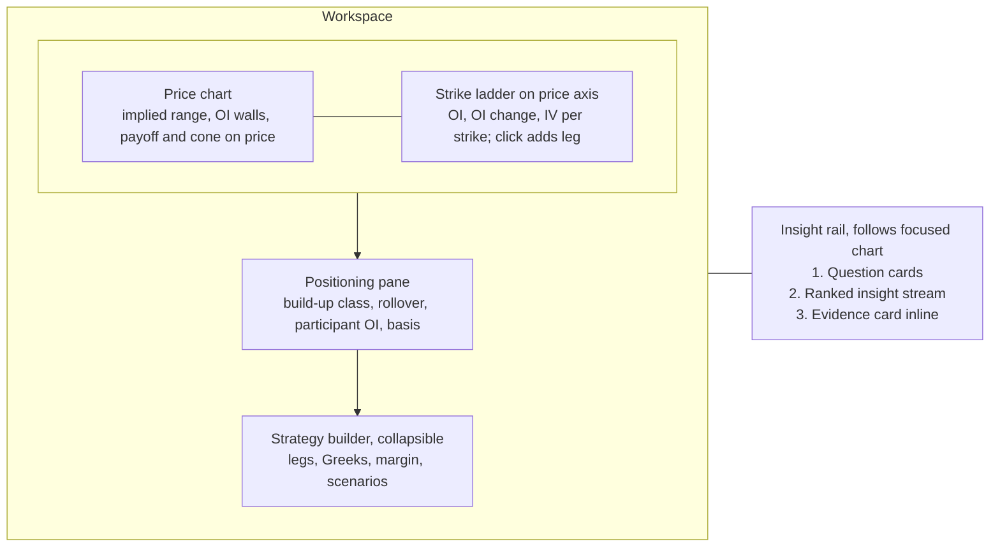
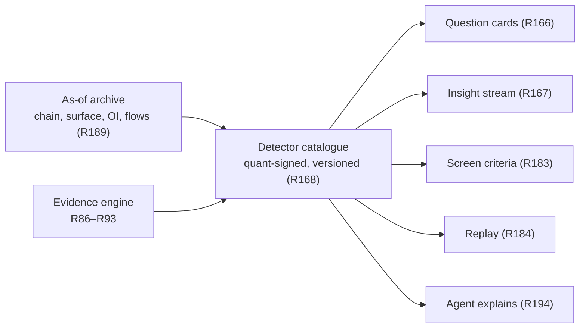
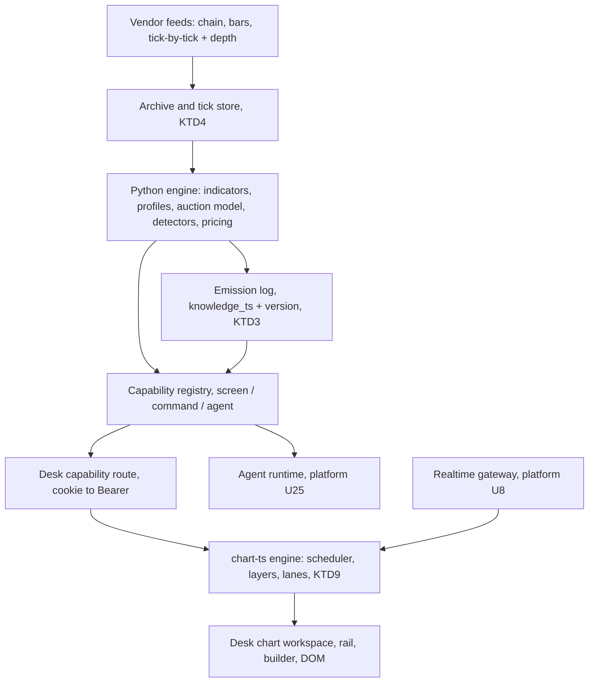
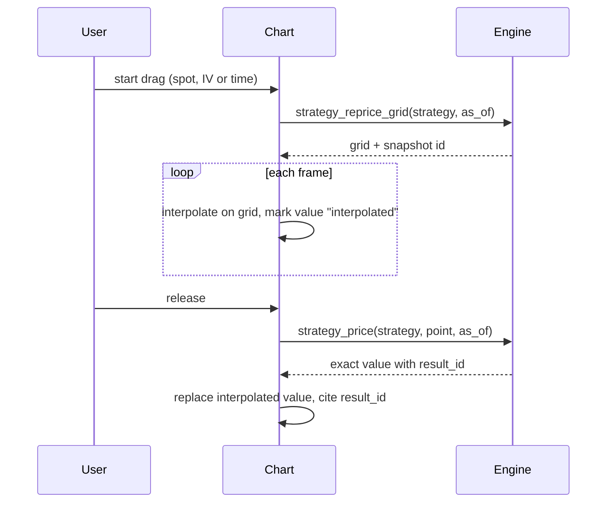
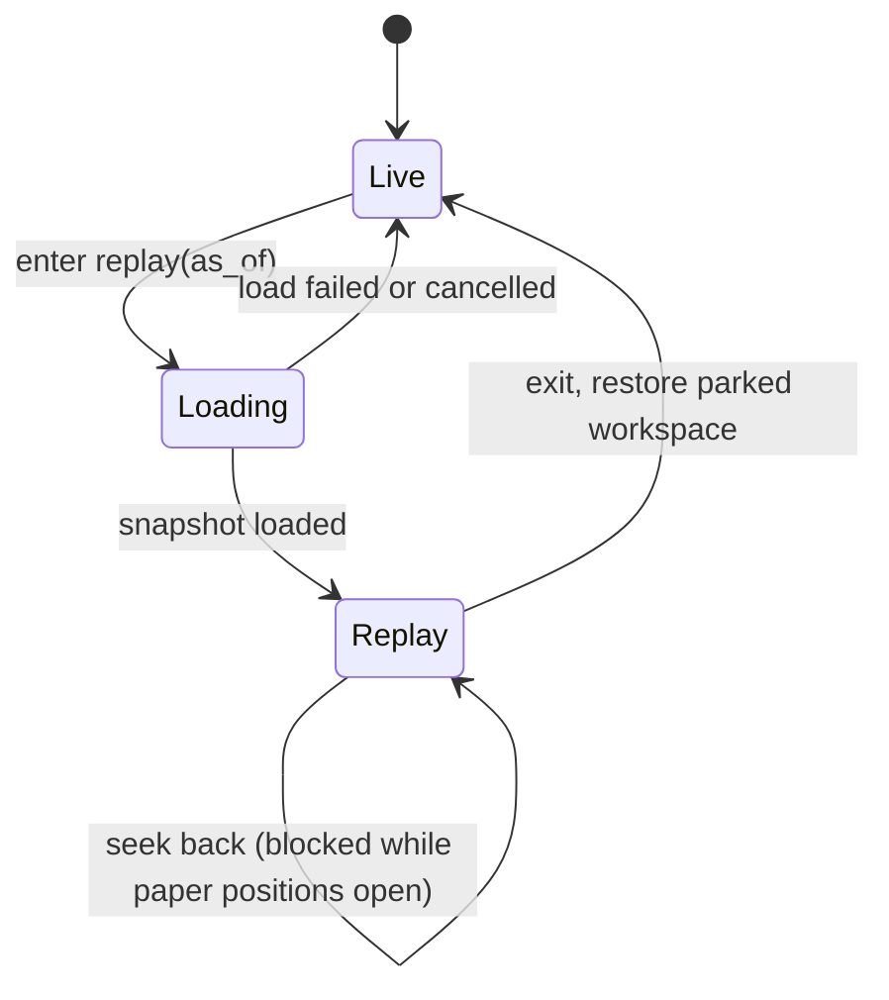
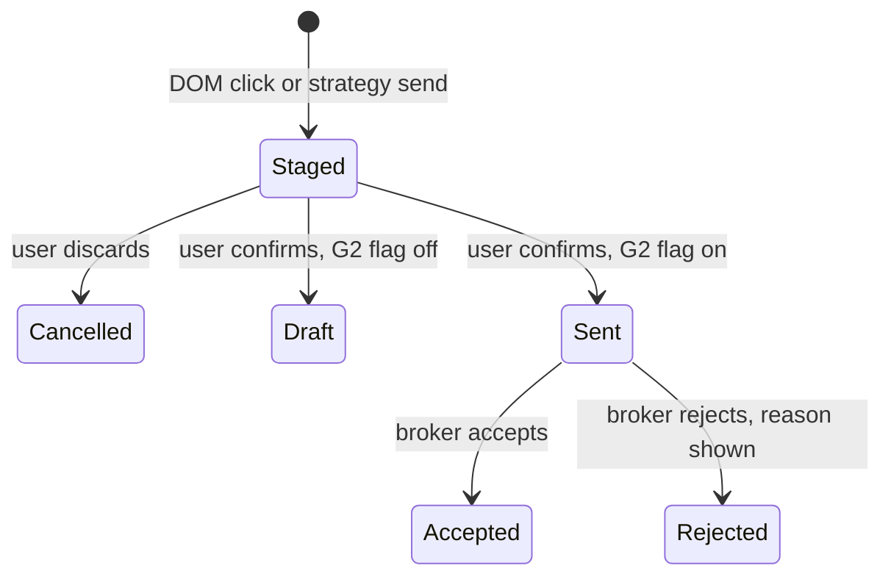

# Axiom Charts - Plan

## Goal Capsule

- **Objective:** A desk trader opens one chart and gets everything needed to decide on an Indian F&O or equity instrument: price, strikes, positioning, volatility, and what the evidence says, each with its base rate. The desk stops opening TradingView for charts, Sensibull, Opstra or Tradl for position building, and GoCharting for market profile and order flow.
- **Means:** An options-native chart with strikes on the price axis and the strategy builder on the chart. An insight rail driven by a quant-specified detector catalogue. Cross-stock pattern twins. An AI screener builder that backtests itself. One auction model per instrument that reads market profile, volume profile and order flow across nested timeframes, with a DOM ladder that sends confirmed orders through the broker. Point-in-time replay across all of it.
- **Product authority:** Extends `docs/plans/2026-11-12-1110-feat-axiom-desk-platform-plan.md` (the platform plan), units U14–U17, and proposes amendments to R12, R14, R20, R49, R56, R110, R116, R126, KTD6, units U7, U12, U14–U19, U21 and U25, gates G1, G2 and G5, and PR5 sequencing, listed under Platform Plan Amendments. Platform R-IDs are not edited here. New IDs continue the platform plan's sequences: R155+, F11+, AE21+. Where this contract and the platform plan disagree, the platform plan stands until an amendment is accepted into it.
- **Execution profile:** four PRs (PR1–PR4 under Implementation Units). PR1 is buildable now. PR2 waits on the renderer decision and G5, PR3 on platform U7–U12, U19 and U25, PR4 on the G1 tick-by-tick feed and platform U21.
- **Stop conditions:** stop and report if a settled decision proves infeasible in the build, if a golden value cannot be matched to its reference formula, or if the R191 or R218 frame budget fails on the named hardware profile.
- **Open blockers:**
  - The U14 renderer decision is open. SciChart was not run (no licence key), the R126 timed tasks were not run (no named desk testers), and 16 charts with the rail open has never been measured.
  - `DESIGN.md` has no chart-pane tokens. G5 blocks chart screen work until it does.
  - Desk quants have not specified the V1 detector catalogues (R169, R200) or the auction pattern catalogue (R209). Intraday detectors launch uncalibrated until Axiom's own archive is deep enough.
  - No tick-by-tick and depth feed is contracted (G1). Footprint, delta, absorption, the heatmap and the DOM depth view (R205, R215) cannot ship without it.
  - Sending orders from the chart (R215) waits on G2 legal review of the broker-API order path.

---

## Product Contract

The Product Contract below keeps its stable IDs. Planning revised R206 and added R219–R226 after the user confirmed them in the scoping synthesis; nothing else changed meaning.

### Summary

Axiom Charts becomes an options-native workbench. Strikes, OI and surface IV sit on the price axis, and strategies are built by clicking strikes and drawn as payoff on the price chart. An insight rail beside the focused chart answers a few desk questions per instrument, then streams evidence-graded insights from quant-signed detectors. Equity charts find pattern twins across stocks and show past analogs, winners and losers. An AI screener builder backtests every screen point-in-time, reports its efficacy, and says plainly when no tweak improves it. A single auction model per instrument reads market profile, volume profile and order flow across today, the current balance and the expiry cycle with no setup, and streams a pre-open plan and scenario cards in Dalton's terms with Axiom's own base rates. A DOM ladder stages an order on a click and sends it through the broker after one confirm. Replay restores all of this exactly as known at any past moment.

### Problem Frame

Desk traders read price in TradingView, then switch to Sensibull, Opstra or Tradl to build and size the position. They read OI build-up, rollover, participant positioning and vol context by hand across tabs. No tool connects those signals to the instrument on screen, says how often each signal has meant anything before, or explains why one strike is a better fit than another for a stated objective.

TradingView is weakest exactly here for an Indian F&O desk (checked 2026-11-13, sources below):

- No IV rank, IV history, smile or surface.
- Per-strike OI only through community scripts. No native PCR, max pain or participant OI (UNVERIFIED absence).
- No options or futures screener.
- Patterns carry no hit rates or sample sizes.
- Replay is not point-in-time.
- Real-time NSE F&O for a professional desk needs an exchange agreement and the top tier.

Its options strategy builder and AI Copilot mean that a payoff diagram and a chart-drawing assistant do not set Axiom apart. Positioning, the arbitrage-free surface, evidence and point-in-time correctness do.

Equity charts have the same gap. Patterns are shown without the story of what followed past occurrences. Screens are built without any measure of whether they ever worked, so the desk backtests them separately in Excel or Python.

Market profile and order flow cost a separate subscription and a separate tool. On GoCharting, the desk's current one, market profile is complex to set up and does not stay clean across timeframes, yet a profile read needs the day, the multi-day balance and the expiry cycle together, with HVN/LVN and order flow beside it. The trader still does the Dalton-style synthesis in their head, and none of these tools says how often a profile pattern has meant anything on NSE.

### Key Decisions

- **The wedge is the options-native chart.** Evidence on the chart, point-in-time replay and speed are kept as supporting pillars, not the lead. Governs R155–R164. (session-settled: user-approved — chosen over evidence-on-chart, point-in-time replay and speed-plus-agent as the primary wedge: TradingView is weakest for NSE F&O.)
- **The chart owns the strategy builder, point-in-time replay, cross-stock pattern twins and 16 synced charts.** Governs R155–R158, R173–R176, R184–R189, R190. (session-settled: user-directed — all four chosen over leaving them where the platform plan put them.)
- **The AI screener builder is fully in this contract.** Governs R177–R183. (session-settled: user-directed — chosen over charts owning only the screener joins, and over dropping the screener: the user wants one contract for the whole loop.)
- **Strikes are ranked by evidence for a stated objective, never called favourable.** Stories show winners and losers. Governs R159, R171, R175. (session-settled: user-approved — chosen over direct "favourable strike" language everywhere and over a direct desk voice with a neutral retail voice: keeps R17, R77 and broker SEBI exposure intact.)
- **Insights sit in a rail beside the focused chart.** The strike ladder is on the price axis, with the positioning pane and a collapsible builder below. Governs R165, R172. (session-settled: user-approved — chosen over all-on-chart pins and a 50/50 chart-plus-workbench split, judged on a rough layout sketch.)
- **A quant-specified detector catalogue powers the rail, led by question cards.** The agent only explains. Governs R166–R170, R194. (session-settled: user-approved — chosen over a stream with no question cards and over an agent-written narrative: the engine computes every number, per KTD5, and TradingView Copilot already does narrative.)
- **When no screen tweak survives testing, the builder says so.** Governs R180, R181. (session-settled: user-approved — chosen over showing the best in-sample tweak with a warning: in-sample winners invite overfitting.)
- **Everything ships in sequence, with no MVP cut.** (session-settled: user-directed — chosen over a one-month index-only slice: the user wants every piece built one by one.)
- **Replay shows detectors as they were live, and includes paper trading.** Governs R184, R187, R196. (session-settled: user-approved — chosen over replaying with today's detector versions by default, and over leaving paper trading in V1.5 per platform R47: keeps "as known then" true while serving practice.)
- **"Easy" is measured, and the look is designed elsewhere.** Ease is judged by timed tasks against TradingView. Finish and motion come from the repo's design pipeline (DESIGN.md, ui-ux-pro-max, impeccable) under G5. Governs R192, R195.
- **Order flow runs on a contracted tick-by-tick feed and is labelled as inferred.** Governs R205, R206. (session-settled: user-approved — chosen over coarse delta from snapshot feeds and over shipping profile in V1 with order flow in V1.5: a real footprint needs per-trade data, and no NSE feed carries the aggressor side.)
- **Composite profiles with naked POCs, the VWAP family, the liquidity heatmap and options flow by strike are all in.** Governs R202, R204, R205, R207. (session-settled: user-directed — chosen from a list where each was optional.)
- **Profiles sit per session inside the chart, Dalton-style.** The strike ladder keeps the price axis, and a composite profile lane sits at the far right. Governs R203. (session-settled: user-approved — chosen over stacked permanent axis lanes and one switchable axis lens, judged on a rough layout sketch.)
- **Suggestions come as a pre-open plan plus live scenario cards and quiet chart marks.** Governs R212, R213. (session-settled: user-approved — chosen over live scenarios only and over marks only.)
- **One auction model per instrument drives every profile and order-flow suggestion.** Overlays are views of it. Governs R208–R214. (session-settled: user-approved — chosen over an indicator toolkit of separate overlays: the user wants the synthesis done for them, not more parts.)
- **The chart sends orders through the broker after one confirm in Axiom.** Governs R164, R215, R216. (session-settled: user-directed — chosen over true one-click sending and over keeping DOM clicks as drafts confirmed in the broker's window: the user wants order placement on the chart through the broker integration.)
- **No 3D on chart panes.** The volatility surface in 3D lives in the Volatility Lab. Chart panes keep the renderer's frame budget, per the repo's UI constraints.

### Actors

Uses the platform plan's actors: A1 desk user (traders, PMs, analysts, quants) and A5 Axiom agent. Desk quants, part of A1, specify and sign off every detector, question card and screen-efficacy statistic.

### Requirements

**Options-native chart**

- R155. On any F&O underlying or contract chart, the price axis carries a strike ladder showing per-strike OI, OI change and surface IV (R68) at each strike's price level, for a selected expiry.
- R156. The ladder shows call and put columns for each strike. A click adds a bought one-lot leg of that type, and a shift-click adds a sold one. Each leg is a chip on the chart that edits side, lots and expiry, and dragging the chip moves it along the strike axis.
- R157. The on-chart strategy draws its payoff at expiry and at a chosen date, breakevens, max profit and loss, and a probability cone from the surface directly on the price chart, with the R38 outputs in the builder below.
- R158. Dragging spot, IV or time reprices the on-chart strategy live, extending R121 to strategies not yet traded.
- R225. Dragging IV shifts every leg's implied volatility by the same amount by default, and the drag handle shows the mode.
- R159. For an objective picked from a closed, quant-signed list, the chart ranks strikes and expiries. Examples: cheapest vega per rupee, highest theta per unit of risk, best liquidity at a target delta, cheapest protection to a level. Each ranked strike shows the metric, bid-ask cost, liquidity and evidence, and is never labelled favourable, buy or sell. The agent maps a free-text objective onto the list, or says none fits.
- R160. Each expiry shows one F&O-implied range combining implied-move bands (R115), OI walls, pin probability (R78) and positioning, with the base rate of the underlying settling inside such ranges.
- R161. OI walls and positioning-derived support and resistance levels are drawn on price with their strength, today's shift, and their historical hold rate per R86–R93.
- R162. The positioning pane (R114) adds rollover percentage and cost against their own history and futures build-up class over time. Participant-wise OI changes (FII, DII, Pro, Client) appear as market-level context, labelled as such and never attributed to the charted instrument.
- R163. Every options-native element reads one chain and surface snapshot and shows its as-of time and freshness per KTD9. An element whose input is unavailable is hidden with the reason shown.
- R164. An on-chart strategy is sent as a multi-leg order through the R215 stage-and-confirm path. Until G2 clears that path, sending creates a ticket draft per R55.

**Insight rail**

- R165. Each layout has one insight rail that follows the focused chart and covers only that chart's instrument.
- R166. The rail opens with question cards answering a fixed set of desk questions per instrument class. For F&O: where it is likely to settle by expiry, who is positioned and how that is changing, whether vol is cheap or rich, and what the current setup usually does. For equities: what pattern is forming and what usually follows, who is accumulating, and where it ranks in its sector.
- R167. Below the cards, the rail streams insights ranked by significance per R117, within the user's budgets per R118.
- R168. Every question-card answer and insight comes from a versioned detector in a catalogue that desk quants specify and sign off, and the agent explains detector outputs without computing new numbers (KTD5).
- R169. The V1 F&O detector catalogue covers:
  - long build-up, short build-up, short covering and long unwinding, at contract and strike level
  - rollover against its base
  - OI walls and their shifts
  - participant-wise OI shifts, as market-level context only
  - PCR and max-pain changes
  - basis anomalies
  - IV against RV and VRP bucket state (R146)
  - skew and term-structure shifts
  - pin candidates and unusual activity

  Each detector is tagged as either calibrated at launch from purchased end-of-day history, or uncalibrated until the R110 archive is deep enough. Question cards use calibrated detectors first.
- R200. The V1 equity detector catalogue covers the three equity questions in R166: R16 chart patterns with their forward outcomes, accumulation from delivery percentage and institutional-flow changes (R133, never naming entities per R77), and sector-relative rank (R135). It carries the same calibration tags as R169.
- R170. Every insight opens an evidence card per R86–R93: base rate, sample, confidence interval, out-of-sample status, and what followed past occurrences, failures included. Otherwise it shows insufficient evidence per R95.
- R171. Each insight tells its story in plain language: what changed, against what normal, what historically followed, and what would invalidate it. The text never uses buy, sell, favourable or assured wording (R17, R77).
- R226. The insight stream controls false discoveries across each instrument's emissions for the day, and an insight that fails the control is not streamed.
- R172. Selecting an insight highlights its strike, level or time on the chart, and selecting a chart object shows the insights attached to it.

**Pattern twins and stories**

- R173. From a detected pattern or a user-selected chart region, "find twins" returns instruments across the R7 universe whose current price action matches, ranked by similarity, each with its evidence card.
- R174. The same request returns past analogs from any instrument, drawn from a point-in-time universe that includes delisted names (R153). Their forward paths are drawn as the R116 fan, with winners, losers and the split shown.
- R175. A pattern's story names the conditions that separated analogs that worked from those that failed, such as regime, volume, sector strength or F&O positioning, only where the difference passes R90. Otherwise it says no distinguishing condition was found.
- R176. Every twin search, analog split and story condition counts as a tested variant under R90, in one family per request and pattern definition, not desk-wide.
- R222. A twin set saved as a screen becomes a criterion "similar to this pattern at or above a stated threshold", evaluated point-in-time on each date. A fixed list of names saves as a watchlist.
- R198. Twins and analogs appear in a results tray under the rail, which is exempt from R165's one-instrument rule. Selecting a twin previews it without moving focus, and "open in layout" places it in a chosen chart slot.

**AI screener builder**

- R177. A user builds a screen by typing or saying it in plain language or by editing criteria, and confirms the structured criteria before the screen runs.
- R178. Every saved screen is backtested automatically and point-in-time. The universe is taken as of each date with delisted names (R153), fundamentals as reported, prices corporate-action adjusted (R3), and history split at SEBI rule-change dates (R110).
- R179. Screen efficacy shows the forward returns of matches against the universe base rate at stated horizons, with hit rate, sample size, confidence interval, turnover, after-cost expectancy, decay over time and regime-conditioned results, per R86–R93.
- R180. The builder suggests criteria to add or remove, and presents a suggestion as an improvement only when it passes R88–R90 out of sample. Every backtested revision of a screen, whether the user or the builder made it, counts as a tested variant in one family for that screen's lineage. The efficacy card shows the lineage's cumulative variant count.
- R181. When no suggestion passes, the builder says no improvement was found and lists what was tried, how many variants, and why each failed.
- R182. A saved screen tracks its live matches forward, and its live efficacy is shown separately from its backtest.
- R223. The builder keeps a final holdout with a fixed number of looks. When they are spent it shows "holdout spent" and the date of new data that unlocks it, separate from R181. Backtests the agent runs count in the lineage (R180) within a per-request budget, and the efficacy card shows how many the agent started.
- R199. Editing a saved screen forks a new version in the same lineage, and the new version's live tracking starts fresh.
- R183. Screen criteria can use equity fields, the F&O screens in R80, detected patterns and rail detectors. Every result opens into a chart with the matching criteria highlighted (R27).

**Point-in-time replay**

- R184. Replay restores everything on the chart surface for the replayed timestamp, exactly as known then: chart, chain, surface, OI, positioning, rail, question cards, patterns, evidence cards and screen results. Nothing computed with later data appears. Detectors show the version live at that timestamp from recorded outputs. Before a detector went live it shows "detector not yet live", unless the user opts into a backfill of the current version, which is labelled as a backfill.
- R196. Replay is an explicit mode. Every chart, the rail and the builder show a non-dismissible "Replay as of <time>" state. Send-to-ticket (R164) is replaced by paper trade, and paper positions stay in a separate replay book after exit.
- R185. Evidence statistics shown in replay use only history available before the replayed timestamp.
- R186. Replay runs synced across every chart in a layout, at selectable speeds, in tick, second or bar steps wherever the data supports that step.
- R187. During replay a user can build on-chart strategies and paper-trade them, with fills at that moment's bid-ask and costs.
- R188. Alerts and triggers evaluate in replay as replay events and never send a live notification.
- R189. Chain, surface and every detector output can be read as of any past timestamp in the archive.

**Auction, market profile and order flow**

- R201. Every intraday chart opens with market profile and no setup: 30-minute TPO periods over the NSE session, the 09:15–10:15 initial balance, a 70% value area and the POC. Index profiles are built on index futures, because index spot has no volume. A changed setting is labelled non-default and carries no base rate.
- R202. Profiles combine three nested timeframes by default: today, the current balance (a composite from the session the market last entered balance, with a rolling 5 sessions as fallback), and the expiry cycle (last expiry to next expiry under the SEBI calendar in force). Weekly and monthly value appear as reference levels. Composites use a basis-adjusted continuous futures series, so contract rolls add no false structure.
- R203. The chart draws each session's TPO profile inside the chart beside that session's bars, with a composite profile lane at the far right. On F&O charts the strike ladder keeps the price axis.
- R204. The volume profile (R14) marks HVNs and LVNs. Naked POCs, unfilled single prints and poor highs and lows carry forward as reference levels until traded. Session and anchored VWAP draw with deviation bands, anchored by click or to an event: an expiry, results or a gap day.
- R205. Zooming in past a threshold replaces bars with a footprint of volume at bid and ask, delta and imbalances per price. A cumulative-delta pane and a liquidity heatmap of resting depth by price, with large-order pulls, refills and large-trade prints, are toggles. These appear only where the tick-by-tick feed covers the instrument; elsewhere they are hidden with the reason shown.
- R206. Every order-flow value is labelled as using an inferred aggressor and shows, per instrument and session, the share of trades classified unambiguously at the bid or the ask.
- R207. The strike ladder (R155) adds options volume and OI change by strike, and dealer gamma levels labelled as a model resting on a stated assumption about who is short options.
- R208. One auction model per instrument tracks: balance or imbalance and its duration, the day type and open type forming, location against prior and composite value, other-timeframe or day-timeframe control, and whether order flow confirms. Desk quants specify and sign it off like the R168 catalogue.
- R209. The V1 auction pattern catalogue covers:
  - day types: normal, normal variation, trend, double distribution, neutral, neutral extreme, non-trend, P and b profiles
  - open types: open drive, open test drive, open rejection reverse, open auction in and out of range, each read against prior value and range, plus inventory correction at the open
  - structure: the 80% rule, IB and range extension, single prints, poor highs and lows, excess, balance-area breakouts with look above or below and fail, value migration, naked POCs, HVN acceptance and LVN fast travel, other-timeframe control
  - order flow: absorption, exhaustion, stacked imbalances, delta divergence, initiative against responsive activity, trapped traders

  Each pattern records its source theory, detection rule, timeframes, what the source says follows, and what invalidates it.
- R210. Every pattern shows the source's reading, such as "Dalton's reading: …", beside Axiom's own NSE walk-forward base rate and sample per R86–R93, or "uncalibrated". Profile patterns may calibrate from purchased 1-minute history. Order-flow patterns stay uncalibrated until Axiom's tick archive is deep enough. No pattern is stated as fact.
- R211. Day type and open type are provisional during the session, shown as a probability per period, and fixed at 15:30. The shortened 15:15–15:30 period is excluded from day-type thresholds, and the futures pre-open auction is its own open reference.
- R212. Before the open, each instrument gets a plan card: the open relative to prior value and range, likely day types, the key reference levels, and scenarios with base rates and invalidation.
- R213. During the session, auction scenario cards stream into the insight rail (R167) as they trigger. Quiet chart marks label poor highs and lows, single prints, IB breaks, range extension and absorption. Each mark carries a one-line plain explanation and opens its evidence card. Wording follows R171.
- R214. Auction-model fields are screener criteria (R183). Replay (R184) restores profiles, the auction state, footprint and cards as known then. Individual trades replay for a recent window, and older sessions replay from per-price, per-minute totals.

**Built-in indicators**

- R219. The built-in library ships this V1 core set, each with the R14 behaviours:
  - trend: SMA, EMA, WMA, HMA, VWMA, DEMA, TEMA, Supertrend, Ichimoku, Parabolic SAR, ADX/DMI, Donchian, Keltner
  - momentum: RSI, MACD, Stochastic, Stoch RSI, CCI, Williams %R, ROC, MFI
  - volatility: Bollinger Bands with %B and bandwidth, ATR, historical volatility, Chandelier exit
  - volume: volume, OBV, A/D, CMF, relative volume, session and anchored VWAP, volume profile
  - levels: classic and Camarilla pivots, CPR, previous day, week and month high and low
  - India: delivery percentage, futures OI and OI change on price, PCR, India VIX overlay
- R220. A new chart opens with defaults by interval. Intraday shows candles, volume, session VWAP and the TPO profile. Daily and above shows candles, volume, and the 50 and 200 SMA. F&O charts add the R193 defaults.
- R221. Each built-in matches its published reference formula on fixed golden series. RSI and ATR use Wilder smoothing, EMA states its seed, nothing draws before warm-up, session indicators reset on the IST trading calendar, and inputs are corporate-action adjusted. A formula change is a new indicator version, and evidence cards cite the version.

**Orders from the chart**

- R215. A DOM ladder shows depth by price. Clicking a price stages a priced order, and one explicit confirm in Axiom sends it through the broker integration. Each send records who confirmed it and when. Until G2 clears the broker-API path, the confirm creates a ticket draft per R55.
- R216. The agent can stage an order but never confirm one. Replay never sends a live order (R196).

**Layout, speed and ease**

- R190. A layout holds up to 16 charts synced by symbol, interval, crosshair, time and date range. Price-anchored drawings sync across charts that plot the same price series, and time-only drawings sync across all charts.
- R191. With 16 F&O charts taking live ticks, the R193 defaults on, one on-chart strategy with payoff and cone, and the rail open, the chart holds at least 60 fps. The limits are p95 frame time at most 16.7 ms, p99.9 at most 33 ms, and at most 3 frames over 50 ms in a 10-minute session, over 3 runs on a named desk hardware profile.
- R192. Every chart tool has a keyboard path and a command-bar entry (R127), and the most-used tools take one keystroke.
- R193. The rail is on by default for every instrument with catalogued detectors. The strike ladder and positioning pane are on by default for F&O charts only, within the U17 overlay budget.
- R197. Chart focus moves by keyboard, by cycling or by jumping to a slot, with a visible focus ring that matches the rail's instrument. Ladder strikes, rail items and strategy legs are labelled controls reachable by keyboard and screen reader. Gain or loss, call or put, and wall strength are never shown by colour alone.
- R217. Every chart element has a named colour role on the white ground, including TPO periods shaded by time, the value area, POC, HVN and LVN, two-sided delta and imbalance, the heatmap ramp, VWAP bands, naked levels, the strike ladder and rail card types. Each role pairs with a shape or label per R197.
- R218. Profiles and the heatmap sit inside the R191 budget. Footprint has its own budget: up to 4 footprint charts in a layout hold the R191 frame limits.
- R224. Below the tablet breakpoint a layout shows one chart, the rail opens as a bottom sheet, and the strike ladder becomes a tap list with explicit buy and sell leg buttons.
- R194. The agent can build an on-chart strategy, rank strikes, find twins, build and explain a screen, and start a replay on request, with the same results as the screen (R4). It explains any rail item by citing its detector and evidence card.
- R195. The R126 timed-task set adds six tasks:
  - build a short straddle on the chart
  - read the implied range to expiry
  - rank strikes for an objective
  - find twins of a pattern
  - build and backtest a screen
  - start a synced replay
  - read the day's plan card
  - find the naked POCs in the current balance
  - spot absorption at a level

  The last three are also timed against the desk's current profile tool, GoCharting.

### Visualizations

The layout chosen for the focused chart (rough probe; final layout comes from the design pass):



One detector catalogue feeds every surface, live and in replay:



### Key Flows

- F11. Instrument to strategy draft
  - **Trigger:** A trader opens BankNifty from the command bar.
  - **Steps:** The ladder, positioning pane and rail load for the nearest expiry. The trader reads the "where will it settle" card and the short-covering insight, and opens its evidence card. They rank strikes for "highest theta per unit of risk", shift-click two strikes to sell a strangle, drag IV down 2 points to see P&L, and send it as a staged order they confirm in Axiom.
  - **Covers:** R155–R160, R164, R166, R170.
- F12. Pattern to twins to screen
  - **Trigger:** A flag is detected on an equity chart.
  - **Steps:** The rail explains the pattern and its story. The trader asks for twins, sees six current matches and the analog fan, and saves the twin set as a screen. The screen backtests automatically.
  - **Covers:** R173–R176, R177–R179.
- F13. Screen build and improve
  - **Trigger:** The analyst types "stocks above 200 DMA with rising delivery and FII buying in sector".
  - **Steps:** The analyst confirms the parsed criteria. The backtest reports efficacy against the base rate. They ask for improvements and get either passing suggestions or "no improvement found" with the tried list. They save the screen, and live tracking starts.
  - **Covers:** R177–R183.
- F14. Replay session
  - **Trigger:** The trader replays the expiry day of a past week across a 4-chart layout.
  - **Steps:** Chain, rail and patterns appear as they were known then. The trader paper-trades a straddle at that moment's bid-ask. A trigger hit shows as a replay event.
  - **Covers:** R184–R188.
- F15. Auction read to order
  - **Trigger:** Before 09:15, a trader opens NIFTY futures.
  - **Steps:** The plan card shows the open below yesterday's value, the current balance in its sixth session, and two scenarios with base rates. At 09:45 an "open test drive" mark appears at yesterday's poor low, with absorption on the footprint. A scenario card for acceptance back into value streams into the rail. The trader stages a buy limit on the DOM at the value-area low and confirms it in Axiom.
  - **Covers:** R201–R206, R208–R213, R215.

### Acceptance Examples

- AE21. **Covers R159, R171.** The user ranks puts for "cheapest protection to 22,000 by expiry". The list shows cost, bid-ask and liquidity per strike, and no row or label says favourable, buy or sell.
- AE22. **Covers R163.** The surface goes stale at 10:42. Ladder IV, the probability cone and the implied range hide with "surface stale since 10:42", while OI stays visible.
- AE23. **Covers R170.** A short-covering insight on a thinly traded stock option has a sample below the R88 minimum. Its card shows insufficient evidence, not a hit rate.
- AE24. **Covers R180, R181.** The user asks to improve a screen. 40 variants are tried and none survives correction. The builder shows "No improvement found", the list of 40 variants tried, and why each failed.
- AE25. **Covers R184, R185.** In replay at 10:30 on a past date, the rail shows a short-covering insight detected at 10:28 and not one detected at 11:00. Its base rate uses data before that date only.
- AE26. **Covers R188.** A price trigger is crossed during replay. It is logged as a replay event and no email or in-app live alert is sent.
- AE27. **Covers R174.** The analogs for a cup-and-handle include a since-delisted company whose pattern failed, and it counts in the loser split.
- AE28. **Covers R165.** With 16 charts open, focus moves from chart 3 to chart 11. The rail switches to chart 11's instrument and shows nothing from chart 3.
- AE29. **Covers R164, R215.** Sending an on-chart iron condor stages a four-leg order. Nothing reaches the broker until the user confirms it in Axiom, and the send records who confirmed it.
- AE31. **Covers R211.** At 11:00 the engine shows "trend day forming, 58%". At 15:30 the day closes back inside the IB, and the label fixes as normal variation. Replay at 11:00 shows the 58% read, not the final label.
- AE32. **Covers R210.** An 80% rule card reads "Dalton's reading: value-area re-entry often traverses value" beside Axiom's NSE base rate for NIFTY futures with its sample, or "uncalibrated" when the sample is below the R88 minimum.
- AE33. **Covers R205.** A cash stock with no tick-by-tick coverage shows TPO, volume profile and VWAP. Footprint, delta and heatmap are hidden with "no tick-by-tick coverage for this instrument".
- AE34. **Covers R216.** The agent stages a two-lot NIFTY futures order from the DOM on request. The order waits for the user's confirm, and the agent has no way to confirm it.
- AE30. **Covers R196.** During a replay of a past expiry day, the builder offers "Paper trade" and no "Send to ticket". After exit, the paper straddle stays in the replay book, and no live draft exists.

### Success Criteria

- The desk does daily charting and position building in Axiom without opening TradingView, Sensibull, Opstra or Tradl. This counts toward the platform V1 gate.
- In the R126 and R195 timed tasks with named desk users, Axiom's median time beats TradingView's on every task TradingView supports. Tasks TradingView cannot do are recorded as unsupported there.
- On the R195 options tasks (short straddle, implied range, strike ranking), Axiom's median also beats each tester's current options tool: Sensibull, Opstra or Tradl.
- The desk builds and backtests its screens in Axiom instead of Excel or Python. This counts toward the platform V1 gate.
- The R191 frame budget holds in the U14 harness with 16 charts and the rail open, and R218 holds with 4 footprint charts.
- The desk cancels its separate market profile and order flow subscriptions, and Axiom's median beats GoCharting on the three profile tasks in R195.
- Every detector in the catalogue appears in the Edge Ledger (R144) and is demoted when it stops beating its base rate.

### Scope Boundaries

**Deferred for later**

- Retail-client voice, plain-language layer and RA routing for rail content and screens (V2, per R60, R62, R125).
- Pine-like scripting (V1.5+, per R15).
- Custom profile scripting (with Pine-like scripting, V1.5+).
- Order flow on global or crypto instruments.
- Webhook and messaging alert delivery (V1.5, per R128).
- Detectors beyond the R169 catalogue and equity question cards beyond R166. Each is added after quant sign-off.

**Outside this product's identity**

- Sending an order without the user's explicit confirm of that order, including engine-fired automatic, bracket or conditional orders.
- Naming entities behind positioning or calling activity manipulation (R77).
- Outcome language that promises or reassures ("assured", "favourable", "sure-shot").
- An agent-written narrative that computes its own numbers.
- 3D or HyperFrames content on chart panes.

### Platform Plan Amendments

Proposed changes to `docs/plans/2026-11-12-1110-feat-axiom-desk-platform-plan.md`. None is applied by this document.

- **R12:** raise the layout cap from 8 to 16 charts and add date-range and drawing sync, as stated in R190.
- **R14:** the built-in library names its V1 core set and correctness standard (R219–R221), and volume profile adds HVN and LVN marks per R204.
- **R49:** market profile, footprint and order flow move from V1.5 into V1 per R201–R214.
- **R56:** an explicit per-order confirm inside Axiom, sent through the broker integration, satisfies R56 per R215. It replaces confirmation inside the broker's own order window.
- **R20:** replace "step through history" with point-in-time replay per R184–R188.
- **R110:** add as-of reads of chain, surface and detector outputs per R189. Today R110 archives daily, and only U7 has an intraday snapshot as-of query.
- **R116:** extend analogs from the charted instrument to the whole point-in-time universe per R173–R176.
- **R126:** add the six tasks in R195.
- **R47:** paper trading moves from V1.5 into V1 for replay only, per R187.
- **KTD6:** change the spike's load from 8 to 16 synced charts with the rail open, and judge it against R191.
- **U7:** owns R189.
- **U12:** registers detectors (R168) and counts twins, story conditions and screen suggestions as tested variants (R176, R180).
- **U14:** re-runs the spike at 16 charts, with SciChart licensed and two named desk testers, before any chart feature work. It owns R184–R186, R188, R190, R191, R196, R197, and the rendering in R203, R205, R217 and R218.
- **U15:** owns R173–R176, R198, the strike-ranking math in R159, the profile math in R201, R202 and R204, and the indicator core in R219–R221.
- **U16:** owns R192 and R195.
- **U17:** owns the strike ladder, implied range, OI walls and positioning additions (R155, R160–R163), plus the rail (R165–R172), the equity catalogue (R200), R193, R207, and the auction model and its cards (R208–R213).
- **U18:** owns the screener builder (R177–R183, R199). The platform plan has no screen-efficacy or screen-backtest requirement today.
- **U19:** keeps the strategy engine (R38, R81). The on-chart builder surface (R156–R158, R164, R187) moves to U17.
- **U25:** owns the agent actions in R194 and the stage-only rule in R216.
- **U21:** owns the order path in R215: staging, the Axiom confirm, broker send and the record of who confirmed.
- **G1:** adds a tick-by-tick and depth feed for index and liquid stock futures (R205).
- **G2:** adds legal review of sending confirmed orders through the broker API (R215).
- **G5:** `DESIGN.md` adds chart-pane tokens: ladder, rail, payoff, cone and evidence card.
- **PR5 sequencing:** U17 and U18 now depend on U7 as-of reads and the U12 detector registry. This plan's PR3 also needs U19's strategy engine and U25's agent runtime, which sit in platform PR6 after PR5. Platform PR6 must land U19 and U25 before this plan's PR3, so the platform plan reorders them or splits PR6. This plan's PR1 and PR2 need none of it.

### Dependencies / Assumptions

- The archive (R110) holds intraday chain and surface snapshots dense enough for tick, second or bar replay of options elements. Where it does not, replay offers only the steps the data supports (R186).
- Participant-wise OI is end-of-day NSE data, published by category (index or stock, futures, calls or puts, long or short) across all underlyings, not per instrument. Intraday participant shifts are not available, and R162 shows the as-of date. The per-instrument "who is positioned" card (R166) answers from contract- and strike-level build-up and OI change.
- Desk quants can specify and sign off the R169 catalogue. Rail breadth grows only as fast as they do.
- A vendor streams NSE and NFO tick by tick with depth (Global Datafeeds does, per `docs/research/2026-11-12-build-research.md`). Its history depth and licence terms for storing ticks are UNVERIFIED.
- No NSE feed flags the trade aggressor, so delta is classified from quotes per R206.
- NSE monthly expiry is the last Tuesday for contracts from 1 Sep 2025, and futures have a 09:00–09:15 pre-open auction from 8 Dec 2025 (secondary sources, see `docs/research/2026-11-14-market-profile-order-flow-patterns.md`).
- The custom Canvas2D renderer measured 120 fps (p95 9.2 ms) at 8 charts, in single runs. 16 charts are unmeasured.

### Outstanding Questions

**Deferred to Planning**

All planning questions are resolved in the Planning Contract (KTD2–KTD19). Items still open are build gates, listed under Planning Contract, Gates and Open Questions.

### Sources / Research

- Platform plan: `docs/plans/2026-11-12-1110-feat-axiom-desk-platform-plan.md`. Covers R9–R30, R38, R68, R74–R95, R110–R129, R144–R154, KTD5, KTD6 and KTD9, U7, U12, U14–U19, and G5.
- Market profile and order-flow pattern research: `docs/research/2026-11-14-market-profile-order-flow-patterns.md`. Dalton's *Mind Over Markets* and *Markets in Profile*, Steidlmayer's CBOT material, Cont–Kukanov–Stoikov (2014), Osler (2003). It found no peer-reviewed test of profile patterns, which is why R210 pairs the source's reading with Axiom's own base rate.
- Renderer spike: `tools/benchmarks/renderer/RESULT.md` (partial, no decision).
- Design inputs: `PRODUCT.md`, `DESIGN.md` (provisional, no chart tokens), `references/TASTE.md`.
- Options research: `docs/research/2026-11-12-options-benchmark.md`, `docs/research/2026-11-12-options-literature.md`.
- TradingView baseline, checked 2026-11-13 from TradingView's own pages:
  - options volatility page: https://www.tradingview.com/symbols/NSE-NIFTY/options-volatility/
  - futures-only intraday OI: https://www.tradingview.com/blog/en/intraday-open-interest-futures-55091/
  - screener list: https://www.tradingview.com/features/
  - auto patterns without statistics: https://www.tradingview.com/support/solutions/43000690464-auto-chart-patterns-on-tradingview/
  - replay limits: https://www.tradingview.com/support/solutions/43000712747-bar-replay-how-and-why-to-test-a-strategy-in-the-past/
  - NSE F&O professional data: https://www.tradingview.com/support/solutions/43000777677-can-i-access-real-time-futures-and-options-data-from-nse-and-bse/
  - layout sync: https://www.tradingview.com/support/solutions/43000629992-how-to-sync-the-charts-of-my-layout/
  - options strategy builder: https://www.tradingview.com/blog/en/new-product-tradingview-options-44783/
  - AI Copilot: https://www.tradingview.com/support/solutions/43000795131-getting-started-with-ai-copilot/
  - tiers and prices: https://in.tradingview.com/pricing/
  - UNVERIFIED: no PCR, max pain or participant OI, and no delisted-symbol handling, since TradingView states neither absence.

---

## Planning Contract

Unit IDs in this plan (U1–U29) are plan-local. Units of the platform plan are written "platform U14" and so on.

### Context and Constraints

The repo has platform U1–U4 built: the capability registry and envelope (`packages/core/src/axiom_core/registry.py`, `envelope.py`), published runs (`runs.py`), jobs (`jobs.py`, `services/worker/main.py`), codegen (`services/api/src/axiom_api/codegen.py`) and `packages/registry-ts`. `apps/desk` has the landing page and desk sign-in. `tools/benchmarks/renderer/` holds the U14 spike. Every engine package the chart reads (data, quant, options, evidence, chartmath, equity) is unbuilt, as are platform U5–U13, U19, U21 and U25.

What the research found that shapes this plan:

- The browser has no path to `/capabilities/*`. The session is a `__Host-` cookie, and the route wants a Bearer token.
- `ts_type` in codegen has no `$ref` support, so nested inputs (legs, criteria) become `unknown`, and output types are not generated.
- `RunStore` has no as-of read, version column or tenant column. The next migration number is `0006`.
- All API requests share one sqlite connection. There is no realtime transport (platform U8).
- `Registry.check()` requires all three bindings on every capability, so a human-only action cannot be registered honestly.
- `apps/desk/test/copy-rules.ts` bans "buy" and "sell" across page copy.
- The spike harness measures p99 and frames over 20 ms for 20 s at 8 charts in one run. R191 needs more.

Repo rules that bind every unit: the feature pipeline in `CLAUDE.md` (groom, archify diagrams in `docs/diagrams/`, ui-ux-pro-max then impeccable, build), the G5 start gate on desk screens, no three.js or HyperFrames on chart panes, and screenshots at 375, 768 and 1280 in light and dark before a UI unit is done.

### Key Technical Decisions

- KTD1. **Capabilities may declare a human-only binding with a stated reason.** `Capability` gains an optional reason that exempts it from the agent binding, and a CI test holds the allowlist. A separate manifest test names every chart capability this plan adds, so a missing one fails CI instead of passing silently. Governs U1.
- KTD2. **Drag repricing interpolates on an engine grid and settles on an exact engine call.** The engine returns a spot by IV by time price grid for the strategy. The browser interpolates on it during the drag, and on release an exact engine call replaces the interpolated value, which is the value shown, cited and checked for agent parity. Governs R158, R191, R225. (session-settled: user-approved — chosen over an engine call per frame, which cannot hold R191, and over pricing in the browser, which breaks the platform rule that the engine computes every number.)
- KTD3. **Replay reads recorded emissions and never recomputes.** Every detector output, strike rank, auction state and screen result is written once to an append-only emission log with `knowledge_ts` and `detector_version`. As-of reads filter on `knowledge_ts`. `as_of` is a required input on every chart capability, filled by the agent runtime from workspace context, never by the model. Governs R184, R189, R196. (session-settled: user-approved — chosen over recomputing with pinned code, which breaks when input data is later corrected.)
- KTD4. **Storage is tiered.** Option chains keep every change for the last 5 sessions, 1-minute snapshots near the money and 5-minute snapshots for the full chain after that, with each surface stored as fitted parameters. Raw ticks stay for 20 sessions and then compact to per-price, per-minute totals. Governs R189, R214. (session-settled: user-approved — chosen over keeping everything at full density, which costs about 1.8 billion rows a day at 1-second chain snapshots.)
- KTD5. **The rail controls false discoveries per instrument per day** with Benjamini–Hochberg across that day's emissions. Governs R226. (session-settled: user-approved — chosen over streaming every detector hit, which is mostly noise.)
- KTD6. **Screen statistics guard against overfitting.** A lineage starts at the first backtest run, and every run counts, saved or not and by the user or the agent. Suggestions pass only on the deflated Sharpe ratio with lineage-wide N, PBO from CSCV and purged, embargoed cross-validation. The final holdout is read only through Thresholdout with a fixed budget. Governs R178–R181, R223. (session-settled: user-approved — chosen over in-sample suggestion gates.)
- KTD7. **Twins use z-normalised matrix-profile search, re-ranked by constrained DTW.** Search runs MASS across the universe, applies an exclusion zone, keeps one match per instrument per window, and reports effective N clustered by date. Governs R173–R176, R222. (session-settled: user-approved — chosen over a static twin list, which is look-ahead when backtested.)
- KTD8. **Plain-language screens parse through strict tool use against a schema generated from the registry.** Free-text expressions are not accepted. Rule-based checks catch vague quantifiers, a missing timeframe and a missing universe, and the engine, not the model, renders the confirmation text. Governs R177.
- KTD9. **One frame scheduler drives every chart.** It uses dirty flags, separate static and overlay layers, typed-array ring buffers and min/max decimation. Plain WebGL2 is used only for the heatmap. A parallel DOM layer carries labelled controls for ladder strikes, rail items and legs. Governs R191, R197, R218.
- KTD10. **The engine computes profiles and footprint bins and pushes them about once a second.** The browser draws and interpolates only. Governs R201–R205. (session-settled: user-approved — chosen over computing per tick in the browser.)
- KTD11. **The aggressor is classified by the quote rule against the depth snapshot at trade time, with the tick rule as fallback.** Trades at the bid or the ask count as unambiguous, which is the share R206 shows. Governs R206. (session-settled: user-approved — chosen over showing an accuracy figure with no ground truth to measure it against.)
- KTD12. **Orders go stage, then Axiom confirm, then the platform U21 broker adapter, behind a G2 flag.** With the flag off, the confirm creates a ticket draft. The confirm action is human-only under KTD1, and the agent binding can stage only. Governs R164, R215, R216.
- KTD13. **Each options element follows a freshness table, and every render reads one snapshot ID.** The table covers the live, delayed, stale, down and market-closed states for each element. A licence refusal shows "not entitled", which is distinct from "unavailable". Governs R163.
- KTD14. **Indicator golden values come from TA-Lib and TradingView exports** on fixed series stored in `specs/quant/golden/indicators/`, with each indicator's version in its record. Governs R219–R221.
- KTD15. **Desk copy allows "buy" and "sell" only in the leg and order-side label module.** Every other chart, rail and screen string keeps the ban. Governs R171, R215. (session-settled: user-approved — chosen over lifting the ban for desk copy.)
- KTD16. **Long operations run as platform U4 jobs:** twins scans, backtests, improvement runs and replay loads. They report queued, running, partial, failed and cancelled, and a focus change cancels a stale job.
- KTD17. **F&O detectors key the rail by instrument, and pattern and auction detectors by instrument and interval.** Every rail response carries a focus epoch, and stale epochs are dropped (AE28).
- KTD18. **Replay is its own workspace state.**
  - Entering replay parks the live strategy, builder and tray, and exit restores them.
  - Live alerts keep arriving, badged as live.
  - Backward seek is blocked while paper positions are open.
  - Mixed step support syncs at the coarsest common step.
  - Speeds are 1×, 2×, 5×, 10×, 30× and 60×.
  - Paper fills happen at the snapshot touch plus statutory charges and a brokerage setting, and an order above displayed depth is rejected with the reason.
- KTD19. **Agent tool results return derived fields only, never a full chain.** Chart objects carry a revision number and `author`, so agent and user edits cannot silently overwrite each other.

### High-Level Technical Design

Data path from feed to pane:



Drag repricing (KTD2):



Replay mode (KTD18):



Order path (KTD12):



### Output Structure

```text
packages/chartmath/src/axiom_chartmath/
  indicators/        R219–R221
  profile/           tpo, volume, composites, vwap, levels (R201–R204)
  twins.py analogs.py
packages/insights/src/axiom_insights/
  catalogue.py emit.py stream.py cards.py auction.py patterns.py
packages/screens/src/axiom_screens/
  criteria.py parse.py backtest.py lineage.py holdout.py
packages/replay/src/axiom_replay/
  session.py book.py fills.py
packages/orderflow/src/axiom_orderflow/
  ticks.py classify.py footprint.py heatmap.py
packages/chart-ts/src/
  scheduler, layers, lanes, hit-test, a11y, sync
apps/desk/src/
  chart/ rail/ builder/ twins/ screener/ replay/ dom/ workspace/
specs/quant/golden/{indicators,profile,auction}/
```

### Gates and Open Questions

- The renderer decision needs a SciChart licence key and two named desk testers before PR2 starts (platform U14 spike, `tools/benchmarks/renderer/RESULT.md`).
- G5: `DESIGN.md` chart-pane tokens and the TASTE file gate every `apps/desk` chart screen.
- G1: the tick-by-tick and depth feed contract, including storage terms that confirm the KTD4 20-session window, gates PR4.
- G2: legal review of sending confirmed orders through the broker API gates turning on the KTD12 flag.
- Desk quants sign the R169, R200 and R209 catalogues and the per-instrument row size, footprint zoom threshold and HVN/LVN cut-offs before those detectors go live.

---

## Implementation Units

### Unit Index

| Unit | Name | PR | Requirements |
|---|---|---|---|
| U1 | Human-only bindings and chart manifest | PR1 | R194, R216 |
| U2 | Nested input and output types in codegen | PR1 | R156, R177 |
| U3 | Desk capability route | PR1 | R163 |
| U4 | As-of emission log | PR1 | R184, R189 |
| U5 | Indicator core | PR1 | R219–R221 |
| U6 | Profile math | PR1 | R201, R202, R204 |
| U7 | Renderer harness to R191 and R218 | PR1 | R191, R218 |
| U8 | Chart tokens and desk copy rule | PR2 | R197, R217 |
| U9 | Chart engine core | PR2 | R190, R191, R197, R203 |
| U10 | Chart workspace | PR2 | R190, R192, R220, R224 |
| U11 | Ladder, strategy and ranking capabilities | PR3 | R155–R159, R163, R207, R225 |
| U12 | Implied range, walls and positioning | PR3 | R160–R162 |
| U13 | Options-native chart UI | PR3 | R155–R164, R207, R225 |
| U14 | Detector runtime and insight stream | PR3 | R165–R171, R200, R226 |
| U15 | Insight rail UI | PR3 | R165–R172, R193 |
| U16 | Auction model and pattern catalogue | PR3 | R208–R213 |
| U17 | Twins and analogs engine | PR3 | R173–R176, R222 |
| U18 | Twins tray UI | PR3 | R198, R222 |
| U19 | Screen criteria and plain-language parse | PR3 | R177, R183 |
| U20 | Screen backtest, efficacy and lineage | PR3 | R178–R182, R199, R214, R223 |
| U21 | Screener builder UI | PR3 | R177–R183 |
| U22 | Replay engine | PR3 | R184–R189, R196 |
| U23 | Replay UI | PR3 | R184, R186, R196 |
| U24 | Agent parity for chart capabilities | PR3 | R194, R216 |
| U25 | Tick store and aggressor classification | PR4 | R205, R206, R214 |
| U26 | Footprint, delta and heatmap rendering | PR4 | R205, R218 |
| U27 | Order-flow patterns | PR4 | R209, R210 |
| U28 | DOM ladder and order path | PR4 | R164, R215, R216 |
| U29 | Timed tasks | PR4 | R195 |

### PR1: Chart foundations and math

Waits on: nothing.

### U1. Human-only bindings and chart manifest

- **Goal:** Let an action be screen-only with a stated reason, and fail CI when a planned chart capability is missing.
- **Requirements:** R194, R216.
- **Dependencies:** none.
- **Files:** `packages/core/src/axiom_core/registry.py`, `packages/core/tests/test_registry.py`, `services/api/tests/test_parity.py`, `services/api/tests/test_chart_manifest.py`, `specs/charts/capabilities.txt`.
- **Approach:** per KTD1. The manifest file lists every chart capability name this plan adds, and the test enumerates it and checks each is registered with its expected bindings.
- **Patterns to follow:** `Registry.check()` and the existing parity test.
- **Test scenarios:**
  - A capability with no agent binding and a reason passes `check()` and is listed by the allowlist test.
  - A capability with no agent binding and no reason fails `check()`.
  - A name in the manifest that is not registered fails the manifest test.
  - A human-only capability called on the agent surface returns 403 and writes an audit row.
- **Verification:** parity and manifest tests pass, and removing one registration makes the manifest test fail.

### U2. Nested input and output types in codegen

- **Goal:** Generate typed TypeScript for nested inputs and for capability outputs.
- **Requirements:** R156, R177.
- **Dependencies:** none.
- **Files:** `services/api/src/axiom_api/codegen.py`, `services/api/tests/test_codegen.py`, `packages/registry-ts/src/generated.ts`, `packages/registry-ts/src/index.ts`, `packages/registry-ts/src/index.test.ts`.
- **Approach:** resolve `$ref` and `$defs` in `ts_type`, and add an optional output model on `Capability` that codegen emits as `Envelope<T>`.
- **Test scenarios:**
  - A model with `legs: list[Leg]` emits a `Leg` type, not `unknown`.
  - A recursive criteria tree emits a self-referencing type.
  - A capability with an output model yields `Envelope<Output>` in the client.
  - `codegen --check` fails when the generated file drifts.
- **Verification:** `codegen --check` and `pnpm -r typecheck` pass.

### U3. Desk capability route

- **Goal:** Let the signed-in desk call capabilities from the browser.
- **Requirements:** R163, and every chart pane.
- **Dependencies:** U2.
- **Files:** `apps/desk/src/app/api/capabilities/[name]/route.ts`, `apps/desk/src/desk/capabilities.ts`, `apps/desk/test/capabilities.test.ts`, `apps/desk/e2e/capabilities.spec.ts`.
- **Approach:** a route handler reads the `__Host-` session cookie, forwards it as a Bearer token with `X-Axiom-Surface: screen`, requires a same-origin `Origin` header, and passes status codes through.
- **Patterns to follow:** the cookie forwarding in `me()` in `apps/desk/src/desk/shell.tsx`.
- **Test scenarios:**
  - A signed-in call to `runs_latest` returns its envelope.
  - A call without a cookie returns 401.
  - A cross-origin POST returns 403.
  - A licence refusal from the registry reaches the browser as a "not entitled" error, distinct from 404.
- **Verification:** the e2e spec passes against the test IdP.

### U4. As-of emission log

- **Goal:** Record every emission once, with knowledge time and version, and read it as of any timestamp.
- **Requirements:** R184, R189.
- **Dependencies:** none.
- **Files:** `packages/core/src/axiom_core/migrations/0006_emissions.sql`, `packages/core/src/axiom_core/emissions.py`, `packages/core/src/axiom_core/runs.py`, `packages/core/tests/test_emissions.py`.
- **Approach:** per KTD3. Rows are append-only (triggers as in `0002`), carry tenant, kind, instrument, `knowledge_ts`, `event_ts` and version, and `RunStore` gains `latest_as_of`.
- **Test scenarios:**
  - An emission written at 10:28 is returned by a read as of 10:30, and one written at 11:00 is not.
  - A corrected input re-emits under a later `knowledge_ts`, and a read as of before the correction returns the original.
  - UPDATE and DELETE on the table fail.
  - A read for another tenant returns nothing.
- **Verification:** the tests pass, and removing the `knowledge_ts` filter makes the 11:00 test fail.

### U5. Indicator core

- **Goal:** Ship the R219 built-ins with reference-correct numbers.
- **Requirements:** R219, R220, R221.
- **Dependencies:** none.
- **Files:** `packages/chartmath/pyproject.toml`, `packages/chartmath/src/axiom_chartmath/indicators/`, `packages/chartmath/tests/test_indicators.py`, `specs/quant/golden/indicators/`, `specs/quant/indicators.md`, root `pyproject.toml` workspace members.
- **Approach:** per KTD14. Each indicator is a pure function over adjusted bars with an incremental update form. It declares its warm-up, reference formula and version. Session indicators take the trading calendar from platform U5 and use a fixture calendar until that lands.
- **Execution note:** write each indicator test-first against its golden file.
- **Test scenarios:**
  - Each R219 indicator matches its golden series within its stated tolerance. The test enumerates the indicators from the library registry, not a hand list.
  - RSI(14) uses Wilder smoothing, and the SMA-smoothed variant fails the golden.
  - No value is emitted before warm-up.
  - Session VWAP and CPR reset at 09:15 IST and skip a fixture holiday.
  - A 1:2 split in the fixture leaves the adjusted SMA continuous.
  - The incremental update equals the full recompute after each of 500 appended bars.
- **Verification:** `uv run pytest -m golden` passes for every indicator.

### U6. Profile math

- **Goal:** Compute TPO and volume profiles, nested composites, VWAP bands and carried reference levels.
- **Requirements:** R201, R202, R204.
- **Dependencies:** U5.
- **Files:** `packages/chartmath/src/axiom_chartmath/profile/`, `packages/chartmath/tests/test_profile.py`, `specs/quant/golden/profile/`, `specs/quant/profile.md`.
- **Approach:** definitions follow `docs/research/2026-11-14-market-profile-order-flow-patterns.md` section 1. The value area expands from the POC to 70%. Row size, HVN and LVN cut-offs are per-instrument parameters with versions. Composites run on a basis-adjusted continuous future (R202).
- **Test scenarios:**
  - A hand-checked NIFTY futures session gives the golden POC, value area and single prints.
  - The 15:15–15:30 period is flagged half and excluded from day-type thresholds.
  - The current-balance composite starts on the session balance began, and falls back to a rolling 5 sessions when no balance start is found.
  - A futures roll with a 40-point basis jump adds no false HVN to the composite.
  - A naked POC stays carried until a later session trades through it, then drops.
  - Anchored VWAP from an expiry anchor matches a hand computation.
- **Verification:** golden tests pass, and a row-size change bumps the parameter version.

### U7. Renderer harness to R191 and R218

- **Goal:** Make the spike harness able to judge R191 and R218.
- **Requirements:** R191, R218.
- **Dependencies:** none.
- **Files:** `tools/benchmarks/renderer/bench.ts`, `tools/benchmarks/renderer/src/replay.ts`, `tools/benchmarks/renderer/src/load.ts`, `tools/benchmarks/renderer/RESULT.md`.
- **Approach:** add p99.9, a count of frames over 50 ms, 600-second runs, 3 repeats, 16 charts with a simulated rail and strategy overlay, replay at 60×, and a 4-footprint-chart load. Results record the hardware profile.
- **Test scenarios:**
  - The metrics function reports p99.9 and the over-50 ms count on a fixed synthetic frame log.
  - A run with fewer than 3 repeats is reported as incomplete.
- **Verification:** a local run writes all R191 fields to `RESULT.md`. The renderer decision itself waits on the SciChart key and testers (Gates).

### PR2: Chart surface

Waits on: PR1 (merge order only), the renderer decision and G5 (both needed before start). Separate PR because `CLAUDE.md` makes G5 a start gate for every `apps/desk` screen, while PR1 is buildable now.

### U8. Chart tokens and desk copy rule

- **Goal:** Give every chart element a colour role, and scope the trade-side word exemption.
- **Requirements:** R197, R217.
- **Dependencies:** G5 design pass.
- **Files:** `DESIGN.md`, `apps/desk/src/app/globals.css`, `apps/desk/src/chart/content.ts`, `apps/desk/src/chart/order-labels.ts`, `apps/desk/test/copy-rules.ts`, `docs/design/charts-*.md`.
- **Approach:** run ui-ux-pro-max, then impeccable, per `CLAUDE.md`. Tokens cover candles, ladder, rail card types, payoff, cone, evidence card, TPO periods, value area, POC, HVN and LVN, delta, the heatmap ramp, VWAP bands and the replay state, on the white ground. KTD15 sets the copy scope.
- **Test scenarios:**
  - Copy rules pass over `content.ts` and fail on "buy" in any string outside `order-labels.ts`.
  - Every R217 colour role has a light and a dark token and a paired non-colour cue in the spec.
- **Verification:** the impeccable review is applied, and token screenshots exist at 375, 768 and 1280 in light and dark.

### U9. Chart engine core

- **Goal:** Build the `packages/chart-ts` engine the desk draws on.
- **Requirements:** R190, R191, R197, R203.
- **Dependencies:** U7, U8, the renderer decision.
- **Files:** `packages/chart-ts/src/`, `packages/chart-ts/test/`, `apps/desk/e2e/chart.spec.ts`.
- **Approach:** per KTD9. Price-axis lanes host the ladder and the composite profile. In-chart session profiles draw beside their session's bars. The sync bus carries symbol, interval, crosshair, time, date range and drawings. Hit testing returns ladder strikes, legs and marks.
- **Test scenarios:**
  - 16 charts share one scheduler, and an idle chart repaints nothing.
  - A crosshair move on one chart moves the crosshair on the other 15 in the same frame.
  - A price-anchored drawing syncs only to charts plotting the same price series.
  - Every ladder strike, leg and mark has a labelled DOM control reachable by Tab.
  - Each session profile draws inside its own session's time span.
- **Verification:** the engine runs in the U7 harness and holds R191 on the named profile.

### U10. Chart workspace

- **Goal:** Build the desk chart workspace: layouts, focus, keyboard, defaults, legend editing.
- **Requirements:** R190, R192, R220, R224, R127.
- **Dependencies:** U3, U5, U6, U9.
- **Files:** `apps/desk/src/workspace/`, `apps/desk/src/chart/`, `apps/desk/src/command/`, `apps/desk/e2e/workspace.spec.ts`.
- **Approach:** layouts of 1–16 slots, focus by cycling or slot jump, a one-keystroke map for the most-used tools, R220 defaults by interval, inline legend editing, and the R224 layout below the tablet breakpoint.
- **Test scenarios:**
  - A new 5-minute chart opens with candles, volume, session VWAP and the TPO profile.
  - A new daily chart opens with candles, volume, and the 50 and 200 SMA.
  - Editing RSI length on the legend recomputes through the engine and updates the legend value.
  - At 375 px, the layout shows one chart and the rail as a bottom sheet.
  - Every chart tool appears in the command bar by name.
- **Verification:** the e2e spec passes, and screenshots exist at 375, 768 and 1280 in light and dark.

### PR3: Options, insights, screens and replay

Waits on: PR2 (merge order only), and platform U7 archive, U8 gateway, U9 surface, U11 options, U12 evidence, U19 strategy engine and U25 agent runtime (needed before start). Separate PR because it cannot be built until those platform units merge, and holding PR1 and PR2 for them would block buildable work.

### U11. Ladder, strategy and ranking capabilities

- **Goal:** Serve the ladder, strategy pricing, the reprice grid and strike ranking from the engine.
- **Requirements:** R155–R159, R163, R207, R225.
- **Dependencies:** U1, U2, U4, platform U9, U11, U19.
- **Files:** `packages/options/src/axiom_options/ladder.py`, `onchart.py`, `rank.py`, `packages/options/tests/test_ladder.py`, `test_onchart.py`, `test_rank.py`.
- **Approach:** capabilities `chart_ladder`, `strategy_price`, `strategy_reprice_grid` and `strike_rank` under KTD2 and KTD13. The IV drag is a parallel shift (R225). Ranking reads only the closed objective list.
- **Test scenarios:**
  - The ladder returns OI, OI change, IV, options volume and one snapshot ID per expiry.
  - A stale surface hides IV, cone and gamma levels with "surface stale since 10:42" while OI stays (AE22).
  - A grid point and the exact `strategy_price` call at the same point agree within tolerance.
  - A parallel IV shift of -2 moves every leg's IV by -2.
  - No strike passing the liquidity filter returns "No strike meets the objective at current liquidity" (AE21 wording rules hold).
  - Dealer gamma levels carry the model label and their stated assumption.
- **Verification:** parity and golden tests pass.

### U12. Implied range, walls and positioning

- **Goal:** Compute the implied range, OI walls with hold rates and the positioning additions.
- **Requirements:** R160, R161, R162.
- **Dependencies:** U11, platform U11, U12.
- **Files:** `packages/options/src/axiom_options/implied_range.py`, `walls.py`, `positioning.py`, `packages/options/tests/test_implied_range.py`, `test_walls.py`.
- **Approach:** R160–R162, with history split at SEBI rule-change dates (R110).
- **Test scenarios:**
  - A weekly expiry with a short post-2024 sample draws the range and reports insufficient evidence for its base rate.
  - Participant OI on a Monday shows the prior Friday's date and the market-level label.
  - A wall's hold rate cites its sample and confidence interval.
- **Verification:** parity and golden tests pass.

### U13. Options-native chart UI

- **Goal:** Draw the ladder, legs, payoff, cone and positioning pane, and handle drag and send.
- **Requirements:** R155–R164, R207, R225.
- **Dependencies:** U10, U11, U12.
- **Files:** `apps/desk/src/chart/ladder/`, `apps/desk/src/builder/`, `apps/desk/e2e/options-chart.spec.ts`.
- **Approach:** drag per KTD2, with the interpolated value marked until release. Send uses the KTD12 path and creates a draft until PR4 and G2. Freshness per KTD13.
- **Test scenarios:**
  - Covers F11. A click adds a bought 1-lot call, shift-click a sold put, and both appear as chips.
  - A leg on an off-ladder expiry renders greyed at its strike with an expiry badge.
  - The value shown during drag is marked interpolated and is replaced on release.
  - Covers AE29. Sending an iron condor stages four legs, and nothing reaches the broker before the confirm.
  - A cash-only stock shows no ladder and no blank axis.
- **Verification:** the e2e spec passes, and screenshots exist at 375, 768 and 1280 in light and dark.

### U14. Detector runtime and insight stream

- **Goal:** Run the versioned detector catalogue, record emissions and stream controlled insights.
- **Requirements:** R165–R171, R200, R226.
- **Dependencies:** U1, U4, platform U12.
- **Files:** `packages/insights/src/axiom_insights/catalogue.py`, `emit.py`, `stream.py`, `cards.py`, `packages/insights/tests/`.
- **Approach:** detectors register with version, sign-off and calibration tag. Emissions go to the U4 log, with insight lifecycle states active, updated, invalidated, expired and demoted. The stream applies KTD5, and the rail key follows KTD17.
- **Test scenarios:**
  - Covers AE23. A thin sample shows insufficient evidence, not a hit rate.
  - Of 20 emissions in a day with one true signal, the stream passes only those surviving BH at the configured rate.
  - An invalidated insight stays, marked invalidated, until session end.
  - A demoted detector stops emitting, and its past items show "demoted".
  - Story text never contains buy, sell, favourable or assured.
- **Verification:** parity and golden tests pass.

### U15. Insight rail UI

- **Goal:** Show question cards, the stream and evidence cards beside the focused chart.
- **Requirements:** R165–R172, R193, R197.
- **Dependencies:** U10, U14.
- **Files:** `apps/desk/src/rail/`, `apps/desk/e2e/rail.spec.ts`.
- **Approach:** focus epochs per KTD17. Stale inputs hide probabilities. A polite live region announces instrument changes.
- **Test scenarios:**
  - Covers AE28. After a fast cycle from chart 3 to chart 11, no chart 3 content renders.
  - An instrument with no detectors shows "No detectors cover this instrument class" without collapsing.
  - Selecting an insight on another expiry switches the ladder expiry and announces it.
  - The evidence engine failing shows a card error with retry, never a stale hit rate.
- **Verification:** the e2e spec passes, and screenshots exist at 375, 768 and 1280 in light and dark.

### U16. Auction model and pattern catalogue

- **Goal:** Maintain the auction state per instrument and emit plan cards, scenario cards and marks from bar data.
- **Requirements:** R208–R213.
- **Dependencies:** U6, U14.
- **Files:** `packages/insights/src/axiom_insights/auction.py`, `patterns.py`, `packages/insights/tests/test_auction.py`, `specs/quant/auction.md`, `specs/quant/golden/auction/`.
- **Approach:** detection rules come from the research catalogue, sections 2–5. Day and open types emit a probability per period and fix at 15:30 (R211). Cards pair the source's reading with the NSE base rate or "uncalibrated" (R210).
- **Test scenarios:**
  - Covers AE31. A session read at 11:00 shows "trend day forming" with its probability, and the label fixed at 15:30 differs. The 11:00 replay read returns the 11:00 emission.
  - Covers AE32. An 80% rule card shows "Dalton's reading" and an NSE base rate with its sample, or "uncalibrated" below the R88 minimum.
  - The futures pre-open auction is used as the open reference, and options opens are not.
  - A plan card before 09:15 lists the open location, likely day types and reference levels.
  - A pattern whose run uses a non-default row size carries no base rate.
- **Verification:** golden tests pass on hand-labelled sessions.

### U17. Twins and analogs engine

- **Goal:** Find current twins and point-in-time analogs, with stories and variant counts.
- **Requirements:** R173–R176, R222.
- **Dependencies:** U4, platform U7, U12.
- **Files:** `packages/chartmath/src/axiom_chartmath/twins.py`, `analogs.py`, `packages/chartmath/tests/test_twins.py`.
- **Approach:** per KTD7, run as platform U4 jobs (KTD16). The variant family is user, pattern definition, instrument and session day.
- **Test scenarios:**
  - Covers AE27. A delisted company's failed analog counts in the loser split.
  - Overlapping windows from one instrument count once.
  - A region shorter than the minimum bars returns a validation message before the search.
  - A twin set saved as a screen stores a similarity criterion, and its backtest on a past date uses that date's universe.
- **Verification:** golden tests pass.

### U18. Twins tray UI

- **Goal:** Show twins and analogs in a tray under the rail.
- **Requirements:** R198, R222.
- **Dependencies:** U15, U17.
- **Files:** `apps/desk/src/twins/`, `apps/desk/e2e/twins.spec.ts`.
- **Test scenarios:**
  - Covers F12. From a detected flag, finding twins, saving the set as a screen and seeing its backtest start works end to end.
  - Previewing a twin does not move focus or the focus ring.
  - "Open in layout" on a full 16-slot layout asks which slot to replace.
  - Zero twins shows an empty state and insufficient evidence in place of the fan.
- **Verification:** the e2e spec passes, and screenshots exist at 375, 768 and 1280 in light and dark.

### U19. Screen criteria and plain-language parse

- **Goal:** Turn typed or spoken screens into confirmed structured criteria.
- **Requirements:** R177, R183.
- **Dependencies:** U2, U16, platform U25.
- **Files:** `packages/screens/src/axiom_screens/criteria.py`, `parse.py`, `packages/screens/tests/test_parse.py`.
- **Approach:** per KTD8. Criteria cover equity fields, R80 F&O screens, patterns, rail detectors and auction fields.
- **Test scenarios:**
  - "Above 200 DMA with rising delivery" parses into two confirmed criteria.
  - "FII buying in sector" lists the term as unmapped, and the run is blocked until it is resolved.
  - "Stocks that look strong" is flagged as a vague quantifier.
  - The confirmation text comes from the engine renderer, not the model output.
- **Verification:** tests pass with the recorded-model harness.

### U20. Screen backtest, efficacy and lineage

- **Goal:** Backtest every run point-in-time, report efficacy, and guard improvements and the holdout.
- **Requirements:** R178–R182, R199, R214, R223.
- **Dependencies:** U4, U19, platform U7, U12.
- **Files:** `packages/screens/src/axiom_screens/backtest.py`, `lineage.py`, `holdout.py`, `packages/screens/tests/`.
- **Approach:** per KTD6 and KTD16. The backtest window is the overlap of the criteria's field histories and is shown on the card.
- **Test scenarios:**
  - Covers AE24. 40 tried variants with none surviving shows "No improvement found" and lists all 40.
  - The holdout budget is spent after its fixed looks, and the builder shows "holdout spent" with the unlocking date.
  - An unsaved run increments the lineage variant count.
  - Agent-run backtests count in the lineage, and a run beyond the per-request budget is refused.
  - A live match that delists stays in live efficacy at its delisting price.
  - Editing a saved screen forks a version, and the old version's live tracking continues read-only.
- **Verification:** golden tests pass.

### U21. Screener builder UI

- **Goal:** Build, confirm, backtest, improve and save screens in the desk.
- **Requirements:** R177–R183.
- **Dependencies:** U10, U19, U20.
- **Files:** `apps/desk/src/screener/`, `apps/desk/e2e/screener.spec.ts`.
- **Test scenarios:**
  - Covers F13. Typing a screen, confirming it, backtesting it, asking for improvements and saving it works end to end.
  - Microphone permission refused falls back to text with the reason.
  - Opening a result highlights matching criteria on the chart, with non-visual criteria in a chip strip.
- **Verification:** the e2e spec passes, and screenshots exist at 375, 768 and 1280 in light and dark.

### U22. Replay engine

- **Goal:** Serve replay sessions, paper trading and replay alerts from recorded data.
- **Requirements:** R184–R189, R196.
- **Dependencies:** U4, U11, U14, U16, platform U7.
- **Files:** `packages/replay/src/axiom_replay/session.py`, `book.py`, `fills.py`, `packages/replay/tests/`.
- **Approach:** per KTD3 and KTD18. The authorizer refuses order sends while the session is in replay.
- **Test scenarios:**
  - Covers AE25. At 10:30 replay the rail shows the 10:28 insight and not the 11:00 one, and its base rate uses earlier data only.
  - Covers AE26. A trigger crossed in replay logs a replay event, and the notification outbox has zero new rows.
  - Covers AE30. Replay offers paper trade only, and the straddle stays in the replay book after exit.
  - A fill above displayed depth is rejected with the reason.
  - A stock F&O paper position held through expiry shows physical settlement.
  - A detector before its go-live shows "detector not yet live", and the opt-in backfill is labelled.
- **Verification:** leakage tests pass, and removing the `knowledge_ts` filter makes AE25 fail.

### U23. Replay UI

- **Goal:** Give replay its mode, transport and workspace handling.
- **Requirements:** R184, R186, R196.
- **Dependencies:** U10, U22.
- **Files:** `apps/desk/src/replay/`, `apps/desk/e2e/replay.spec.ts`.
- **Test scenarios:**
  - Covers F14. Entering replay shows the "Replay as of" state on every chart, the rail and the builder.
  - Exit restores the parked live strategy and the tray.
  - Backward seek is blocked while a paper position is open.
  - A live alert during replay arrives badged as live.
- **Verification:** the e2e spec passes, and screenshots exist at 375, 768 and 1280 in light and dark.

### U24. Agent parity for chart capabilities

- **Goal:** Give the agent every R194 action with screen parity and the R216 limits.
- **Requirements:** R194, R216.
- **Dependencies:** U1, U11, U14, U17, U20, U22, platform U25.
- **Files:** `packages/agent/src/axiom_agent/context.py`, `packages/agent/tests/test_chart_tools.py`, `services/api/tests/test_parity.py`.
- **Approach:** workspace context carries the focused chart, replay `as_of`, the strategy, the selected region, rail items and the tray. KTD19 applies to results.
- **Test scenarios:**
  - Each R194 action returns the same `result_id` on the screen and agent surfaces.
  - Covers AE34. The agent stages an order, and its confirm call is refused.
  - In replay, the agent's calls carry the injected `as_of`, and a model-supplied `as_of` is ignored.
  - An agent edit on a stale chart-object revision is rejected.
- **Verification:** parity tests pass.

### PR4: Order flow and DOM orders

Waits on: PR3 (merge order only), the G1 tick-by-tick feed with sample data, and platform U21 broker integration (both needed before start). Separate PR because no vendor contract covers tick data yet and it is needed to build and verify this group, while PR3 can ship without it.

### U25. Tick store and aggressor classification

- **Goal:** Store ticks and depth under KTD4 and classify the aggressor under KTD11.
- **Requirements:** R205, R206, R214.
- **Dependencies:** U4, G1.
- **Files:** `packages/orderflow/src/axiom_orderflow/ticks.py`, `classify.py`, `packages/orderflow/tests/`.
- **Test scenarios:**
  - A trade at the ask classifies as buyer-initiated and counts as unambiguous.
  - A mid-spread trade falls back to the tick rule and counts as ambiguous.
  - After 20 sessions, raw ticks compact to per-price, per-minute totals, and the footprint for that session is unchanged.
  - The unambiguous share per instrument and session matches a hand count on the fixture.
- **Verification:** golden tests pass.

### U26. Footprint, delta and heatmap rendering

- **Goal:** Draw footprint on zoom, cumulative delta and the liquidity heatmap.
- **Requirements:** R205, R218.
- **Dependencies:** U9, U25.
- **Files:** `packages/orderflow/src/axiom_orderflow/footprint.py`, `heatmap.py`, `packages/chart-ts/src/footprint/`, `apps/desk/src/chart/orderflow/`, `apps/desk/e2e/orderflow.spec.ts`.
- **Test scenarios:**
  - Covers AE33. A cash stock without coverage hides footprint, delta and heatmap with the reason.
  - Zooming past the threshold swaps bars for the footprint, and zooming out swaps back.
  - Four footprint charts hold R191 limits in the U7 harness.
- **Verification:** the harness result is recorded, and screenshots exist at 375, 768 and 1280 in light and dark.

### U27. Order-flow patterns

- **Goal:** Add the R209 order-flow patterns to the auction model.
- **Requirements:** R209, R210.
- **Dependencies:** U16, U25.
- **Files:** `packages/insights/src/axiom_insights/patterns.py`, `packages/insights/tests/test_orderflow_patterns.py`.
- **Test scenarios:**
  - Absorption at a poor low on the fixture emits an "uncalibrated" mark with its inferred-aggressor label.
  - Stacked imbalances of 3 rows emit, and 2 rows do not.
  - Delta divergence at a new high emits once per swing.
- **Verification:** golden tests pass.

### U28. DOM ladder and order path

- **Goal:** Stage orders from the DOM and strategies, and send them on confirm.
- **Requirements:** R164, R215, R216.
- **Dependencies:** U1, U13, U25, platform U21, G2.
- **Files:** `apps/desk/src/dom/`, `packages/drafts/src/axiom_drafts/stage.py`, `packages/drafts/tests/test_stage.py`, `apps/desk/e2e/dom.spec.ts`.
- **Approach:** per KTD12. The confirm records the user and time.
- **Test scenarios:**
  - With the G2 flag off, a confirm creates a ticket draft, and no broker call is made.
  - With the flag on, a confirm sends once, and a double click sends once.
  - A broker rejection shows its reason, and the order stays rejected.
  - In replay, the DOM offers paper orders only.
  - Covers F15. From the plan card through an absorption mark to a staged DOM limit order confirmed in Axiom works end to end on a recorded session.
- **Verification:** the e2e spec passes against a broker test double, and screenshots exist at 375, 768 and 1280 in light and dark.

### U29. Timed tasks

- **Goal:** Run the R195 timed tasks against TradingView, the options tools and GoCharting.
- **Requirements:** R195.
- **Dependencies:** U13, U16, U21, U23, U26.
- **Files:** `tools/benchmarks/tasks/`, `tools/benchmarks/tasks/RESULT.md`.
- **Test expectation:** none, this is a measurement deliverable. Its result is the record.
- **Verification:** `RESULT.md` records the testers, the tasks and the median times per tool.

---

## Verification Contract

| Gate | Command | Applies to |
|---|---|---|
| Python lint and types | `uv run ruff check .`, `uv run ruff format --check`, `uv run pyright` | every Python unit |
| Python tests | `uv run pytest` | every Python unit |
| Parity | `uv run pytest -m parity` | U1, U11, U12, U14, U16, U17, U19, U20, U22, U24 |
| Golden numbers | `uv run pytest -m golden` | U5, U6, U11, U12, U14, U16, U17, U20, U25, U27 |
| Codegen | `uv run python -m axiom_api.codegen --check` | U1, U2, and every unit adding a capability |
| TypeScript | `pnpm -r typecheck`, `pnpm -r lint`, `pnpm -r test` | U2, U3, U7–U10, U13, U15, U18, U21, U23, U26, U28 |
| End to end | `pnpm --filter desk e2e` | U3, U10, U13, U15, U18, U21, U23, U26, U28 |
| Frame budget | U7 harness, results in `tools/benchmarks/renderer/RESULT.md` | U9, U26 |
| Screenshots | 375, 768 and 1280 px in light and dark | U8, U10, U13, U15, U18, U21, U23, U26, U28 |

Bug fixes show their test failing on the reverted code. Tests that claim "every" item enumerate the items from data, such as the indicator registry or the capability manifest.

## Definition of Done

- **Per unit:** its test scenarios pass, its capabilities have all bindings or a stated human-only reason plus parity fixtures, its gate is closed, and UI units have impeccable review applied and screenshots recorded.
- **Per PR:** every unit in it is done, `ponytail-review` has run on the full diff with each finding fixed or rejected, and the PR is not merged without the user's go-ahead.
- **Plan complete:** PR1–PR4 merged, R191 and R218 recorded as holding on the named hardware profile, F11–F15 run end to end on recorded sessions, and U29 results recorded.
