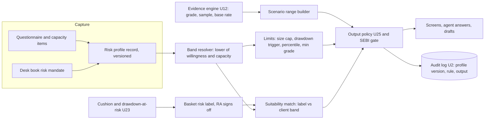

# Risk Appetite: Profile, Suitability Labels and Evidence-Graded Ranges - HLD and LLD

## Goal Capsule

- **Objective:** add risk appetite to the platform so that what a user sees (ideas, ranges, sizes, basket labels) respects a stated risk level, every number carries its evidence grade, and the broker can show a regulator why.
- **Authority:** `docs/plans/2026-11-12-1110-feat-axiom-desk-platform-plan.md` governs. Specifically R52-R56, R60-R62, R137, KTD16, KTD17, KTD20 and the plan-delta decision D1 (`docs/research/2026-11-12-plan-deltas-from-ce-plan-session.md`). Where this file disagrees, the platform plan wins.
- **Status:** draft for Kunal and a desk quant. Every band number is a placeholder. Regulatory points are my reading of the RA master circular and secondary sources, not legal advice, and go through a new legal gate, G6 (proposed in section 7 and 9; G2 does not cover this), before build.
- **Stop conditions:** stop and ask if any requirement can only be met by the agent proposing its own allocation, instrument or ticket to a retail client (that breaks D1 and R55), or if any retail output would show one client a personal size number.
- **Companion:** an earlier research draft exists in a private Claude Docs file. Nothing in this plan depends on it; every source used is listed at the end (S1-S8).

## 1. What the plan already says, and a correction

An earlier draft of this work said the plan has no risk profile and proposed personalised size guidance for every user. Reading the plan in the repo shows both points were wrong or incomplete:

| Item | What the plan says | Consequence |
| --- | --- | --- |
| Risk profiling | R61 [V2]: retail clients complete risk profiling, and a basket is shown as suitable or unsuitable against that profile. | The feature exists as one requirement. It has no design, data model or unit. This document supplies those. |
| Retail agent limits | D1 and R55: for retail the agent drafts only what an RA authored, explains freely, and never proposes its own allocation, instrument or ticket. | Personalised size guidance for retail is out. Sizing follows an RA basket and the client holdings only. |
| Who authors for retail | R60 and A3: baskets, Radar calls and ideas reach retail only when the tenant RA team authored or approved them. A2: the broker owns client compliance. | The broker, not Axiom, is the party that holds the client relationship. |
| Output gate | R62 and U25: the SEBI gate classifies output as data, neutral analytics or research/advice; no-op in V1, blocking in V2. | Risk-appetite rules plug into this gate. |
| Portfolio risk | R137 and U23: each holding shows a risk cushion (distance to invalidation, drawdown-at-risk, crash flag). | The basket risk label can be computed from these, not typed by hand. |

Not found in the plan: a questionnaire, a band scheme, a profile data model, per-book risk limits for the desk (V1), or re-profiling rules. Those are new. The platform plan also lists risk profiling as V2 scope, and has no requirement for a V1 desk mandate, so section 9 lists the plan edits this unit needs.

## 2. Evidence

Grades: Strong (regulator text or peer-reviewed), Moderate (professional or law-firm summary), Weak (blog, vendor, opinion).

| Claim | Source | Grade |
| --- | --- | --- |
| SEBI separates research from advice by whether a trading call is one-to-one after risk profiling and suitability assessment (advice) or one-to-many with neither (research). | Cyril Amarchand Mangaldas summary of SEBI consultation paper of 6 Aug 2024 [S1] | Moderate. Consultation paper, final rules not checked. |
| A basket of securities with weights in an RA research report is a model portfolio and a research service. SEBI first said so in informal guidance to LGT Wealth (5 Apr 2023), then codified it: RA Regulations 2(1)(wa) and 24(8), master circular clause 1.11, Annexure A, compliance by 30 Jun 2025. Annexure A requires a research report with factsheet, methodology, a true-to-label name, investment horizon, review frequency, a risk disclosure and a benchmark. | [S4] (rule text); [S1], [S2] (history) | Strong for the rule text. |
| An RA running model portfolios without IA registration was treated as a violation and settled for Rs 28.6 lakh (settlement order of 6 May 2022, Stallion Asset). | Order date and name from [S1] footnote 3; amount from Vinod Kothari [S2] | Moderate. |
| Investment advisers must build a risk profile, assess suitability, advise appropriately to the profile, and keep records for at least 5 years (IA Regulations). RAs also keep client records five years (S4 clause 1.13(d)). | SEBI (Investment Advisers) Regulations 2013, BCAS reference copy, partly locked [S3] | Moderate. Check the official text. |
| The RA master circular (6 Feb 2026, all 107 pages and Annexures A-J read) puts no duty on an RA to risk-profile a client or assess suitability. The phrase risk profile appears once in a rule: a conflicts rule against an incentive structure that encourages sale of products not suiting the client risk profile (16.4(xi)). The only other hit is operational risk profile, which is unrelated. | [S4] | Strong. |
| About 80% of 90,000 surveyed households put capital preservation first. | SEBI 2025 household survey as reported by Business Standard [S5] | Moderate. Press report of the survey. |
| 93% of F&O traders lost money between Apr 2021 and Mar 2024. | SEBI data (a separate study from the household survey), as quoted in the same article [S5] | Moderate. Press quote of SEBI data. |
| Free AMC risk profilers average about 10 questions and end in a product list. | freefincal review of several online tools [S6] | Weak. One author's opinion. |
| Assess need, ability and behavioural tolerance separately, reconcile, aim for questionnaire reliability 0.70 or higher. | CFA Institute Research and Policy Center guide [S7] | Moderate. |
| Scaling exposure down when volatility is high improved Sharpe out of sample, 1977-2020, net of costs: 1.062 against 0.940. Robustness is disputed. | DeMiguel et al., Journal of Finance 2024 [S8] | Strong, but US factor data, not Indian equities. |

Not found: any study showing that questionnaire scores predict how Indian investors behave in a drawdown. The design therefore treats the questionnaire as a record and a floor, and treats the label, ranges and gating as the product. Whether re-profiling after an actual drawdown improves outcomes is an untested idea (my hypothesis), to be measured through the Edge Ledger (U27).

## 3. HLD

### Principles

1. Risk appetite changes what is shown and how large for desk books (Track A), never what is true. Numbers stay the same; ranges, percentiles and gating change. For retail (Track B) it changes one thing only: the suitability result on an RA label.
2. Two tracks, because the legal position differs. Desk users (A1) are the broker's own staff, so a risk mandate is internal risk control. Retail clients (A4) bring the advice question, so Axiom only labels what an RA authored.
3. The party that owns the client owns the profile: the broker (A2). Axiom stores it per tenant, versioned, and obeys it.
4. No profile, no personalised output. Without one, only general non-personalised views show.
5. Every output states its evidence grade (Tested, Candidate, Opinion) and the band rule that applied.

### Components



### Track A: desk (V1)

A PM or admin sets a book risk mandate. It reuses the same band table and limits. Effect: the idea cards, Radar and agent answers for that book show the percentile, size range and minimum evidence grade of the mandate. Desk users keep full drafting (R55), so no suitability issue arises.

### Track B: retail via broker (V2)

1. The broker captures the client profile through Axiom white-labelled screens or imports its own (open decision).
2. The RA team authors a basket and signs its risk label. A basket with weights is a model portfolio, so it is a research report under Annexure A of [S4]: factsheet, methodology, horizon, review frequency, risk disclosure and benchmark. The label is the risk disclosure and carries those fields. Axiom proposes the label from computed cushions (U23); the RA edits and approves it. Radar calls get the same.
3. Suitability match compares the basket label with the client band and shows suitable, caution or unsuitable with the reason. This is R61.
4. The agent explains and analyses. It drafts only follow or rebalance drafts toward an RA basket, sized to holdings (D1).
5. Retail output is not personalised by band. Every client sees the same label, the same non-personal range (conservative, base, best case at a fixed percentile, worst past drawdown) and no size number for an RA item. The only per-client output is the suitability result and its reason. Band limits (size cap, drawdown trigger, percentile, minimum grade) apply to desk books only. Axiom never computes a personal allocation.

### Open legal question (blocks Track B build)

SEBI summaries draw the research/advice line at one-to-one output after risk profiling and suitability. R61 shows a per-client suitable or unsuitable label on an RA basket. That may be read as the suitability step that turns research into advice. Options for counsel: (a) the broker, who is registered, performs and owns the suitability judgement and Axiom only displays its result; (b) the broker or tenant holds IA registration; (c) show a non-personalised risk label only and let the client compare it themselves. Track B design below assumes (a) and degrades to (c) by turning off the match step; retail ranges are already non-personal, so nothing else changes. A new gate, G6, decides; G2 (algo empanelment and trade-book reading) does not cover this.

What the master circular adds [S4]: model portfolios are already codified as research with Annexure A duties, and an RA has no risk-profiling or suitability duty. Risk profiling and suitability are what the SEBI summaries tie to the IA side. So R61 asks Axiom to add the one step the RA rules do not require, which is why option (a) puts that step with the broker and option (c) leaves it out.

### Data handling (retail profile)

The model sees only the band id and the label, never scores, goals or horizon (KTD17). Retention is at least five years (IA Regulations [S3], RA records [S4 1.13(d)]); deletion requests and who is the data controller go to counsel together with decision 2 in section 7. This is a design position, not legal advice.

## 4. LLD

### 4.1 Data model (proposed, all point-in-time like U5)

| Table | Key fields | Notes |
| --- | --- | --- |
| `risk_profile` | profile_version (id), tenant_id, subject_id, questionnaire_version, willingness_score, capacity_score, horizon, goals, band, band_reason, source (axiom or broker_import), effective_from, effective_to, recorded_at, recorded_by | Insert-only. A change inserts a new row; resolution picks the latest `recorded_at` in force, as U5 does in `pointintime.py`. No row is edited or closed. `subject_id` is a directory user id (U2) of the tenant; KTD20 has no client role, so section 9 adds one. Past outputs replay against the profile version in force then. |
| `risk_override` | profile_version, direction, new_band, reason, recorded_at | Insert-only. Lower band always allowed. Higher band only for view-only scenarios, never size guidance. Set by the profile subject or the broker, never by the agent (KTD16). |
| `book_mandate` | mandate_version (id), tenant_id, book_id, band, limits_override, set_by, effective_from, effective_to, recorded_at | Track A. Insert-only, same rule as `risk_profile`. Set by PM or admin only. |
| `band_table` | version, band, single_idea_cap_pct, drawdown_trigger_pct, best_case_percentile, min_evidence_grade, signed_by, signed_at | Versioned. Signed by a quant (G4). Values are placeholders until signed. Equity share is left out: Axiom never computes an allocation. |
| `basket_risk_label` | basket_id, version, label (level 1-5), computed_inputs (cushion stats), horizon, benchmark, review_interval, risk_disclosure, proposed_by, approved_by_ra, approved_at | RA approval required before a retail client sees it (R60). The four middle fields are the Annexure A items in [S4]. |
| `suitability_result` | output_id, profile_version, label_version, rule_version, band_table_version, result, reason, evaluated_at | One row per suitability evaluation (retail), and the audit row of any desk output also carries the versions in 4.5 item 4. |
| evidence grade (derived, no new table) | grade, sample_size, independent_episodes, last_validated | Derived from U12 states, see 4.3. `independent_episodes` is a proposed new U12 output field and needs G4 sign-off. |

### 4.2 Band resolution

- Willingness band and capacity band are scored separately. The band is the lower of the two. Horizon and need do not set the band; if the need exceeds capacity, the goal is flagged.
- Five bands as a starting point, in order from level 1 to 5: Capital preservation, Cautious, Balanced, Growth, Aggressive. A basket label uses the same five ordered levels, and a higher level is riskier. Whether to map names to the SEBI risk-o-meter (six levels) is open; if it changes the scale, the scale is versioned with the suitability rule.

Placeholder limits for desk books (quant to set; shape only). Retail does not use this table to personalise output; it uses only the band level in 4.4:

| Band | Single-idea cap | Drawdown trigger | Best case shown | Min grade to show |
| --- | --- | --- | --- | --- |
| Capital preservation | 2% | -5% | 50th pct | Tested |
| Cautious | 3% | -10% | 75th pct | Tested |
| Balanced | 5% | -15% | 75th pct | Tested, Candidate flagged |
| Growth | 7% | -25% | 90th pct | Tested, Candidate flagged |
| Aggressive | 10% | -35% | 90th pct | All grades; an Opinion note is shown but never sized |

### 4.3 Scenario range builder (extends U12)

- Input: the forward-return distribution after matching readings, and the unconditional base rate for the same instrument, horizon and days to expiry (R87), shown beside every range.
- Output: conservative (control median), base (pattern median), best case (the band percentile), plus the worst past drawdown beside the upside in the same type size.
- Grades map onto the U12 states (R88, R93), they are not a new store. Tested: a published, calibrated setup. Candidate: a published setup that is still labelled uncalibrated (R93), shown with its confidence interval. Opinion: a note that is not a setup and carries no numbers. A setup below the R88 minimum sample is never graded or shown in any band; it shows insufficient evidence (AE8). Tested shows the range. Candidate shows the lower end of the interval, with the independent episode count (a proposed U12 output field).
- Size range = band single-idea cap times 100% (Tested) or 50% (Candidate, my proposal), none for Opinion. Applies to desk books only. Retail sees no size range.
- Drawdown throttle: when a linked portfolio passes the band trigger, new-idea size ranges halve until recovery (needs quant sign-off).

### 4.4 Suitability match (Track B)

```
result = suitable   if label_level <= client_band_level
         caution    if label_level == client_band_level + 1
         unsuitable otherwise
```
The rule and the label, band and versions used are stored in `suitability_result`. Rule text is versioned and signed. If counsel chooses option (c), this step is switched off by tenant configuration and only the label shows.

### 4.5 Output policy additions (U25)

1. No current profile: general views only.
2. Evidence-grade gating as in 4.2 and 4.3.
3. Wording: historical frequencies and ranges only; no accuracy, assured or target returns (R53).
4. Disclosure on every output: as-of time, sources, method, sample size, grade, and the versions it used: profile or mandate, band table, range method, rule, and the U12 run id with its grade. The audit row stores the same set, so a replay can rebuild the output.
5. Retail: block any agent-proposed allocation, instrument or ticket not authored by the RA (D1, R55).
6. No incentive coupling: ranking and revenue sharing must not favour higher-risk ideas for higher bands (conflicts rule 16.4(xi) in [S4]).

### 4.6 Capabilities and files (proposed)

| Capability | Purpose | Files |
| --- | --- | --- |
| `risk_profile_get` | read a profile, point-in-time | `packages/core/src/axiom_core/riskprofile.py`, migrations |
| `risk_profile_set` | record a profile version (not the agent) | `packages/core/src/axiom_core/riskprofile.py`, `authz.py` |
| `risk_band_resolve` | band and limits for a principal | `packages/core/src/axiom_core/riskband.py` |
| `risk_mandate_set` | desk book mandate (PM or admin; quant signs band table) | `packages/core/src/axiom_core/riskprofile.py`, `authz.py` |
| `risk_range_build` | scenario range by grade and band (desk) or non-personal (retail) | `packages/evidence/src/axiom_evidence/ranges.py` |
| `risk_label_propose` | basket label from cushions, RA approves | `packages/portfolio/src/axiom_portfolio/risklabel.py` |
| `risk_suitability_check` | match label to client band | `packages/portfolio/src/axiom_portfolio/suitability.py` |
| policy rules | rules in 4.5 | `packages/agent/src/axiom_agent/policy.py`, `packages/core/src/axiom_core/sebi_gate.py` |
| UI | profile capture, band badge, range card, label chip | `apps/desk/src/risk/` (after G5 and the feature pipeline in CLAUDE.md) |

Every capability is registered in U3 so screen and agent return the same envelope (AE7). Names follow the registry rule `^[a-z][a-z0-9_]{0,63}$`.

### 4.7 Test scenarios

- A profile change inserts a new row and an output from last week replays against the profile version, band table version, range method and U12 run in force then.
- Willingness Aggressive with capacity Cautious resolves to Cautious, with the reason shown.
- A user override to a higher band is refused for size guidance and allowed for a view-only scenario, and is logged.
- No profile: personalised range requests return the general view and say why.
- A Candidate idea in the Cautious band is not shown; in Growth it shows the lower interval end, the episode count and a flag.
- An Opinion idea shows no numbers in any band; in Aggressive it shows as marked opinion with no size.
- A retail client asks the agent what to buy: the agent explains, lists RA-published baskets and drafts nothing not authored by an RA (D1).
- A basket label proposed from cushions cannot reach a client before RA approval.
- A forged tenant, subject or band in request parameters is refused; the session decides the principal (KTD20).
- Each suitability result writes one audit row with profile, label and rule versions.
- Band table edited without quant signature is rejected (G4).
- Two retail clients with different bands see the same label, the same range and no size for the same RA basket; only the suitability result differs.
- The agent principal calling `risk_profile_set`, `risk_override` or `risk_mandate_set` is refused (KTD16).
- An analyst setting a book mandate is refused; a PM sets it.
- Tenant B reading tenant A's profile or mandate is refused (R5).

## 5. Feasibility

| Piece | Reuse | New work (my estimate) | Risk |
| --- | --- | --- | --- |
| Profile, mandate, audit | U2 tenancy and audit; U5 point-in-time convention | Small to medium: tables, authz roles, capture API | Low |
| Band table and limits | Config plus quant sign-off (G4) | Small to build; the numbers are a quant task | Medium: numbers need backtesting |
| Evidence grade and ranges | U12 states (R88, R93), unconditional base rate (R87) | Medium | History since 2019 gives few independent episodes, so many ideas will grade Candidate (my reasoning) |
| Basket label from cushions | U23 cushion and drawdown-at-risk | Medium; blocked until U23 exists | Label design is a quant call |
| Suitability match | Output policy U25 | Small | The legal question above |
| Questionnaire | None | Medium: 7-12 willingness items plus capacity items, a pilot | No Indian evidence on predictive power; reliability target 0.70 from [S7] |
| UI | Desk app after G5 | Medium | Premium design bar in CLAUDE.md |

Order: Track A first (V1, no regulatory dependency beyond the output wording, once section 9 is accepted), Track B design now and build after the legal read. The profile service needs no market data, so it can start before G1 clears (my reasoning).

## 6. Edges to sell

Competitor behaviour here is from one blog review of free AMC tools [S6] and the SEBI circulars; I did not trial any competitor product, so treat edge claims as hypotheses to be measured.

| Edge | Buyer | Why it is hard to copy | How we prove it |
| --- | --- | --- | --- |
| Risk label computed from drawdown-at-risk and cushion, not typed by hand | Broker RA team | Needs our U23 cushion and the evidence engine | Compare label to realised drawdown per basket in the Edge Ledger |
| Evidence grade on every range, with the control beside it | Broker, desk | Needs matched controls and point-in-time data (U5, U12) | Share of ideas shown at each grade; hit rate against control by grade |
| Replayable audit trail: any past output against the profile and rules in force | Broker compliance | Point-in-time convention on every table | Demo: replay a past day for an auditor in one query |
| Software-enforced research/advice line (RA-authored only) | Broker legal | U25 gate plus D1 | Gate log: blocked outputs by reason |
| Desk book mandates with the same grading | Prop and broker desks | Same engine as retail track, no extra build | Fewer limit breaches per book (needs desk pilot) |
| Re-profile prompted by an actual drawdown, not an annual form | Broker | Needs portfolio link (U23) | Untested hypothesis; measure panic-exit rate before and after in a pilot |
| Honest ranges for a market where 93% of F&O traders lost money (SEBI data, Apr 2021 to Mar 2024) and about 80% of households put capital preservation first (SEBI 2025 survey) [S5] | Broker marketing and compliance | Positioning, not technology | Pilot feedback |

## 7. Decisions needed

1. Counsel: does the R61 suitable/unsuitable label on an RA basket stay research, or does it need IA registration (options a, b, c in section 3)? The RA master circular is now read in full (section 2, S4); counsel confirms that reading and covers the final rules after the 2024 consultation paper.
2. Who captures and stores the retail profile: broker or Axiom?
3. Quant: band cut-offs, percentiles, caps, minimum sample for Candidate, volatility scaling versus fixed caps.
4. Kunal: should band names follow the SEBI risk-o-meter?
5. Confirm the new gate G6 (research or advice read for R61), separate from G2.
6. Retention, deletion and who is the data controller for the retail profile (goes with decision 2).

## 8. Implementation unit

### U29. Risk profile, bands and suitability labels (proposed)

- **Goal:** one profile and band service that every output obeys, with evidence-graded ranges and RA-signed basket labels.
- **Requirements:** R61 (design), R55, R60, R62, R137, AE7; KTD16, KTD17, KTD20; D1; and a new V1 requirement for desk book mandates (section 9).
- **Dependencies:** U2, U3, U12, U23 (labels), U25.
- **Gates:** G6 (new, proposed: legal read of option a, b or c), G4 (band table and range method, added to G4's list in section 9).
- **Files:** see 4.6.
- **Execution note:** build Track A and the profile service test-first; hold Track B label and match steps until the legal read.
- **Verification:** all scenarios in 4.7 pass; replay test reproduces a past output exactly.

## 9. Plan delta (edits the platform plan needs before U29 is accepted)

This PR changes no platform text. The platform plan governs, so these edits go in with the PR that accepts U29:

1. **Requirement.** Add a V1 requirement: a PM or admin can set a risk mandate per desk book, and idea cards, Radar and agent answers for that book respect it. The platform plan has none today, and lists risk profiling as V2 (R61). The number is assigned when merged.
2. **Phase PR.** U29 depends on U12 (PR4), U25 (PR6) and U23 (PR7). Put it after PR7 as a new phase PR, or inside PR8; the plan owner chooses.
3. **KTD16.** Add to what the agent cannot do: set or change a risk profile, risk override or book mandate.
4. **KTD20.** Say who sets what: PM or admin sets a book mandate, a quant signs the band table, and a retail client is a directory user of the tenant (a client role is added; KTD20 has none today).
5. **Gates.** Add G6: legal read of research versus advice for R61 (options a, b, c). Add the band table and range method to G4's list.
6. **CLAUDE.md.** It says "Units U1-U27 ... gates G1-G5". Update it to the new unit and gate counts when this is accepted.

## Sources

- [S1] Conventus Law, India: revamping the investment advisers and research analysts frameworks (CAM summary of SEBI consultation paper, 6 Aug 2024). https://conventuslaw.com/report/india-revamping-the-investment-advisers-and-research-analysts-frameworks-the-sebi-way/
- [S2] Vinod Kothari, Research Analysts v/s Investment Advisors, is the line blurring? (9 Aug 2024, updated 1 Oct 2024). https://vinodkothari.com/?p=50960
- [S3] SEBI (Investment Advisers) Regulations 2013, BCAS reference copy. https://www.bcasonline.org/Referencer2016-17/Other%20Laws/sebi_investment_advisers_regulations_2013.html
- [S4] SEBI Master Circular for Research Analysts, 6 Feb 2026 (mirror, 107 pages, read in full). https://www.cse-india.com/upload/upload/1770375507051.pdf
- [S5] Business Standard, Indian investors remain risk-averse, Sebi urges diversified portfolios. https://www.business-standard.com/amp/finance/personal-finance/sebi-2025-investment-survey-risk-appetite-diversification-portfolio-125101001108_1.html
- [S6] freefincal, Your risk profile is not a label, it is a behaviour you discover in a drawdown. https://freefincal.com/your-risk-profile-isnt-a-label-its-a-behaviour-you-discover-in-a-drawdown/
- [S7] CFA Institute Research and Policy Center, Investment Risk Profiling. https://rpc.cfainstitute.org/-/media/documents/survey/investment-risk-profiling.pdf
- [S8] DeMiguel et al., A Multifactor Perspective on Volatility-Managed Portfolios, Journal of Finance (2024). https://lbsresearch.london.edu/id/eprint/3716/1/The%20Journal%20of%20Finance%20-%202024%20-%20DeMIGUEL%20-%20A%20Multifactor%20Perspective%20on%20Volatility%E2%80%90Managed%20Portfolios.pdf

Not checked: final SEBI rules after the 2024 consultation paper; the final IA rules text on suitability beyond [S3]; any competitor product; Indian evidence that questionnaires predict drawdown behaviour. Counsel confirms every regulatory reading.
