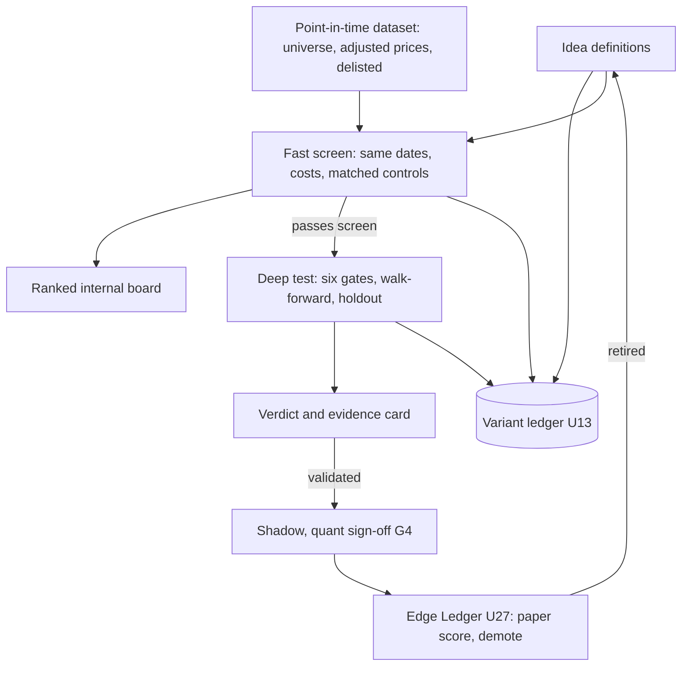

# Edge-Hunting Pipeline - Plan

## Goal Capsule

- **Objective:** an engine that hunts for edge. Many candidate ideas go in (swing setups, market readings, combinations), a fast screen ranks them against fair controls, survivors get a deep test, then shadow and live tracking. Every idea ends with a verdict: validated, inconclusive, rejected or data-insufficient.
- **Means:** this is the first slice of U12 (evidence engine) and U13 (variant ledger, shadow, promotion), with U27 (Edge Ledger) scoring later. It adds what those units do not yet specify: matched controls, episode grouping, one definition format for swing setups and market readings, and a two-stage screen.
- **Authority:** `docs/plans/2026-11-12-1110-feat-axiom-desk-platform-plan.md` governs (U12, U13, U27; R86-R95, R144, R151, R152; KTD11-KTD13). Where this plan disagrees, the platform plan wins.
- **Scope agreed with Kunal, 17 Nov 2026:** V1 is swing trading plus multi-asset rotation across equity and F&O, adding gold and silver if easy. HVRP is one example idea to compare, not a flagship and not a fixed list.
- **First batch:** HVRP, momentum leaders, ordinary pullback, a Nifty 500 breadth reading, and gold and silver trend against equity and cash.
- **Execution profile:** this PR is the plan only. Build PRs follow as units E1-E5. Build and test on recorded fixtures; real verdicts wait on licensed point-in-time data (G1).
- **Stop conditions:** stop and ask if a requirement needs data we cannot hold point-in-time, or if any output would reach a client.
- **Finishes and ships:** the implementing agent, through the repo feature pipeline (CLAUDE.md). No UI beyond an internal report, so the UI step is skipped.

---

## Product Contract

### Summary

Every member of the team has candidate edges: Kunal's HVRP setup and sector score, Abrar's multi-asset mood index, breadth readings from the research brief. None has been tested on our data. This plan builds the shared machine that tests all of them the same way, so new ideas cost a definition, not a build.

### Problem Frame

- Ideas arrive faster than anyone can test them, and each would otherwise get its own one-off backtest.
- Vendors publish single backtests on overlapping readings with no control (Tickertape MMI: 32 readings, no control). We need to do better or we have no edge to sell.
- The more ideas we try, the more will look good by luck. Without counting every attempt, the search itself manufactures false edges.
- U12 and U13 describe the evidence engine and discovery, but not the order of build, the controls, or a first batch to prove the machine.

### Requirements

**Ideas in**

- R1. An idea is one versioned definition: kind (setup, reading or combination), universe, timeframe, signal rule, entry and exit rules or forward horizon, the controls it is compared with, and its data dependencies. An idea expressible in the feature grammar needs a definition only, not code.
- R2. Every definition and every variant run is recorded in the variant ledger (U13) with time, author and data snapshot, including ideas later dropped.

**Fast screen**

- R3. The screen runs every idea on the same universe, dates and cost model, and reports its effect against each matched control with an interval, the number of independent episodes and turnover. It ranks ideas on an internal board.
- R4. Matched controls: random eligible entries matched on date, sector, liquidity and volatility; momentum-only; pullback-only; breakout-only; sector-only. For volume-profile setups, also frozen advance profile against value retained after the pullback.
- R5. Overlapping signals for one instrument form one episode with a stated cooldown. Signals on the same date across instruments are clustered for inference, never counted as independent.

**Deep test**

- R6. Ideas that pass the screen run the six gates: frozen definitions; point-in-time data; matched controls; effect size with a dependence-aware interval; multiple testing (t above 3 and deflated Sharpe, with the bar rising as variants are counted); walk-forward plus an untouched holdout period.
- R7. The verdict is validated, inconclusive, rejected or data-insufficient, with its reason, sample size, independent episodes, costs and the snapshot id. Below the minimum sample the verdict is data-insufficient and shows no probability (platform AE8).

**Shadow and tracking**

- R8. Validated ideas run in shadow on live data without being shown. Promotion needs a quant signature (G4, U13).
- R9. Live ideas are paper-scored in the Edge Ledger (U27). A family trailing its base rate after costs is flagged and demoted automatically.

**Data integrity**

- R10. Inputs are point-in-time: universe membership as of each date, corporate-action-adjusted prices from U5, delisted instruments included, and publication timestamps for any fundamental or flow data.
- R11. Costs follow Indian rules per instrument type: brokerage, STT, exchange and regulatory charges, GST, stamp duty, spread and impact.
- R12. Any result replays exactly from its snapshot id and definition version.

**Outputs**

- R13. Every result carries the evidence-card fields from the research brief inside the platform result envelope. A hit rate is shown beside its base rate and never called accuracy.
- R14. Nothing from this pipeline is client-facing until the SEBI gate path (U25, G2) allows it.

### Acceptance Examples

- AE1. HVRP measured on its frozen advance profile matches the momentum-only control within its interval: verdict inconclusive or rejected, reason no information beyond momentum.
- AE2. The breadth reading has six independent washout episodes since 2019: verdict data-insufficient, with the episode count shown and no probability.
- AE3. Fifty HVRP variants raise the significance bar compared with three; a variant that would pass alone fails after correction.
- AE4. A new setup expressible in the grammar is added as one definition file and runs through the screen with every control, with no code change.
- AE5. The gold and silver trend rule is judged as a monthly portfolio against a fixed equity, gold and cash mix after costs and tax, reporting drawdown, switches and turnover, never trade win rate.
- AE6. An order-flow feature is missing for a date: the idea runs on its price-volume version, the gap is shown, and missing is never treated as zero. Estimated delta is tagged `delta_inferred`.

### Scope Boundaries

- **In:** Nifty 500 cash equities; Nifty sector indices; India VIX and breadth derived from constituents; gold and silver ETFs on NSE, if covered by the NSE licence (unverified).
- **Later:** option-chain features (need U9-U11), MCX futures, debt and liquidity readings, trade-level volume profiles.
- **Out:** live signals to any user, UI beyond an internal report, tuning of weights beyond declared variants.

---

## Planning Contract

### Key Technical Decisions

- KTD-E1. Build inside `packages/evidence` as the first slice of U12 and U13, not as a new package.
- KTD-E2. Idea definitions are data records validated against a schema. The feature grammar is a bounded list of features drawn from Kunal framework feature dictionary and the market-profile research note; adding a feature is code, adding an idea is not.
- KTD-E3. Two stages: the screen is cheap (fixed horizons, no walk-forward) and only ranks; the deep test is expensive. Both write to the variant ledger, so screening cannot hide multiple testing.
- KTD-E4. Inference uses a block bootstrap by date, clustered by date and sector; results report medians and full distributions, not only means.
- KTD-E5. Rotation ideas are judged as portfolios with monthly decisions against static mixes. Setup ideas are judged per episode. The two are compared only inside a common risk budget (Kunal comparison protocol).
- KTD-E6. Volume at price from daily bars is an estimate. Faithful profiles need trade-level data. NSE public feeds carry no aggressor flag, so any order-flow delta is inferred from last trade and top-5 depth (market-profile note) and tagged.

### High-Level Design

### Data Needed

| Dataset | Source | Status |
| --- | --- | --- |
| Daily OHLCV, traded value, delivery | NSE bhavcopy | G1 licence open |
| Point-in-time Nifty 500 membership | Nifty Indices constituent history | Availability and depth unverified |
| Corporate actions, instruments, calendar | U5 (PR #13) | In review |
| Sector index levels | Nifty Indices | G1 |
| India VIX | NSE | G1 |
| Gold and silver ETF prices | NSE cash market | G1; same licence assumed, unverified |
| Trade-level data for profiles | Vendor | Later; screen starts on daily estimates |
| Fundamentals and revisions with publication dates | Vendor or XBRL | Later |

### Implementation Units

| Unit | Goal | Main files | Depends on |
| --- | --- | --- | --- |
| E1 | Idea schema and variant ledger | `packages/evidence/src/axiom_evidence/ideas.py`, `variants.py`, `specs/quant/ideas.md` | U3 |
| E2 | Point-in-time dataset builder on recorded fixtures | `dataset.py` | U5 |
| E3 | Matched controls and episode grouping | `controls.py`, `episodes.py` | E1, E2 |
| E4 | Screen, deep test, costs and verdicts | `screen.py`, `stats.py`, `walkforward.py`, `costs.py`, `verdict.py` | E3, U4 |
| E5 | First batch and internal board report | `specs/ideas/hvrp.yaml`, `momentum_leaders.yaml`, `pullback.yaml`, `breadth_washout.yaml`, `gold_silver_trend.yaml`, `report.py` | E4 |

Shadow (rest of U13) and the Edge Ledger (U27) follow once E5 produces its first board.

### Test Scenarios

- E1: a definition missing its controls or data dependencies is rejected; editing a definition creates a new version and keeps the old one; every run writes one ledger row.
- E2: a stock that left the Nifty 500 in 2021 appears in 2020 runs and not in 2022 runs; a split is adjusted in price and volume together; a delisted stock stays in history.
- E3: two signals on one stock five days apart form one episode under a ten-day cooldown; random controls match on date, sector, liquidity band and volatility band; the frozen-profile control is computed only from data known at the advance high.
- E4: a walk-forward fold never sees data after its window (platform U12); costs include STT and stamp duty; forty null ideas with random outcomes produce no validated verdict; AE1, AE3 and AE6 pass on fixtures.
- E5: AE2, AE4 and AE5 pass on fixtures; the board lists every idea with its verdict, sample, episodes and snapshot id.

### Open Questions

1. Source and depth of point-in-time Nifty 500 membership.
2. Whether gold and silver ETFs fall under the NSE licence being negotiated (G1).
3. Minimum sample and minimum independent episodes per verdict: a quant decision (G4).
4. Decision horizon for rotation: monthly or quarterly.
5. Vendor for trade-level data, for faithful volume profiles.
6. Should Kunal framework document (15 Nov) be added under `docs/research/`?

### Sources

- Platform plan: `docs/plans/2026-11-12-1110-feat-axiom-desk-platform-plan.md` (U12, U13, U27).
- Research brief, six gates and evidence cards: https://claude.ai/artifact/E3EFLFdF7gmqFkqE598B2y
- Situational awareness and multi-asset rotation research: https://claude.ai/artifact/Dbh3AocgfMKqrePNBHHtRN
- Market-profile and order-flow note: `docs/research/2026-11-14-market-profile-order-flow-patterns.md`
- Equity regime and rotation note: `docs/research/2026-11-12-equity-regime-rotation.md`
- Kunal, Acceptance, Accumulation and Sector Rotation framework (15 Nov 2026), shared outside the repo.
